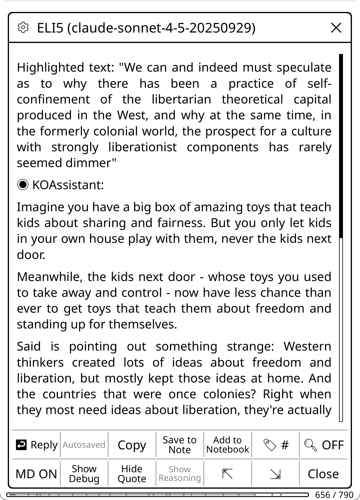
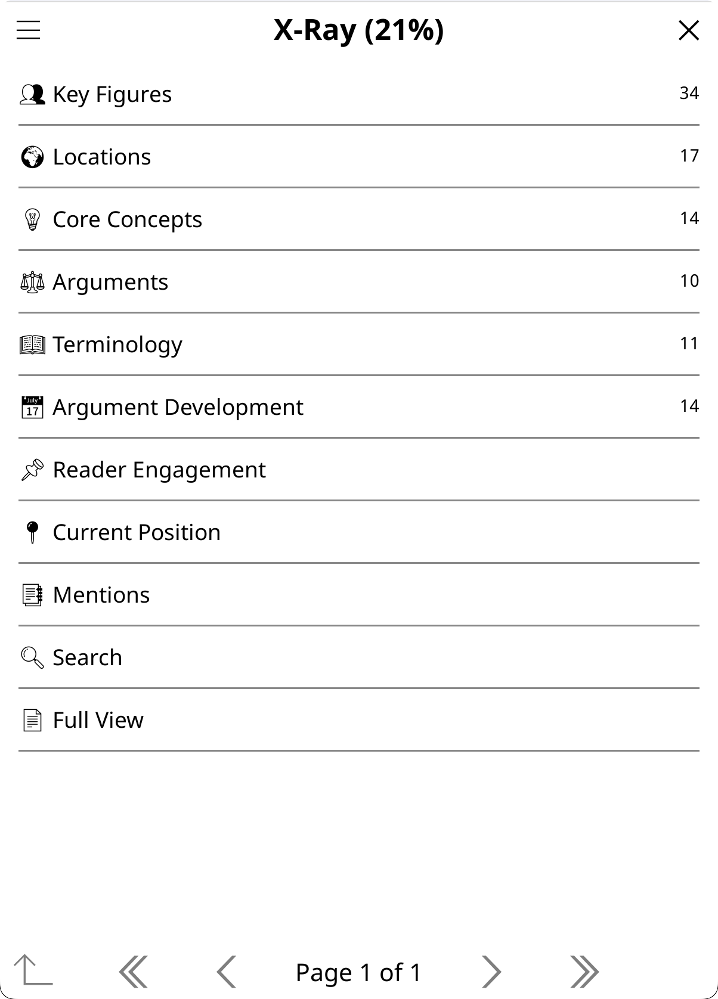
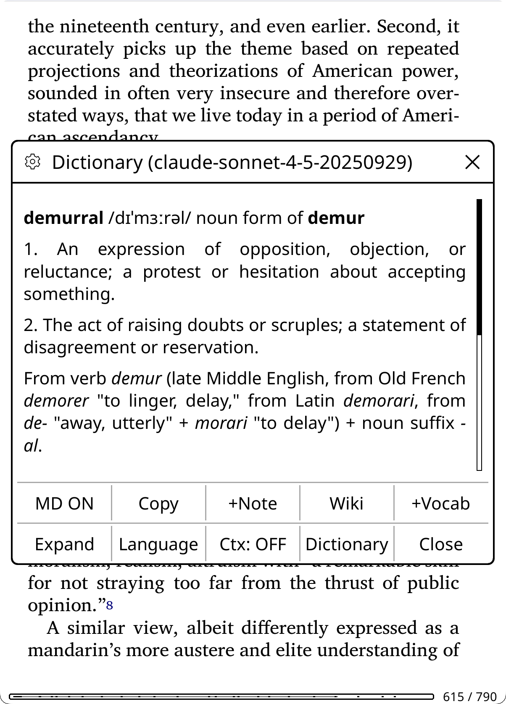
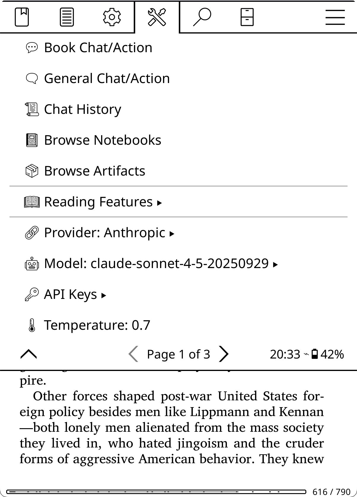

# KOAssistant

[](https://github.com/zeeyado/koassistant.koplugin/releases/latest)
[](https://github.com/zeeyado/koassistant.koplugin/wiki)
[](LICENSE)
[](https://hosted.weblate.org/engage/koassistant/)
[](https://hosted.weblate.org/engage/koassistant/)

**Powerful, customizable AI assistant for KOReader.**

**Documentation:** the [Wiki](https://github.com/zeeyado/koassistant.koplugin/wiki) has a page for every feature; the full list is at the [end of this page](#documentation).

<p align="center">
  <a href="screenshots/ELI5highlightchat.png"></a>
  <a href="screenshots/Xraybrowser.png"></a>
  <a href="screenshots/compactdict.png"></a>
  <a href="screenshots/settingsui.png"></a>
</p>

## What it does

- **Highlight text** → translate, explain, define words, analyze passages, connect ideas, and save the answer into KOReader's notes. [Contexts and Chat](https://github.com/zeeyado/koassistant.koplugin/wiki/Contexts-and-Chat)
- **Short answers in a small popup** → Translate, Quick Define and Quick Explain land in a chrome-less popup at your selection when they fit; tap it to open the answer in the action's usual window. [Chat Windows](https://github.com/zeeyado/koassistant.koplugin/wiki/Chat-Windows)
- **X-Ray** → a browsable guide to the book you are reading: people, places, ideas, terms and events, built from the text up to where you are and kept current by checkpoints as you read; known names are underlined in the text and open a card; section X-Rays for one chapter or part; a local, offline lookup; version history. [Using X-Ray](https://github.com/zeeyado/koassistant.koplugin/wiki/Using-X-Ray)
- **Book Groups** → a series or a project as a named list of books (a series in reading order) with its own hub page and settings; what the other books' X-Rays know is carried in for free (in a series, from the earlier books only), and an AI merge can combine X-Rays on top. [Book Groups and Series](https://github.com/zeeyado/koassistant.koplugin/wiki/Book-Groups-and-Series)
- **Book Hub** → one page per book gathering its artifacts, chats, notebook, group and settings. [Book Settings and Book Hub](https://github.com/zeeyado/koassistant.koplugin/wiki/Book-Settings-and-Book-Hub)
- **Reading analysis** → recap, document summary and analysis, an About overview, notes analysis, discussion questions, chapter quizzes, an end-of-book suggestion. [Reading Analysis Actions](https://github.com/zeeyado/koassistant.koplugin/wiki/Reading-Analysis-Actions)
- **Research Mode** → papers with a DOI get an academic X-Ray, research-aware prompts and, with web search on, web-enriched analysis, with no setup. [Research Mode](https://github.com/zeeyado/koassistant.koplugin/wiki/Research-Mode)
- **Spoiler protection** → on by default: the AI stays behind your reading position, per book or for one chat. [Spoiler Protection](https://github.com/zeeyado/koassistant.koplugin/wiki/Spoiler-Protection)
- **Session controls** → a chip row in the input dialog (Domain, Web, Tools, Quick, Scope, Attach, Spoiler); most chips are a tap for this chat and a hold for their default. [Contexts and Chat](https://github.com/zeeyado/koassistant.koplugin/wiki/Contexts-and-Chat)
- **Dictionary and translation** → actions in KOReader's dictionary popup, a compact AI dictionary, bypass modes that skip the menus, and translate views. [Dictionary and Translation](https://github.com/zeeyado/koassistant.koplugin/wiki/Dictionary-and-Translation)
- **Notebooks** → a markdown notebook per book, an optional one-tap Add to notebook button in the highlight menu, Obsidian vault integration. [Conversations, Notebooks and Export](https://github.com/zeeyado/koassistant.koplugin/wiki/Conversations-Notebooks-and-Export)
- **Library** → what to read next, reading patterns, comparisons across books, collection analysis. [Contexts and Chat](https://github.com/zeeyado/koassistant.koplugin/wiki/Contexts-and-Chat)
- **General chat** → the AI without book context.
- **Web search** → current information from the providers that offer it, with a Show Sources viewer. [Reasoning, Web Search and Book Tools](https://github.com/zeeyado/koassistant.koplugin/wiki/Reasoning-Web-Search-and-Book-Tools)
- **AI Book Tools** → the AI searches and reads the open book on demand to ground its answers. [Reasoning, Web Search and Book Tools](https://github.com/zeeyado/koassistant.koplugin/wiki/Reasoning-Web-Search-and-Book-Tools)
- **Reasoning** → thinking configured per model, with a global stance. [Reasoning, Web Search and Book Tools](https://github.com/zeeyado/koassistant.koplugin/wiki/Reasoning-Web-Search-and-Book-Tools)
- **Multilingual** → chat in any language the AI understands; the plugin's UI has 26 languages. [Languages](https://github.com/zeeyado/koassistant.koplugin/wiki/Languages)
- **Generate images** → a highlight or an X-Ray entry becomes an image (OpenAI, xAI, Gemini or OpenRouter image models) in a style and shape you pick, its prompt written by your chat model from the book's context, kept on the device in a thumbnail gallery. [Image Generation](https://github.com/zeeyado/koassistant.koplugin/wiki/Image-Generation)
- **Customizable** → custom actions, behaviors, domains, per-action models, template variables, and control over every menu the plugin appears in. [Actions and Menus](https://github.com/zeeyado/koassistant.koplugin/wiki/Actions-and-Menus), [Prompts, Behaviors and Domains](https://github.com/zeeyado/koassistant.koplugin/wiki/Prompts-Behaviors-and-Domains)
- **Private by default** → your highlights, notes, notebook, the book's text, library scan and reading habits stay on the device until you say so: the first time an action wants one, it shows what it sends and to whom, and your answer can be kept for the book. [Privacy and Data](https://github.com/zeeyado/koassistant.koplugin/wiki/Privacy-and-Data)
- **Keeps itself current** → one-tap updates, backups and restore. [Backups and Updates](https://github.com/zeeyado/koassistant.koplugin/wiki/Backups-and-Updates)

[33 built-in providers](#supported-providers) (Anthropic, OpenAI, Gemini, Ollama and more) plus custom OpenAI-compatible providers. OpenAI can also be used without an API key by signing in with your ChatGPT plan (OpenAI Subscription). Reasoning is configured per model. Personal reading data (highlights, annotation notes, notebooks, the book's text) is not sent to the AI until you allow it.

**Status:** Active development. [Issues](https://github.com/zeeyado/koassistant.koplugin/issues), [discussions](https://github.com/zeeyado/koassistant.koplugin/discussions) and [translations](https://hosted.weblate.org/engage/koassistant/) welcome. If you are somewhat technical and do not want to wait for tested releases, you can run off the main branch to get the latest features; breakage may happen, as untested features may be on main. 

This plugin is developed using [Claude Code](https://claude.ai) and other tools.

---

## Quick setup

### 1. Install the plugin

Download `koassistant.koplugin.zip` from the latest [Release](https://github.com/zeeyado/koassistant.koplugin/releases) → Assets. To run the latest code instead: Code → Download Zip, or clone the repository:
```bash
git clone https://github.com/zeeyado/koassistant.koplugin
```

Extract or copy the `koassistant.koplugin` folder to your KOReader plugins directory:
```
Kobo:         /mnt/onboard/.adds/koreader/plugins/koassistant.koplugin/
Kindle:       /mnt/us/koreader/plugins/koassistant.koplugin/
Android:      /sdcard/koreader/plugins/koassistant.koplugin/
macOS:        ~/Library/Application Support/koreader/plugins/koassistant.koplugin/
Linux:        ~/.config/koreader/plugins/koassistant.koplugin/
```

The folder must be named exactly `koassistant.koplugin` (remove a "-main" suffix if you downloaded the zip of the main branch), with `main.lua` and `_meta.lua` directly inside it, not in a nested folder.

> **This is the only time you install by hand.** From then on KOAssistant updates itself: when a new version is out you see its release notes with an "Update Now" button, and one tap downloads, installs and keeps your settings. See [Updating](#updating).

**Alternative:** [Storefront](https://github.com/ultimatejimmy/storefront.koplugin) or the [App Store plugin](https://github.com/omer-faruq/appstore.koplugin) installs KOAssistant from inside KOReader, from releases or from the main branch, with no computer.

### 2. Restart KOReader

KOAssistant's menu is at **Tools → KOAssistant**, the first row of KOReader's Tools menu. The Setup Wizard runs the first time you open it: a provider, privacy, language, emoji icons, the (KOA) button mark, gestures; after an update it checks only what changed.

### 3. Add an API key

**Option A, in the plugin:** go to **Tools → KOAssistant → API Keys & Auth**, tap a provider and paste its key. A saved key is shown masked, its first three and last four characters only. You can keep several keys for one provider and switch between them.

**Option B, in a file:** copy `apikeys.lua.sample` to `apikeys.lua` and fill in your keys:
```lua
return {
    anthropic = "YOUR_ANTHROPIC_API_KEY",  -- console.anthropic.com
    openai = "YOUR_OPENAI_API_KEY",       -- platform.openai.com
}
```
Restart KOReader after editing the file (it is read once per session); keys entered in the plugin take priority over it. Provider pickers list only the providers that have a key (plus local, keyless providers such as Ollama), so the menus stay short.

**Option C, a ChatGPT plan instead of a key:** **Settings → API Keys & Auth → OpenAI Subscription → Connect** shows a verification URL and a one-time code; open the URL on another device, enter the code, then tap **Check authorization**. This works with paid plans and with free ChatGPT accounts (limits undocumented, expect them to be modest), uses no API credits, and is an unofficial integration that may change with OpenAI's Codex service. Device code access must be enabled for your ChatGPT account; the verification page explains how.

> **Free options:** Groq, Gemini and Ollama have free tiers, a free ChatGPT account works through Option C, and Claude Max and Team plans include monthly API credits. See [Supported providers](#supported-providers).

### 4. Privacy settings

Your highlights, annotation notes, notebook, the book's text, library scan and reading habits are each asked for the first time an action wants them. **Settings → Privacy & Data** holds one value per kind (Ask, Allow or Never) and a **Preset** row that sets them all at once (the Setup Wizard's privacy step offers the same presets); **Allow everything** sends everything without a question, book text included. See [Privacy at a glance](#privacy-at-a-glance).

## First steps

**The Setup Wizard** connects a provider, sets the privacy preset, detects your UI language and offers it as the AI language, installs the emoji font and tests the icons, asks whether KOAssistant's buttons carry a (KOA) mark, and gives the two quick panels their gestures (any KOReader gesture). After an update it shows only what changed, with a choice to keep or change each. **Settings → Setup Wizard** re-runs any topic.

**Two quick panels, one gesture.** Quick Settings (everywhere) and Quick Actions (while reading) hold most of what you need, and in the reader each has a button to open the other. The wizard gives each its gesture (one tap assigns both to "tap bottom-right corner" when it is free), **Settings → Gestures** changes them any time; by hand: KOReader's gear menu → Taps and gestures → Gesture manager, pick a gesture, choose **KOAssistant: Quick Settings** in the file browser and **KOAssistant: Quick Actions** in a book. Without a gesture, both are the first rows of the KOAssistant menu.

**Then:**
- Answer the question the first time an action wants your data, or set a kind to Allow or Never for all books: **Settings → Privacy & Data**. [Privacy and Data](https://github.com/zeeyado/koassistant.koplugin/wiki/Privacy-and-Data)
- Try the highlight menu: Translate, Explain, Quick Explain, Summarize, Quick Define and Dictionary are there by default; add more under **Settings → Menus & Buttons → Highlight Menu Actions**. [Actions and Menus](https://github.com/zeeyado/koassistant.koplugin/wiki/Actions-and-Menus)
- Try the bypass modes: a single word straight to the AI dictionary, a longer selection straight to a translation. [Dictionary and Translation](https://github.com/zeeyado/koassistant.koplugin/wiki/Dictionary-and-Translation)
- Hold any action button, in the highlight menu, the dictionary popup, Quick Actions or the input dialog, for its description, one-time run options (Quick answer, another model, no reasoning, web search) and its placements.
- Open a book's X-Ray from Quick Actions (or a gesture, or the book chat dialog) and let checkpoints keep it current. [Using X-Ray](https://github.com/zeeyado/koassistant.koplugin/wiki/Using-X-Ray)

Everything about the wizard, the panels, gestures and bypass modes: [Setup, Gestures and Panels](https://github.com/zeeyado/koassistant.koplugin/wiki/Setup-Gestures-and-Panels).

## Privacy at a glance

KOAssistant sends data to AI providers to generate answers. The threat model is simple: you may include sensitive data (annotations, notes, book content) by accident. Pick providers thoughtfully; local or self-hosted models (Ollama and the local presets) keep everything on your own hardware.

- **Always sent:** your question, and the selected text for highlight actions.
- **Sent by default:** the book's title and author (Book info, which None turns off so nothing names the book), the enabled system content (languages, domain, behavior), your reading position (progress, chapter, time since you last read), the text around what you tap (a few sentences or one page), and a per-book Background note if you wrote one.
- **Asked the first time:** highlights, annotation notes, the notebook, the book's text (for X-Ray, Recap and the like), the library scan, reading habits (curated groups with rounded hours and days; the raw statistics stay on the device). The question names the action, the provider and the amount; **Allow once** covers that run, **Allow for this book** keeps your answer.

| Preset | What it does |
|---|---|
| **Default (Ask)** | Every value as it ships: the kinds above are asked for the first time an action wants them. |
| **Allow everything** | Every kind goes without a question, book text included. |
| **Block everything** | Every kind set to Never: only your question, the selected text and the book info go (and the behavior, domain and Background texts). |

**Book text** (**Settings → Privacy & Data → Text Extraction**) raises token costs, so the question says how much would go (up to your position, the whole book, a section); most actions that would use it answer from AI knowledge without it, while X-Ray, Document Summary and Document Analysis need it. **Trusted providers** (a local Ollama, say) follow their own column of values, Allow unless you change it. **Per-book values** in Book Settings → Privacy & Data (or a group's, in Group Settings) allow or refuse book text, highlights, annotation notes, the notebook and the text around what you tap for one book; a book's Never beats everything, trusted providers included. In a book or highlight chat's input dialog, the gear menu's **Send book info** row switches the book info for that chat.

The full model, the double-gating of book text, what each action accesses, and the design choices: [Privacy and Data](https://github.com/zeeyado/koassistant.koplugin/wiki/Privacy-and-Data).

## Supported providers

KOAssistant has **33 built-in providers**: a **curated set** the maintainer tests with real keys and automated probes, and a **community set** (marked `*` in the plugin, *Docs-based* below) implemented from provider documentation; plus any number of custom OpenAI-compatible providers you add yourself. OpenAI is listed twice: once for API keys, once for the ChatGPT-subscription login.

| Provider | Description | Status | Get API key |
|----------|-------------|--------|-------------|
| **Anthropic** | Claude models (primary focus). Claude Max and Team plans include monthly API credits | Tested | [console.anthropic.com](https://console.anthropic.com/) |
| **OpenAI** | GPT models | Tested | [platform.openai.com](https://platform.openai.com/) |
| **OpenAI Subscription** | GPT models through your ChatGPT plan's Codex access (device login; no API key, no API credits; unofficial) | Tested | [Quick setup, Option C](#3-add-an-api-key) |
| **DeepSeek** | Cost-effective reasoning models | Tested | [platform.deepseek.com](https://platform.deepseek.com/) |
| **Gemini** | Google's Gemini models | Tested | [aistudio.google.com](https://aistudio.google.com/) |
| **Ollama** | Local models (no API key needed) | Tested | [ollama.ai](https://ollama.ai/) |
| **Groq** | Extremely fast inference; free tier | Tested | [console.groq.com](https://console.groq.com/) |
| **Fireworks** | Fast inference for open models; book tools supported | Tested | [fireworks.ai](https://fireworks.ai/) |
| **SambaNova** | Fast inference; the advertised free tier now needs a card | Docs-based* | [cloud.sambanova.ai](https://cloud.sambanova.ai/) |
| **Together** | 200+ open source models | Docs-based* | [api.together.xyz](https://api.together.xyz/) |
| **Mistral** | European provider, coding models; free tier | Tested | [console.mistral.ai](https://console.mistral.ai/) |
| **xAI** | Grok models, up to 1M context | Tested | [console.x.ai](https://console.x.ai/) |
| **OpenRouter** | Meta-provider, 500+ models | Tested | [openrouter.ai](https://openrouter.ai/) |
| **Requesty** | OpenAI-compatible model router | Docs-based* | [requesty.ai](https://requesty.ai/) |
| **Cohere** | Command models | Tested | [dashboard.cohere.com](https://dashboard.cohere.com/) |
| **Qwen** | Alibaba's Qwen models | Tested | [modelstudio.console.alibabacloud.com](https://modelstudio.console.alibabacloud.com/) (international; the CN console differs) |
| **Kimi** | Moonshot models | Tested | [platform.kimi.ai](https://platform.kimi.ai/) (international; platform.moonshot.cn for the China region setting) |
| **Doubao** | ByteDance Volcano Engine | Docs-based* | [console.volcengine.com](https://console.volcengine.com/) |
| **Z.AI** | GLM models, free tier available | Tested | [z.ai](https://z.ai/) |
| **Perplexity** | Sonar plus other companies' models, each answering with Perplexity's web search and citations | Tested | [perplexity.ai](https://www.perplexity.ai/settings/api) |
| **NVIDIA** | Nemotron family and hosted open models; generous free tier, no card; no web search | Tested | [build.nvidia.com](https://build.nvidia.com/) |
| **Cerebras** | Very fast open-model inference | Docs-based* | [cloud.cerebras.ai](https://cloud.cerebras.ai/) |
| **MiniMax** | MiniMax M-series models | Docs-based* | [platform.minimax.io](https://platform.minimax.io/) |
| **DeepInfra** | Many open models, low prices | Docs-based* | [deepinfra.com](https://deepinfra.com/) |
| **Novita AI** | Open-model marketplace | Docs-based* | [novita.ai](https://novita.ai/) |
| **Hyperbolic** | Open-model host | Docs-based* | [app.hyperbolic.xyz](https://app.hyperbolic.xyz/) |
| **Nebius AI Studio** | Open-model host | Docs-based* | [studio.nebius.com](https://studio.nebius.com/) |
| **Chutes** | Decentralized GPU marketplace | Docs-based* | [chutes.ai](https://chutes.ai/) |
| **Featherless** | Huge open-model catalog | Docs-based* | [featherless.ai](https://featherless.ai/) |
| **Vercel AI Gateway** | 200+ models behind one key | Docs-based* | [vercel.com](https://vercel.com/) |
| **Cheaper Inference** | OpenAI-compatible gateway; models from several labs behind one key | Docs-based* | [cheaperinference.com](https://cheaperinference.com/) |
| **OpenCode Zen** | Pay-as-you-go credit; open-weight models (GLM, DeepSeek, Kimi, MiniMax, Qwen) | Tested | [opencode.ai/auth](https://opencode.ai/auth) |
| **OpenCode Go** | The monthly subscription with its own model list; the same account key, entered under `opencode_go` | Tested | [opencode.ai/docs/go](https://opencode.ai/docs/go/) |
| **A2Agent** | Gateway to Chinese models (DeepSeek, GLM, Kimi, Qwen, MiniMax) behind one key | Tested | [a2agent.me](https://a2agent.me/) |

\* *Tested* providers are covered by the maintainer's own keys and probe tooling. *Docs-based* providers are implemented from their documentation and user reports; they should work the same way, but regressions can go unnoticed until someone reports them. You can promote one: test it and open an issue with what worked and what did not, or donate a limited-spend, revocable key to the contact email on the maintainer's GitHub profile.

**Free and low-cost:** Groq (nearly all models, no card), Gemini (Flash models, no card), Ollama (local), Mistral (all models, phone verification), OpenRouter (rotating `:free` models), Z.AI (GLM-4.7-Flash), NVIDIA (free developer program, email only), a free ChatGPT account through OpenAI Subscription, and the monthly API credits of Claude Max and Team plans. Free tiers change often; the details and dates are on [Providers and Models](https://github.com/zeeyado/koassistant.koplugin/wiki/Providers-and-Models).

**Capabilities by provider:** web search on Anthropic, Gemini, OpenAI, OpenAI Subscription, xAI, Perplexity, OpenRouter, Z.AI and Qwen; AI Book Tools on Gemini, Anthropic, OpenAI (API or Subscription), OpenRouter, DeepSeek, Mistral, Groq, xAI, Fireworks, Qwen, Kimi, OpenCode Zen, OpenCode Go, A2Agent and Ollama; image generation on OpenAI, xAI, Gemini and OpenRouter. [Reasoning, Web Search and Book Tools](https://github.com/zeeyado/koassistant.koplugin/wiki/Reasoning-Web-Search-and-Book-Tools), [Image Generation](https://github.com/zeeyado/koassistant.koplugin/wiki/Image-Generation).

Custom providers and local presets (LM Studio, llama.cpp, Jan, vLLM, KoboldCpp, LocalAI), custom models, favorites, default models and tiers, quirks: [Providers and Models](https://github.com/zeeyado/koassistant.koplugin/wiki/Providers-and-Models).

## Updating

When a new version is out, KOAssistant shows its release notes with an **Update Now** button. One tap downloads the release, verifies it, keeps your configuration files (`apikeys.lua`, `configuration.lua`, `custom_actions.lua`, `custom_models.lua`, your `behaviors/` and `domains/`), swaps the plugin folder (the previous version is restored if the swap fails) and asks you to restart KOReader, which you should do right away (on Android, close and reopen the app). Since v0.24.0 the plugin's code lives in a `koassistant/` folder inside the plugin folder while your own files stay at its root; if you update by hand, deleting the old folder first (after copying your own files out) leaves only the current files. The list of preserved files comes from the plugin's storage registry, the same list that drives backups and resets. If you installed by cloning the repository, the button does not appear: use `git pull`.

Manual updates, what is safe during an update, update checking, backups, restore and reset: [Backups and Updates](https://github.com/zeeyado/koassistant.koplugin/wiki/Backups-and-Updates).

## Getting help

**Quick checks when something does not work:**
- **An action ignores your highlights, notes or the book's text.** Each kind is asked for the first time an action wants it, and "Not for this book" sets the book's value to Never: check Book Settings → Privacy & Data for the book and **Settings → Privacy & Data** for all books. X-Ray is refused while the book's text is Never; X-Ray (Simple) works from AI knowledge instead.
- **"No API key found".** Add the key for the selected provider in **Settings → API Keys & Auth** or in `apikeys.lua`; a sample placeholder such as "your-key-here" counts as no key. Pasted keys are cleaned of stray spaces and line breaks on read.
- **No response or a timeout.** Check the connection and read the error: it names the provider and model and adds one tip. Try **Settings → Advanced → Test Connection**; **Settings → Advanced → Console Debug** writes the provider's own error text to crash.log. The plugin waits up to 15 minutes for the provider to send something.
- **Menu icons show as boxes.** KOReader ships no emoji font; **Settings → Display Settings → Emoji → Emoji Font** installs the bundled one (a restart follows), and the rows below it turn the icons off.
- **Highlight menu or bypass actions do not appear.** In a book: KOReader's gear menu → Taps and gestures → Long-press on text; "Dictionary on single word selection" must be on for dictionary bypass, and the highlight action must be "Ask with popup dialog".

The whole list, with fonts for Arabic and other scripts, settings reset and debug mode: [Troubleshooting](https://github.com/zeeyado/koassistant.koplugin/wiki/Troubleshooting).

**Where to ask:** [Discussions](https://github.com/zeeyado/koassistant.koplugin/discussions) for questions, prompt ideas, setups and workflows; [Issues](https://github.com/zeeyado/koassistant.koplugin/issues) for bugs with steps to reproduce and for specific feature requests.

## Documentation

The [Wiki](https://github.com/zeeyado/koassistant.koplugin/wiki) holds the reference, one page per feature:

- **Getting started:** [Getting Started](https://github.com/zeeyado/koassistant.koplugin/wiki/Getting-Started) · [Setup, Gestures and Panels](https://github.com/zeeyado/koassistant.koplugin/wiki/Setup-Gestures-and-Panels) · [Privacy and Data](https://github.com/zeeyado/koassistant.koplugin/wiki/Privacy-and-Data)
- **Using KOAssistant:** [Contexts and Chat](https://github.com/zeeyado/koassistant.koplugin/wiki/Contexts-and-Chat) · [Chat Windows](https://github.com/zeeyado/koassistant.koplugin/wiki/Chat-Windows) · [Using X-Ray](https://github.com/zeeyado/koassistant.koplugin/wiki/Using-X-Ray) · [Book Groups and Series](https://github.com/zeeyado/koassistant.koplugin/wiki/Book-Groups-and-Series) · [Reading Analysis Actions](https://github.com/zeeyado/koassistant.koplugin/wiki/Reading-Analysis-Actions) · [Research Mode](https://github.com/zeeyado/koassistant.koplugin/wiki/Research-Mode) · [Spoiler Protection](https://github.com/zeeyado/koassistant.koplugin/wiki/Spoiler-Protection) · [Dictionary and Translation](https://github.com/zeeyado/koassistant.koplugin/wiki/Dictionary-and-Translation) · [Book Settings and Book Hub](https://github.com/zeeyado/koassistant.koplugin/wiki/Book-Settings-and-Book-Hub) · [Conversations, Notebooks and Export](https://github.com/zeeyado/koassistant.koplugin/wiki/Conversations-Notebooks-and-Export) · [Artifacts and Caching](https://github.com/zeeyado/koassistant.koplugin/wiki/Artifacts-and-Caching) · [Image Generation](https://github.com/zeeyado/koassistant.koplugin/wiki/Image-Generation)
- **Customization:** [Actions and Menus](https://github.com/zeeyado/koassistant.koplugin/wiki/Actions-and-Menus) · [Template Variables](https://github.com/zeeyado/koassistant.koplugin/wiki/Template-Variables) · [Prompts, Behaviors and Domains](https://github.com/zeeyado/koassistant.koplugin/wiki/Prompts-Behaviors-and-Domains) · [Languages](https://github.com/zeeyado/koassistant.koplugin/wiki/Languages)
- **Providers and models:** [Providers and Models](https://github.com/zeeyado/koassistant.koplugin/wiki/Providers-and-Models) · [Reasoning, Web Search and Book Tools](https://github.com/zeeyado/koassistant.koplugin/wiki/Reasoning-Web-Search-and-Book-Tools)
- **Reference and support:** [Settings Reference](https://github.com/zeeyado/koassistant.koplugin/wiki/Settings-Reference) · [Backups and Updates](https://github.com/zeeyado/koassistant.koplugin/wiki/Backups-and-Updates) · [Advanced Configuration and Development](https://github.com/zeeyado/koassistant.koplugin/wiki/Advanced-Configuration-and-Development) · [Troubleshooting](https://github.com/zeeyado/koassistant.koplugin/wiki/Troubleshooting) · [Contributing](https://github.com/zeeyado/koassistant.koplugin/wiki/Contributing)

## Requirements

- KOReader
- Internet connection
- At least one API key, or a ChatGPT plan through OpenAI Subscription (device login, no key), or a local, keyless provider such as Ollama, LM Studio or llama.cpp

## Contributing

Contributions welcome: bug reports and feature ideas in [Issues](https://github.com/zeeyado/koassistant.koplugin/issues), questions and setups in [Discussions](https://github.com/zeeyado/koassistant.koplugin/discussions), pull requests for code and for the documentation (the wiki pages are the `wiki/` folder of this repository: open a page's file there, press the pencil icon, and GitHub prepares the pull request), and translations of the plugin's UI on [Weblate](https://hosted.weblate.org/engage/koassistant/).

**Translations.** The UI is available in 26 languages, all pre-translated by AI and marked "needs editing" on Weblate; human review is very welcome, and a new language is one issue or Weblate request away. If you prefer the original UI, **Settings → Display Settings → Plugin UI Language** switches to English.

**Developers.** A standalone test suite lives in `tests/` (left out of release zips, so clone the repository): `lua tests/run_tests.lua --unit` runs the unit tests without API calls, `lua tests/inspect.lua <provider>` shows the exact request a change produces. See [Advanced Configuration and Development](https://github.com/zeeyado/koassistant.koplugin/wiki/Advanced-Configuration-and-Development) and [Contributing](https://github.com/zeeyado/koassistant.koplugin/wiki/Contributing).

## Credits

This project was originally forked from [ASKGPT by Drew Baumann](https://github.com/drewbaumann/askgpt), renamed to Assistant, and expanded with multi-provider support, custom actions, chat history and more. It was renamed to KOAssistant after a naming conflict with [a fork of this project](https://github.com/omer-faruq/assistant.koplugin); some internal references may still show the old name.

Thanks to Drew Baumann for the original ASKGPT plugin, to the KOReader community for an excellent plugin framework, and to all contributors and testers.

This plugin is developed with AI assistance using (mostly) [Claude Code](https://claude.ai) (Anthropic). The well-documented KOReader plugin framework and codebase made it possible for AI tools to understand the existing patterns and contribute to development and documentation.

**License:** GNU General Public License v3.0, see [LICENSE](LICENSE).
