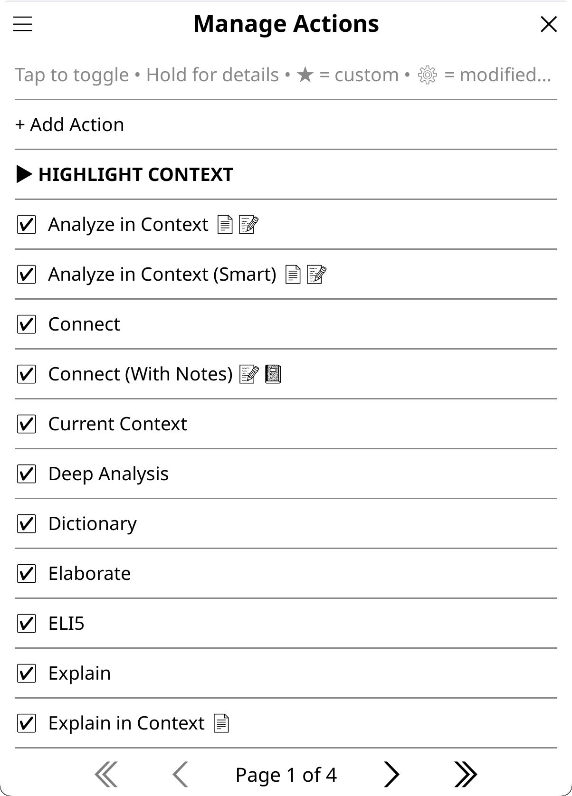

# Actions and Menus

Actions are the buttons that ask the AI something: Explain, Translate, X-Ray and the others, plus any you write yourself. This page covers managing, tuning and creating actions, the long-press menu every action button shares, and where actions appear: the highlight menu, the dictionary popup, the input dialogs, the Quick Actions panel, the file browser and gestures.

## Managing actions

An action is a prompt template with settings of its own: it can override the behavior, domain, language, temperature, reasoning, web search, provider and model. How its prompt joins the rest of the request is explained in [Prompts, Behaviors and Domains](Prompts-Behaviors-and-Domains). When you start an action from an input dialog, you can add your own input (a question, more context or a specific request), which is combined with the action's prompt: see [Adding extra instructions to an action](#adding-extra-instructions-to-an-action).

**Settings → Actions & Prompts** holds four rows:

- **Manage Actions**: the Action Manager, below.
- **Manage Behaviors** (select or create AI behavior styles) and **Manage Domains** (create and manage knowledge domains): see [Prompts, Behaviors and Domains](Prompts-Behaviors-and-Domains).
- **Default Domain & Research**: the default domain and research mode for AI requests. Individual books can override both in Book Settings ([Research Mode](Research-Mode)).

### The Action Manager



*The screenshot shows an earlier version of the list.*

**Settings → Actions & Prompts → Manage Actions** lists every action under its context heading: Highlight Context, Book Context, Library Context, General Context, and combined headings such as Highlight & Book for an action in several contexts. Under a one-line legend at the top, **+ Add Action** opens the editor ([Creating actions](#creating-actions)). Manage Actions is also a tile of the Quick Settings panel.

- **Tap** an action to turn it on or off (☑ / ☐). Turning off the built-in actions you don't use gives cleaner action menus.
- **Hold** an action for its [details screen](#the-details-screen).

The names carry markers:

- **★** your own action, editable; **★ … (file)** an action from `custom_actions.lua` ([File-based actions](#file-based-actions))
- **⚙** a built-in action with modified settings
- **[reading]** needs an open book, so the file browser doesn't offer it
- **[gesture]** is in KOReader's gesture menu
- **Data access indicators**, when Settings → Display Settings → Emoji → Emoji Data Access Indicators is on: marks after the name for the data the action may send (📄 document text, 🔖 highlights, 📝 annotations, 🌐 web search and the rest). In an input dialog, **(🔍)** marks smart retrieval as available: the action has `smart_retrieval = true` and the session can use book tools (a tool-capable model, the open book, and the book's text not set to Never: on Ask the run asks first), whether the Tools chip is on or off; the chip only decides whether the source popup preselects Smart retrieval (with Quick on, an action that takes Quick loses the mark, since the preset turns book tools off). With the ⚡ chip on, **⚡** marks the actions that take the Quick preset; the others run as they always do. The legend is on [Privacy and Data](Privacy-and-Data#seeing-what-an-action-uses).

The lists that place actions in a menu (Highlight Menu Actions and the others) mark their entries their own way: **✓** and a position number for the entries in that menu, **★** your own action, **◆** an action from `custom_actions.lua`, and **(dynamic)** for an entry that shows only when it applies (Look up in X-Ray when the book has an X-Ray, Generate Image when an image provider is configured, the file browser's Chat History and View Artifacts buttons for books that have some).

### The details screen

Hold an action in the Action Manager for its details: its description, whether it works only while reading, its context, source and status, its flags, its AI settings and its prompt. The buttons depend on where the action comes from:

| Action | Buttons |
|---|---|
| Built-in | **Edit Settings**, **Duplicate**, and **Reset to Default** once you have changed it |
| Your own | **Quick Edit**, **Duplicate**, **Delete** |
| From `custom_actions.lua` | **Edit file** (a reminder to edit the file), **Duplicate** |

Below them sit the placement buttons: **+ Highlight Menu**, **+ Dict. Popup**, **+ Quick Actions**, **+ Input Dialog**, **+ General Input**, **+ File Browser** and **+ Gesture Menu**. Each reads ✓ instead of + where the action already is; a tap adds or removes it, and a notification confirms. Only the placements that fit the action show ([Where actions appear](#where-actions-appear)).

### The footer and the menu button

- **Restore Defaults**, at the bottom, resets everything about actions ([Resetting actions and menus](#resetting-actions-and-menus)). **Import** and **Export** are not available yet.
- The **☰** button at the top left jumps to the other action lists (Highlight Menu, Dictionary Popup, Input Dialog Actions, QA Panel Actions, QA Panel Utilities, QS Panel Items, File Browser Items) and holds the resets. Every one of those lists has the same ☰ menu, with **Reset to defaults** for that list.

### Input dialog actions

Each input dialog has its own action list and order: Book, Closed Book, Highlight, X-Ray Chat, Library and General. Open Settings → Menus & Buttons → Input Dialog Actions, pick the context, then tap an action to show or hide it and hold one to move it (the General list can't be reordered there). The same chooser is in the ☰ menu of every action list, and an input dialog's gear → **Choose and Sort Actions…** opens that dialog's own list. The default lists are in [Contexts and Chat](Contexts-and-Chat#actions-in-the-input-dialog).

## The action hold menu

Long-press an action button in the highlight menu, the dictionary popup, the Quick Actions panel, an input dialog or the file browser's long-press menu, and the same menu opens. Its title is the action's description. It also opens on a grayed-out button (a library selection action before you add books, for example), without the run buttons.

**Run it once another way.** The buttons at the top run the action this one time with a change, and change no setting:

- **Quick answer**, or **Without Quick** where Quick is already on, for an action that accepts the Quick Answer posture (among the built-ins: Explain, Quick Explain, ELI5, Elaborate and Explain in Context). See [Contexts and Chat](Contexts-and-Chat#quick-answer-and-its-preset).
- **Without book info**, or **With book info** where None is in effect (the book's own level, Settings → Privacy & Data → Book info, or the dialog's **Send book info** switch), for any action that names the book (a book action, or a highlight action that sends the book info or names the title; the artifact builders included; not Translate, Quick Define, Dictionary, Deep Analysis or Grammar, which never do): nothing that names the book goes with that one run, or the title and author do. Not offered for the actions that answer from what the AI knows about the book, which cannot run without the title ([Privacy and Data](Privacy-and-Data#what-gets-sent)).
- Up to three model buttons: your favorite models first, then the models you picked lately through **More models…** (newest first), then your provider's fast model while a spot is free. A model whose provider has no API key, or the model a plain tap would use anyway, is left out.
- **No reasoning**, when the action would reason, its model can turn reasoning off, and the action doesn't set reasoning itself.
- **With web search** or **Without web search**, when the model can search and the action doesn't decide that itself.
- **More models…**: any model you have a key for. It opens on the models of the provider a tap would use, with **Other provider…** at the top and your favorites after it. A model you pick there joins your recent picks (the five latest are kept).

Only the buttons that would change something appear. With emoji icons on, they carry the chips' icons (⚡ Quick, 🤖 models, 🧠 reasoning, 🌐 web) and 🔒 for the book info. In an input dialog they run on top of that dialog's chips.

The action's own settings still apply: an action that turns reasoning off, or always or never searches, keeps that; only a model you pick overrides a model pinned on the action. Artifact actions (X-Ray, summaries, recaps, the quiz, AI Wiki) get the model buttons and the book info button only, and the pick carries through their View / Update / Redo popup (for X-Ray, the X-Ray popup) to the run that tap starts, section X-Rays and section summaries included (checkpoint builds and automatic updates keep your default model); on AI Wiki it writes a new entry, which replaces the saved one once it succeeds. Replies in the chat that opens stay on the picked model, a chat you resume later keeps it, and the next action you run uses your defaults again.

**Change the action for good.** Below a double line:

- **Add to …** or **Remove from …**, naming this menu: "the highlight menu", "the dictionary popup", "Quick Actions", "this input dialog" or "the file browser menu".
- **Edit…** opens the settings editor of a built-in action, or the full editor of your own. For an action from `custom_actions.lua` it reads **Edit (custom_actions.lua)…** and reminds you to edit the file.
- **More…** holds **Other placements…** (the action's details screen, with every placement button), **Duplicate as custom action…** (not for X-Ray, whose result needs the X-Ray browser), and **Reset to default** for a built-in you have changed. When only one of these applies, it shows directly instead.

Look up in X-Ray, Generate Image and the model button run handlers of their own: their menu has the placement rows, with no Edit and no Duplicate, and no run buttons. Generate Image's choices are all in the popup its tap opens (a note, X-Ray entries, the style and the rest: [Image Generation](Image-Generation)), as an action's with a scope popup are.

A long-press on **Send** (in an input dialog, the reply window, or a chat about an artifact) offers the model buttons, **No reasoning** and **More models…** for that message and the rest of the chat: see [Contexts and Chat](Contexts-and-Chat#managing-the-input-dialog). To make a model a favorite, long-press it in any model list; ♥ marks favorites ([Providers and Models](Providers-and-Models#favorite-models)).

## Tuning built-in actions

Don't like how a built-in action behaves? Change its settings, or make a copy you can rewrite. Both start from its details screen (hold it in Manage Actions) or from a menu's long-press.

- **Edit Settings** (**Edit…** in a long-press menu) customizes a built-in's settings without creating a new action: provider and model, tier, behavior, domain, temperature, reasoning, web search, background, view, and the checkboxes. The action is then marked ⚙, and **Reset to Default** restores its original settings. A built-in's prompt can't be changed there: duplicate the action instead.
- **Duplicate** saves a copy at once as your own action, named "Explain Copy" for Explain (then "Explain Copy (2)" and so on), to use as a template for a slightly different variant. The copy keeps the prompt, behavior, model settings, view and data-access boxes, but it is a plain chat action: the menu placements, the Quick Answer opt-in, the source popup, smart retrieval, and saving the result as an artifact stay with the original. The details screens of X-Ray, Look up in X-Ray, Generate Image and the model button offer no Duplicate.

**Common tweaks:**

1. **Action too verbose?** Elaborate gives you walls of text, for example. Duplicate the action and add "Keep response under 150 words" to the copy's prompt. Cloning keeps the original, so you can compare.
2. **A different model for one action?** Quick Define lookups are slow with your main model, for example. In **Edit Settings**, set **Tier** to **Fastest available** or a named tier: the action keeps your provider and swaps in its faster model. Translate, Quick Define and Quick Explain already ship with a fast tier hint. To force a specific model instead, set **Provider** and **Model** on the same screen. Different actions benefit from different models:
   - fast, cheap models for Dictionary, Quick Define and Translate (speed matters, the task is simple);
   - standard models for Explain, Summarize and ELI5 (balanced quality and cost);
   - reasoning models for Deep Analysis, Key Arguments and academic tasks (complex thinking). Deep Analysis turns reasoning off for itself; set its **Reasoning** to **Global (use setting)** to let the model reason.

   For example claude-haiku-5-5, gpt-6-luna or llama3.2:3b for lookups; claude-sonnet-5-5, gpt-5.6-terra or llama3.3 for general use; claude-opus-5-5, gpt-6.1-sol or deepseek-v4-pro for analysis.
3. **An action without the domain or your languages?** A translation action you created gives unexpected results because of your domain, for example: domain context can alter the style and register of a translation. Set its **Domain** to **None (no domain)**, and tick **Skip language** to leave out your language preferences. Translate, Dictionary, Quick Define, Deep Analysis and Grammar already skip the domain.
4. **Compare approaches.** Duplicate an action several times with different prompts, name the copies "Explain (brief)", "Explain (detailed)" and "Explain (ELI5)", and test which works best for your reading.

**Quick workflow:**

1. Hold an action in Manage Actions.
2. Tap **Duplicate** or **Edit Settings**.
3. Change the prompt, the settings or the model.
4. Test it in the web inspector ([Advanced Configuration and Development](Advanced-Configuration-and-Development#the-request-inspector)).
5. Use it on your e-reader when satisfied.

## Creating actions

Tap **+ Add Action** at the top of Manage Actions. The editor takes three steps:

1. **Name & Context.** The button text, and **Context:**, which sets where the action appears and what it receives on its own: Highlight (the selected text, and optionally the book's title and author), Book (the title and author), Library (the list of selected books and their count) or General (no automatic context). **ⓘ Info** in the context picker explains them. For a highlight action, the **Highlight Menu** and **Dictionary Popup** boxes place it there at once.
2. **Action Prompt.** The instruction, full screen, with **Insert...** for placeholders and **Help** for tips. Every placeholder is listed in [Template Variables](Template-Variables).
3. **Settings**, laid out two per row:
   - **Provider** / **Model**: force a specific provider and model for this action, or leave them Global. Pick the provider first. With a provider and a tier but no model, the action uses that provider's model for the tier (the Model row reads "Auto: …").
   - **Tier**: a speed hint instead of a hard pin. Pick **Fastest available** or a named tier (Ultrafast, Fast, Standard) and the action runs on that tier of your current provider, falling back to the current model when the provider has no model in that tier. An explicit Provider/Model pin always wins over a tier. For an action without a provider of its own, a model you pinned to that tier in Settings → Advanced → Tier Models (Global) is used ([Providers and Models](Providers-and-Models#model-speed-tiers)), and Settings → Advanced → Faster Models for Quick Actions turns every tier hint off. **None (use configured model)** also clears the hint a built-in ships with.
   - **Behavior**: a preset behavior, a custom one (**Custom...**, typed in), **None (no behavior)**, or **Global (use setting)**.
   - **Domain**: a specific domain, **None (no domain)**, or **Global (use setting)**, which uses your global or per-book domain.
   - **Temp** / **Reasoning**: per-action overrides. Temperature runs from 0.0 to 2.0 (Anthropic's maximum is 1.0), and **Global** clears it. Reasoning offers **Global (use setting)**, **Force OFF for all providers** and **Configure per-provider...** ([Reasoning, Web Search and Book Tools](Reasoning-Web-Search-and-Book-Tools)).
   - **Web**: force web search Always or Never, or follow Global.
   - **Background**: whether the action sends the book's Background note ([Prompts, Behaviors and Domains](Prompts-Behaviors-and-Domains)). **Follow domain (default)** sends it whenever the domain is sent; the others are **Always include** and **Never include**.
   - **View** (highlight actions): how the answer shows. Standard (full chat), Dictionary (full-size with dictionary buttons), Dictionary Compact (compact dialog with language buttons) or Translate (translation-focused, with a language switch and a toggle for the original text). An action in the Minimal Popup list opens there first when the answer fits, and the row says so; edit that list in Settings → Minimal Popup → Actions Using Minimal Popup ([Chat Windows](Chat-Windows#minimal-popup)).
   - **Skip language**: don't send your language preferences (useful when the prompt already specifies a target language).
   - **Include book info** (highlight actions; ticked for a new one): send the book's title and author with the highlight.
   - **Takes the Quick preset**: the ⚡ chip, an action's long-press **Quick answer** and Quick Answer On by Default reach this action. Off for a new action. Not offered for an action that saves a result (X-Ray, Summary and the like): a short answer would break what it saves. The settings editor of a built-in action has the same box, and Action Details shows the value.
   - The data-access boxes, the per-action half of [double-gating](Privacy-and-Data#double-gating-for-custom-actions): **Allow text extraction**, **Allow highlight use**, **Allow annotation use (notes)** (which ticks highlight use with it), **Allow notebook use** for highlight and book actions; **Allow Library Scan** for any action (on a built-in action, the ones that use the library), and **Allow reading habits** under it once it is ticked (the habits are read from the library's books). Ticking one whose data is set to Never for all books (Settings → Privacy & Data) says so: the action is refused, or that data is not sent, until you change it.

**Create** saves the action, turned on and marked ★.

**Editing your own action later:** hold it in Manage Actions for **Quick Edit** (the name and every setting of step 3 on one screen, with **Full Editor** for the context or the prompt), **Duplicate** or **Delete**. In a menu, long-press it and tap **Edit…** for the full editor.

## Tips for custom actions

Every placeholder you can use, with the privacy setting behind it, is listed in [Template Variables](Template-Variables).

- **Skip the domain for linguistic tasks.** Translation, grammar checking and dictionary lookups work better without domain context shaping the output. Set the editor's **Domain** row to **None (no domain)** for these, unless the text you translate would benefit from the context a domain adds.
- **Skip language** when the prompt already specifies a target language (with the `{translation_language}` or `{dictionary_language}` placeholders), to avoid conflicting instructions.
- **Put task-specific instructions in the action prompt**, not in the behavior. Behavior applies globally; action prompts are specific. Use a standard behavior and a detailed action prompt for most custom actions.
- **Temperature matters:** lower (0.3 to 0.5) for deterministic tasks such as translation and definitions, higher (0.7 to 0.9) for creative ones such as elaboration and recommendations.
- **Experiment with domains:** run the same action with and without a domain to see what works for you. Some actions benefit from domain context (analysis, explanation), others don't (translation, grammar).
- **Test before deploying:** the web inspector lets you try different combinations of settings and shows exactly what is sent to the AI, before you use an action on your e-reader ([Advanced Configuration and Development](Advanced-Configuration-and-Development#the-request-inspector)).
- **Reading mode and the file browser:** what the file browser hides is decided by an action's *flags*, not by its placeholders. An action hides there when it sets `use_book_text`, `use_page_text`, `use_reading_stats`, `source_selection` or `requires_open_book`, the things that need a live document. `{highlights}`, `{annotations}` and `{notebook}` map to flags that are read from the book's saved data on disk, so those actions stay available from the file browser on purpose; `{reading_progress}` has a fallback on disk too. Text extraction is never inferred from a placeholder: if your action uses `{book_text_section}` or `{full_document_section}`, tick **Allow text extraction** yourself, or the flag is not set. The Action Manager marks the actions that need an open book with `[reading]`. Highlight actions always need an open book (you can't highlight without one).
- **Document caches:** three caches are available as placeholders: `{summary_cache_section}`, `{xray_cache_section}` and `{analyze_cache_section}`. They need the matching `use_summary_cache`, `use_xray_cache` or `use_analyze_cache` flag, set in `custom_actions.lua` (the editor has no box for them); a cache built from book text is read only while text extraction is allowed, and `use_book_text` is not required (setting it hides the action from the file browser). The **summary cache** is the main one for custom actions: a neutral, comprehensive representation of the document, made to be reused. The **X-Ray cache** is useful as supplementary context (a structured reference of characters and concepts). The **analyze cache** is more specialized: it is an opinionated analysis, so avoid using it as the input of another analysis (you'd be analyzing an analysis, a game of telephone where each layer loses nuance). Cache placeholders disappear when empty, so including them is always safe. Two patterns:
  - **Replace:** use `{summary_cache_section}` instead of the raw book text to save tokens on long books. Add `source_selection = true` and `use_summary_cache = true` to let the reader choose between full text, summary and AI knowledge at run time, or use `{document_context_section}`, one placeholder that resolves to the source the reader picks.
  - **Supplement:** add a cache as bonus context beside other data, for example `{xray_cache_section}` in a custom action, so the AI has the character and concept reference when one exists. The placeholder vanishes when there is no cache, so there is no downside.

  The **Attach** chip in the input dialog also attaches a notebook, a saved artifact, a chat, a file or a note to a chat on the fly, so you can pull one book's cached artifact into a chat about another (comparing an X-Ray across the volumes of a series, for example): see [Contexts and Chat](Contexts-and-Chat#session-controls-chips).
- **Surrounding context:** use `{surrounding_context_section}` in highlight actions to include the text around the highlighted passage. It is extracted live (not cached) and capped at 2000 characters. It is most useful in custom dictionary-like actions that need the sentence around a single word. The built-in Quick Define, Dictionary and Deep Analysis don't use it: they set `use_surrounding_context = false` and take their passage from the separate dictionary channel (`{context_section}`), driven by Settings → Dictionary Settings; copy them only if you want that channel. The mode (sentence, paragraph or a character count) comes from Settings → Highlight Settings → Surrounding Context, together with its direction and amount. A book can have its own mode (Book Settings), and the Ctx chip changes the mode, amount and direction for one chat. Dictionary lookups use their own context setting, under Dictionary Settings.

## File-based actions

For more control, write actions in `custom_actions.lua`, in the plugin's folder (`koassistant.koplugin`, next to `custom_actions.lua.sample`). Updates keep the file ([Backups and Updates](Backups-and-Updates)).

```lua
return {
    {
        text = "Grammar Check",
        context = "highlight",
        behavior_override = "You are a grammar expert. Be precise and analytical.",
        prompt = "Check grammar: {highlighted_text}"
    },
    {
        text = "Discussion Questions",
        context = "book",
        prompt = "Generate 5 discussion questions for '{title}'{author_clause}."
    },
    {
        text = "Series Order",
        context = "library",
        prompt = "What's the reading order for these books?\n\n{books_list}"
    },
}
```

Every entry needs:

- `text`: the button label.
- `context`: `"highlight"`, `"book"`, `"library"` or `"general"`. `"both"` puts the action in the highlight and book contexts; `"highlight+general"`, `"book+general"` and `"both+general"` add the general context. Any other value, or no `context` at all, skips that action, with a line in the log (KOReader's crash.log); the other actions still load.
- `prompt`: the instruction, with placeholders ([Template Variables](Template-Variables)).

Good to know:

- In the app these actions show as ★ … (file). They can't be edited there (**Edit file** says so); **Duplicate** turns one into an action of your own that you can edit.
- Each entry is known by its position in the file. Add new entries at the end: inserting or removing one shifts the on/off state and the menu placements of the entries after it.
- If the file has an error, none of its actions load. The first time you use KOAssistant after a start, a notice names the error with its line; the file's actions stay out of the menus until it is fixed, and their places in the menus are kept.
- `enabled` is **ignored in file-based actions**. The loader overwrites it from the Action Manager's own enable/disable state on every load, so a value written here has no effect. Disable the action in Manage Actions instead.

**Optional fields.** Model and behavior:

- `behavior_variant`: a preset behavior by ID, such as `"standard"`, `"mini"`, `"full"`, `"gpt_style_standard"`, `"perplexity_style_full"`, `"reader_assistant"` or `"none"`. The IDs are the names of the behavior files ([Prompts, Behaviors and Domains](Prompts-Behaviors-and-Domains)).
- `behavior_override`: custom behavior text (overrides the variant).
- `provider`: force a specific provider (`"anthropic"`, `"openai"` and so on).
- `model`: force a specific model of that provider.
- `model_tier`: a speed hint, `"fastest"` or a tier name such as `"fast"`. The action uses a faster model of the same provider; explicit provider and model pins win. Settings → Advanced → Faster Models for Quick Actions turns the whole mechanism off.
- `temperature`: override the global temperature (0.0 to 2.0).
- `api_params`: raw parameters merged into the request, such as `{ temperature = 0.7, max_tokens = 1500 }`; the only route to `max_tokens`.
- `reasoning_config`: per-provider reasoning settings ([below](#per-provider-reasoning)).
- `extended_thinking`: legacy, `"off"` to disable and `"on"` to enable reasoning; read when `reasoning_config` is not set.
- `thinking_budget`: legacy, the token budget when `extended_thinking = "on"` (1024 to 32000).

What the request includes:

- `domain`: force a specific domain by ID (overrides the per-book and global domain). The editor's **Domain** picker sets it too.
- `research_mode`: `true` or `false` turns research mode on or off for this action, ahead of the book's setting, DOI detection and the global setting ([Research Mode](Research-Mode)).
- `enable_web_search`: override the global web search setting (`true` forces it on, `false` off, unset follows the global setting).
- `include_book_context`: send the book's title and author with a highlight action, as far as Settings → Privacy & Data → Book info allows (at None nothing names the book).
- `skip_language_instruction`: leave the language instruction out of the system message (default off; Translate and Dictionary set it, since the target language is in their prompt).
- `skip_domain`: leave the domain out of the system message (default off; Translate and Dictionary set it).
- `skip_background`: whether the action sends the per-book Background note (your standing note about the book). Unset follows `skip_domain`, `true` never sends it, `false` always does.
- `skip_spoiler`: `true` leaves the action out of spoiler protection. The artifact, translation and dictionary actions do this, since their scope or their prompt handles spoilers ([Spoiler Protection](Spoiler-Protection)).

Data the action may use. The sensitive flags are double-gated: they need the global setting too, and a placeholder never switches them on ([Privacy and Data](Privacy-and-Data#double-gating-for-custom-actions)).

- `use_book_text`: allow text extraction for this action. It is a permission gate and also needs the book's text allowed (**Settings → Privacy & Data → Text Extraction → Book text**, or your answer when it asks); the placeholders trigger the extraction: `{book_text_section}` extracts up to your position, `{full_document_section}` the whole document. It also gates the document cache placeholders.
- `use_highlights`: include the book's highlights (text only, no notes). Needs highlights or annotation notes allowed.
- `use_annotations`: include annotations (highlights with your notes). Needs annotation notes allowed.
- `use_notebook`: include the book's KOAssistant notebook. Needs the notebook allowed.
- `use_library`: include the library catalog (`{library_section}`). Needs Library Scan allowed plus a folder ticked for the run (triple-gated).
- `use_advanced_stats`: include reading engagement groups (`{deep_reads}`, `{stalled}`, `{recently_finished}`, `{briefly_started}` and their section forms) and per-book engagement labels in library output. Needs reading habits allowed and this flag. Used by the library scan actions Next Read, Discover New, Analyze Library and Challenge My Taste.
- `use_summary_cache` / `use_xray_cache` / `use_analyze_cache`: let the matching document cache placeholder resolve (double-gated; see [Document caches](#tips-for-custom-actions) above).
- `use_reading_progress`: include the reading position (`{reading_progress}`, `{progress_decimal}`, `{time_since_last_read}`). Needs Reading position on.
- `use_reading_stats`: chapter information (`{chapter_title}`, `{chapters_read}`, `{page_number}`). Needs Reading position on; inferred from those placeholders.
- `use_surrounding_context`: include the text around a highlight; inferred from the `{surrounding_context}` placeholder. `false` never includes it, `true` always does, unset follows the Surrounding Context setting.
- `use_page_text`: include the text of the visible page (`{page_text_section}`). A single page, so no text-extraction gate; inferred from the placeholder.

Blocking:

- `requires`: requirements that block the action when unmet: `{"book_text"}`, `{"highlights"}`, `{"library"}`. The message names the gate (per-action or global) that is the problem, with your `blocked_hint` when set ([Privacy and Data](Privacy-and-Data#when-an-action-is-blocked)).
- `blocked_hint`: the suggestion shown when the action is blocked, for example `"Or use X-Ray (Simple) for an overview based on AI knowledge."`.

Results and display:

- `description`: the text shown when the action is long-pressed in the managers and menus.
- `use_response_caching`: store the result as a per-action artifact, with the View / Update / Redo popup ([Artifacts and Caching](Artifacts-and-Caching)).
- `update_prompt`: the prompt used when an artifact is updated incrementally rather than regenerated.
- `cache_as_xray`, `cache_as_analyze`, `cache_as_summary`: save the result to the X-Ray, document analysis or document summary cache, for other actions to reference.
- `storage_key`: `"__SKIP__"` keeps this action's chats from being saved (the artifact actions use it).
- `compact_view` / `dictionary_view` / `translate_view` / `minimal_buttons`: the view of the response window.

Choices at run time:

- `source_selection`: show a scope and source popup, so the reader picks what feeds `{document_context_section}` at run time: full text, a cached summary, AI knowledge, plus scope rows ("Up to current position (NN%)", "From section…", "Pick section range…"; highlight actions get them too). With spoiler protection on, the popup pre-selects "Up to current position" and asks before running a scope that reaches past your position ([Contexts and Chat](Contexts-and-Chat#source-selection)).
- `smart_retrieval`: the AI looks up only the passages it needs instead of receiving the whole document. On **highlight** actions it is a "Smart retrieval" row in the source popup: grayed with the reason when the session can't use book tools, pre-selected when it can. On book and library actions there is no row: the flag makes the action gather passages silently. Explain in Context and Analyze in Context use it ([Reasoning, Web Search and Book Tools](Reasoning-Web-Search-and-Book-Tools)).
- `accept_quick_answer`: opt the action into the Quick Answer posture (brevity nudge, reasoning, web and tools off, plus whatever else the preset includes). Launched from the input dialog it follows the Quick Answer chip; launched directly (highlight menu, dictionary popup, gesture, Quick Actions) it follows your per-book or global Quick Answer default. Never applies to an action that saves a result, whatever the flag says. The editor's **Takes the Quick preset** box sets it for your own actions and for built-ins.

### Per-provider reasoning

`reasoning_config` is the top reasoning layer: it wins over your global stance and any per-model setting ([Reasoning, Web Search and Book Tools](Reasoning-Web-Search-and-Book-Tools)).

```lua
reasoning_config = {
    anthropic = { effort = "high" },    -- low/medium/high (+ xhigh/max on Opus and Sonnet 5)
    openai = { effort = "medium" },     -- low/medium/high/xhigh
    gemini = { level = "high" },        -- minimal/low/medium/high (Gemini 3)
    deepseek = "off",                   -- binary providers: true (on) or "off"
}
-- reasoning_config = "off"                -- force off for all providers
-- reasoning_config = { default = "off" }  -- default for providers not listed above
```

Built-in actions such as Translate, Quick Define, Dictionary and Summarize use `reasoning_config = "off"`.

See `custom_actions.lua.sample` for more examples.

## Where actions appear

| Place | Actions it takes | Add or remove | Order |
|---|---|---|---|
| Highlight menu | Highlight actions | **+ Highlight Menu**, the **Highlight Menu** box in step 1 of the editor, or a long-press in the menu | Settings → Menus & Buttons → Highlight Menu Actions |
| Dictionary popup | Highlight actions | **+ Dict. Popup**, the **Dictionary Popup** box in step 1, or a long-press in the popup | Settings → Menus & Buttons → Dictionary Popup Actions |
| Input dialogs | Each context its own list | **+ Input Dialog** (**+ General Input** for a general action), a long-press in the dialog, or its gear → **Choose and Sort Actions…** | Settings → Menus & Buttons → Input Dialog Actions |
| Quick Actions panel | Book actions | **+ Quick Actions**, or a long-press on the panel | Settings → Menus & Buttons → Panel Actions, or the panel's gear |
| File browser long-press menu | Book actions that need no open book | **+ File Browser**, or a long-press in that menu | Settings → Menus & Buttons → File Browser Items |
| Gesture menu | Book and general actions | **+ Gesture Menu**, then restart KOReader | bind it in Settings → Gestures |

- The **+** buttons are on the action's [details screen](#the-details-screen). Except for the highlight menu and the dictionary popup, they show only for an action that is turned on.
- An action whose prompt needs typed input (`{user_input}`) can't go in the highlight menu or the dictionary popup.
- **+ Input Dialog** adds a book action to the open book's dialog, a highlight action to the highlight dialog and a library action to the library dialog; the Closed Book and X-Ray Chat lists are set in Input Dialog Actions or by a long-press in that dialog.
- Changes to the highlight menu, the dictionary popup and the file browser show the next time that menu opens. Action gestures are covered in [Setup, Gestures and Panels](Setup-Gestures-and-Panels#custom-action-gestures).

## Highlight menu actions

Add the highlight actions you use most to KOReader's highlight popup, for faster access.

**Default actions** (included on fresh installs):

1. **Switch model**: the [model button](#the-model-button), showing your model.
2. **Translate**: instant translation of the selected text.
3. **Explain**: an explanation of the passage.
4. **Quick Explain**: a two-or-three-sentence explanation, usually landing in the Minimal Popup.
5. **Summarize**: the passage condensed to its essential points.
6. **Quick Define**: a short definition of the selected word.
7. **Dictionary**: a fuller dictionary-style entry.
8. **Look up in X-Ray**: a local search of the book's X-Ray (only when the book has one; [Using X-Ray](Using-X-Ray)).
9. **Generate Image**: an illustration of the passage (only when an image-capable provider is configured; [Image Generation](Image-Generation)).

Propagation runs one way. A built-in that gains a default placement **is** injected into an existing install's menu at its default position on the next read, unless that install removed it before (removals are remembered). A built-in that *loses* its default placement stays where it is; only ids that no longer resolve at all are pruned.

**Other built-in actions you can add:** ELI5, Elaborate, Connect, Connect (With Notes), Fact Check, AI Wiki, Grammar, Counterpoint, Explain in Context, Analyze in Context, Thematic Connection, Current Context, Deep Analysis.

**Adding more actions:**

1. Go to Manage Actions.
2. Hold any highlight action.
3. Tap **+ Highlight Menu**.
4. A notification confirms it; the change takes effect the next time the highlight menu opens (no restart needed).

In the highlight menu, actions read "Explain (KOA)", "Translate (KOA)" and so on (untick **Show (KOA) on KOAssistant's buttons** under Settings → Menus & Buttons → Highlight menu to drop the mark; the dictionary popup and the file browser have their own box, and the Setup Wizard's Button marks step sets all three at once: [Setup, Gestures and Panels](Setup-Gestures-and-Panels#setup-wizard)). Long-press any of them to run it once another way, or for its description plus **Remove from the highlight menu**, **Edit…** and **More…**: [The action hold menu](#the-action-hold-menu).

**Managing the menu:**

- Settings → Menus & Buttons → Highlight Menu Actions lists every highlight action; ✓ and a number mark the ones in the menu, in order (up to 15 shown).
- Tap an action to add it to the menu or remove it; hold one that is in the menu to move it up or down.
- Default actions can be removed (they won't come back on their own).
- Freeform chat is always available through the **Send** button of the input dialog.

Changes take effect the next time the highlight menu opens.

### The model button

The first KOAssistant button of the highlight menu shows your model: 🤖 and its name, or "Model: …" without emoji icons. It is on by default, as the **Switch model** entry of Settings → Menus & Buttons → Highlight Menu Actions: tap it there to remove it, hold it to move it like any other entry (added back, it goes first).

- **Tap** the button for your [favorite models](Providers-and-Models#favorite-models) (♥) and your recent picks, then **More models…** (with neither yet, the full model picker opens at once). A pick changes your model, the button updates, and the menu and your selection stay open, so the next action you tap runs on it. Long-press a model in that list to add it to or remove it from your favorites.
- Actions with a model of their own keep it. To run one action once on another model, long-press the action instead.
- **Long-press** the button itself for **Remove from the highlight menu** and **Other placements…**.
- **Dictionary Popup Actions** has the same entry for the dictionary popup (off there by default; to try another model on one lookup, long-press the action instead).
- Turning off **Show quick actions** hides the button with the rest of KOAssistant's action buttons.

> **Prefer a cleaner menu?** You can turn off KOAssistant's highlight menu integration entirely in Settings → Menus & Buttons. **Show Chat/Action button** (the main button) and **Show quick actions** (the action shortcuts such as Translate and Explain) have separate toggles. There is also **Show Add to Notebook button** (off by default; turn it on to save selected text straight to the book's notebook). Generate Image is an ordinary action, so add or remove it in Highlight Menu Actions.

## Menus & Buttons

**Settings → Menus & Buttons** controls where KOAssistant appears in KOReader's menus, panels and buttons. It gathers the placement toggles that used to sit under "KOReader Integration", "Highlight Settings", "Dictionary Settings", "Quick Settings" and "Quick Actions". Which *actions* appear on each surface is set in its action list here, or in the Action Manager (hold an action).

### Highlight menu

- **Show Chat/Action button** (on): the main **Chat/Action** button, which opens the input dialog. Takes effect the next time the menu opens.
- **Show quick actions** (on): the action buttons (Explain, Translate and the rest of Highlight Menu Actions, the model button included).
- **Show Add to Notebook button** (off): an **Add to notebook** button that saves the selected text straight to this book's notebook.
- **Show (KOA) on KOAssistant's buttons** (on): marks KOAssistant's buttons with "(KOA)", to tell them apart from KOReader's own.
- **Highlight Menu Actions**: which actions appear, and their order (up to 15 shown). Defaults, in order: Switch model, Translate, Explain, Quick Explain, Summarize, Quick Define, Dictionary, Look up in X-Ray, Generate Image; the last two appear only when the book has an X-Ray, and when an image provider is configured. See [Highlight menu actions](#highlight-menu-actions).

### Dictionary popup

- **Show AI buttons** (on): AI buttons in KOReader's dictionary popup.
- **Show (KOA) on KOAssistant's buttons** (on): the same mark in the dictionary popup; takes effect on the next lookup.
- **Dictionary Popup Actions**: which actions appear and their order, custom ones and the model button included. The dictionary actions themselves are in [Dictionary and Translation](Dictionary-and-Translation).

### Input dialogs

- **Show View Artifacts button** (on): the **View Artifacts** button in book and highlight input dialogs, for books that have artifacts.
- **Show Group button** (on): the **Group** button, for books in a group.
- **Input Dialog Actions**: pick a context (Book, Closed Book, Highlight, X-Ray Chat, Library, General), then toggle and reorder its action buttons ([Input dialog actions](#input-dialog-actions)).
- The chips are set from the input dialog's own gear menu (**Toolbar Buttons…**): see [Contexts and Chat](Contexts-and-Chat#choosing-which-chips-appear).

### File browser

Listed in the order the buttons appear in the long-press popup. All nine are on by default.

- **Show KOAssistant actions**: KOAssistant's buttons in the file browser's long-press menu (changes apply the next time the menu opens).
- **Show Chat/Action button**: the main "Chat/Action (KOA)" button.
- **Show Notebook button**: a **Notebook** button when you long-press a book.
- **Only for books with notebooks**: show that button only when a notebook already exists (turn it off to create notebooks from the file browser).
- **Show Chat History button**: that book's saved chats, for books that have some.
- **Show View Artifacts button**: that book's cached artifacts, for books that have some.
- **Show Book Hub button**: the "Book Hub (KOA)" button ([Book Settings and Book Hub](Book-Settings-and-Book-Hub)).
- **Show Book Settings button**: that book's per-book settings.
- **Show (KOA) on KOAssistant's buttons**: the mark in this menu.
- **File Browser Items**: the same buttons as one list of toggles, then the actions pinned to the menu (About is the only default).

### Quick panels

**Panel Actions**, **Panel Utilities** and **Quick Settings Items** choose and order the actions and utility buttons of the Quick Actions panel and the tiles of the Quick Settings panel; each is also reachable from its panel's gear icon. Add an action to the panel with **+ Quick Actions** in the Action Manager. The panels and their contents are described in [Setup, Gestures and Panels](Setup-Gestures-and-Panels#quick-panels).

### Gestures

- **Register gesture actions** (on): registers the actions you added with **+ Gesture Menu** in KOReader's gesture dispatcher (needs a restart). The built-in gestures (Chat History, Quick Settings, the toggles and the others) are always available.

To give KOAssistant's panels and actions a gesture, use **Settings → Gestures**: it lists every KOAssistant gesture action with the gestures it has now and offers any KOReader gesture, showing what holds a gesture that is already in use. More in [Setup, Gestures and Panels](Setup-Gestures-and-Panels#gestures).

### Text selection in viewers

- **Enhance text selection** (off; needs a restart): dictionary lookup and an action popup for text you select in KOReader's own viewers (the dictionary popup, TextViewer and others). A single word goes to the dictionary; a long-press on a word, or a selection of several words, opens a popup with Copy, Dictionary and Translate. See [Chat Windows](Chat-Windows#selecting-text-in-a-window).

**Restarts:** adding an action to the gesture menu, **Register gesture actions** and **Enhance text selection** need a KOReader restart, since they are registered when the plugin starts. Binding a gesture in **Settings → Gestures** does not while KOReader's gesture plugin is loaded. File browser, highlight menu and dictionary popup changes take effect the next time the menu opens.

## The first rows of the KOAssistant menu

The KOAssistant menu (Tools → KOAssistant) starts with rows that open something:

- **Quick Settings**: opens the Quick Settings panel, as its gesture does (the menu closes).
- **Quick Actions** (with a book open): opens the Quick Actions panel, as its gesture does. Both panels: [Setup, Gestures and Panels](Setup-Gestures-and-Panels#quick-panels).
- **Book Chat/Action** (with a book open): a conversation about the current book, or a book action ([Contexts and Chat](Contexts-and-Chat#bookdocument-mode)).
- **Book Hub** (with a book open): the current book's hub, with its artifacts, chats, notebook, group and settings in one view ([Book Settings and Book Hub](Book-Settings-and-Book-Hub)).
- **General Chat/Action**: a context-free conversation, or a general action ([Contexts and Chat](Contexts-and-Chat#general-chat)).
- **Library Chat/Action**: the library dialog with scan-based and selection-based actions. The scan-based ones (Next Read, Discover New, Analyze Library, Challenge My Taste) need Library Scan not set to Never and a folder ticked under the dialog's **Library Scan ▾** (your default scan folders start ticked); on Ask a run asks first, naming the folders; the selection-based ones (Compare, Recommend and the others) need books you add under **Items ▾** ([Contexts and Chat](Contexts-and-Chat#library-mode)).
- **Chat History**: your saved conversations ([Conversations, Notebooks and Export](Conversations-Notebooks-and-Export)).
- **Browse Notebooks**: the Notebook Manager, with every notebook.
- **Browse Artifacts**: the Artifact Browser, with every cached artifact ([Artifacts and Caching](Artifacts-and-Caching)).
- **Groups**: the Groups list, one row per group ([Book Groups and Series](Book-Groups-and-Series)).

## Adding extra instructions to an action

An action started from a gesture, a panel or the highlight menu runs at once with its own prompt. To add context, or to focus the AI on one aspect:

1. Skip the direct button (the gesture or the highlight menu's action button).
2. Open the input dialog instead: in the highlight menu, tap **Chat/Action (KOA)**; for a book, Book Chat/Action.
3. Type your extra instructions in the text field (for example "esp. focus on X aspect").
4. Tap the action.

Your typed text is combined with the action's prompt template; a prompt can also place it exactly where it wants with `{user_input}` ([Template Variables](Template-Variables)). To run an action once with another model or without reasoning instead, long-press it ([The action hold menu](#the-action-hold-menu)).

## Resetting actions and menus

- **Restore Defaults** (the footer of Manage Actions) deletes the actions you created in the app, reverts every change to built-in actions, turns all actions back on, and resets every action list, the Quick Actions utilities and the Quick Settings tiles. Actions in `custom_actions.lua` stay, since they live in the file.
- The **☰** menu of Manage Actions resets one part at a time:
  - **Reset custom actions** deletes the actions you created; built-in actions and their edits stay.
  - **Reset action edits** reverts your changes to built-in actions and turns disabled actions back on; your own actions stay.
  - **Reset action menus…** offers Reset Highlight Menu, Reset Dictionary Popup, Reset Quick Actions, Reset File Browser Actions, Reset QA Utilities, Reset QS Panel Items, Reset Input Dialog Actions (every input dialog but the general one) and Reset All Menus. Your actions stay.
- Every action list's ☰ menu has **Reset to defaults** for that list alone.
- **Settings → Backup & Reset → Reset Settings... → Quick: Actions only** resets the same as Restore Defaults and keeps everything else: your settings, API keys, custom behaviors and domains, custom providers and models, gesture registrations and chat history ([Backups and Updates](Backups-and-Updates)).

## Related

- [Contexts and Chat](Contexts-and-Chat): the input dialog, its chips, and the actions each context offers.
- [Template Variables](Template-Variables): every placeholder an action prompt can use.
- [Prompts, Behaviors and Domains](Prompts-Behaviors-and-Domains): how an action's prompt joins the request, and the behaviors and domains it can use.
- [Privacy and Data](Privacy-and-Data): the global settings behind the data-access boxes.
- [Setup, Gestures and Panels](Setup-Gestures-and-Panels): the Quick Actions and Quick Settings panels, gestures and bypass modes.
- [Providers and Models](Providers-and-Models): favorites, tiers and the models an action can pin.
