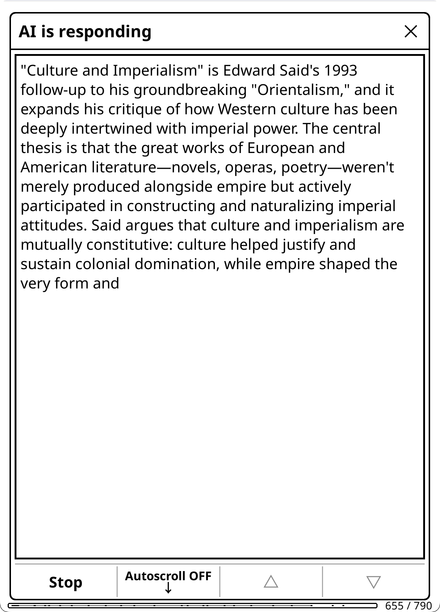

# Chat Windows

Every answer opens in a window where you read it, reply, copy or save it, and change how it looks. This page covers the chat window's buttons and long-presses, replying, streaming, the Minimal Popup for short answers, the view modes, window size, selecting text inside a window, and the Sources and Reasoning viewers.

## Kinds of window

- **Chat window**: chats and most actions. Its buttons are described [below](#the-chat-window).
- **Dictionary windows** (the compact popup and the full-size window) and the **translate window**: they have their own button rows, described on [Dictionary and Translation](Dictionary-and-Translation). Their **→ Chat** button opens the answer in a full chat window.
- **Artifact windows**: summaries, analyses, a book's About, AI Wiki entries, pinned answers, X-Ray versions and the like. Their buttons (→ Chat, Info, Regenerate, Delete and others) are on [Artifacts and Caching](Artifacts-and-Caching).
- **Minimal Popup**: a small popup for short answers, with no buttons ([below](#minimal-popup)).

The chat, dictionary, translate and artifact windows share the gear menu, the **MD ON / TXT ON** toggle, the long-press on **Close** and text selection. All of them but the compact dictionary popup follow the window size setting.

## The chat window

The title bar has the gear icon on the left ([the gear menu](#the-gear-menu)) and **×** on the right. Two rows of buttons sit under the answer.

| Button | Tap | Long-press |
|---|---|---|
| **↩️ Reply** (**Reply** without emoji icons) | Opens the Reply box ([Replying](#replying)) | |
| **Copy** | Copies the chat in the form set by **Settings → Chat & Export Settings → Content Format → Copy Content** | Asks what to copy this time |
| **Save to Note** | Saves the answer as a KOReader note attached to your highlight. Highlight chats only; see [Contexts and Chat](Contexts-and-Chat) | Asks what to put in the note this time |
| **Notebook** | **Add Chat to Notebook**, **Add (choose format)...**, and once the book has a notebook, **View Notebook** and **Edit Notebook**. Grayed out in general and library chats | Same as tap |
| **Pin / ★** (📌 / ⭐ with emoji icons) | **Pin Last Response as Artifact** (or **Unpin from Artifacts**) and **Star Conversation** (or **Unstar Conversation**) | A one-line hint |
| **#** (🏷️ # with emoji icons) | Add or manage this chat's tags | A one-line hint |
| **Save** / **Autosaved** | Saves the chat. Reads **Autosaved** when auto-save already keeps it | Closes everything (below) |
| **MD ON** / **TXT ON** | Switches this chat between Markdown and Plain Text ([view modes](#markdown-and-plain-text)) | The **Display** menu: the default view mode and other display options |
| **Hide Quote** / **Show Quote** | Hides or shows your highlighted text in this chat. Grayed out when there is none | The quote defaults for new chats ([Quotes](#quotes)) |
| **⇱** / **⇲** | Jumps to the top or the end | Closes everything |
| **Close** | Closes the window | Closes everything |

Saving, tags, pinning and starring are explained on [Conversations, Notebooks and Export](Conversations-Notebooks-and-Export).

**Hold to close everything:** a long press on **Close** or on the title bar's X in any KOAssistant window (in the chat window also on **Save**, **⇱** and **⇲**) closes that window, any dictionary windows under it, and the highlight menu, taking you straight back to the page in one gesture.

**Other ways to close a window:** **×** in the title bar, a tap outside the window, the Back key, or any multiswipe.

**Moving around:** swipe left or right on the text to turn its pages. A swipe up or down on the text refreshes the whole screen (handy against e-ink ghosting).

**Links:** in Markdown view, tapping a link (plain web addresses become links too) opens KOReader's external link dialog: Copy, Show QR code, Open in browser, and any registered plugin actions (e.g., Add to Wallabag). When no book is open, a basic version of the dialog is shown: Copy and Show QR code, plus Add to Wallabag when that plugin is installed and Open in browser when the device can open links.

## The gear menu

Tap the gear icon in the title bar:

- **Font Size**: 12 to 32 (default 20). It sizes the Markdown view (Plain Text uses a fixed size) and the text of the streaming window.
- **Alignment** (Markdown view; Plain Text starts every paragraph at its own side): cycles **Auto → Left → Justify → Right**. Auto, the default, follows each paragraph's own direction (left for LTR, right for RTL) instead of forcing one side, so RTL answers align right; Left and Right put every paragraph on that side, right-to-left ones included.
- **Reset to Defaults**: font size 20 and Auto alignment.
- **Window Size**: Standard or Expanded, the same setting as Display Settings ([Window size and rotation](#window-size-and-rotation)). Not offered on compact dictionary popups.
- **Show Excerpt** (dictionary windows only): the same setting as **Settings → Dictionary Settings → Show Excerpt**; see [Dictionary and Translation](Dictionary-and-Translation).
- **Export**: writes the chat to a file ([Copy and export](#copy-and-export)).
- **Show Reasoning** and **Show Sources**: see [Show Sources and Show Reasoning](#show-sources-and-show-reasoning).
- **Show Debug** / **Hide Debug**: shows what was sent to the AI in this window and its replies only; the **Settings → Advanced → Show Debug in Chat** setting stays as it is. See [Advanced Configuration and Development](Advanced-Configuration-and-Development).

Font size and alignment **persist across opens**, artifact and X-Ray windows included, so you only set them once. Artifact windows leave out Export, Show Reasoning and Show Sources: they have their own Export button.

## Replying

**Reply** opens a box over the window. Above its **Close** and **Send** buttons sits a row of chips for this chat:

- **Web** (🌐 with emoji icons): web search for your next replies, on or off. It reads **Web N/A** when your provider cannot search; tap it to see which providers can.
- **Tools** (🔍): AI Book Tools for your next replies. Only in book chats with the book open. It reads **Tools N/A** when your provider cannot use them, when text extraction is not allowed, and in X-Ray chats; tap it for the reason.
- **Quick** (⚡): the speed parts of the Quick Answer preset for your next replies (the model, reasoning, web search and book tools; the shorter-answer instruction stays as the chat started). It reads **Quick ON** or **Quick** (⚡ ON or ⚡ OFF with emoji icons).
- **Attach** (📎): stages a notebook, artifact, chat, file or note to go with your next reply; the label shows the count.

A tap changes this chat only, without touching your saved settings, and keeps your draft. A long press opens the same pickers as the input dialog's chips: the per-book and global defaults for Web and Tools, the Quick answer default and **Preset settings…** for ⚡, and the staged items for Attach. What each chip does is on [Contexts and Chat](Contexts-and-Chat).

**Send with another model:** type your message, then long-press **Send** for your model buttons, **No reasoning** and **More models…**. The pick applies to this reply and the rest of the chat, and a chat you resume later keeps it. Favorite models are explained on [Providers and Models](Providers-and-Models).

### Reply drafts

The Reply box keeps what you type for as long as the chat window stays open. You can:

- close the box (Close, or a tap outside it) and reopen it later: your draft is still there
- switch between the answer and the box while composing, or toggle a chip
- copy text from the AI's response and paste it into your reply, or quote it with **Add to reply** ([Selecting text](#selecting-text-in-a-window))
- rotate the device

The draft is cleared when you send the message or start a new chat. Closing the chat window drops it.

## Streaming

With streaming on (the default), responses appear in real time as the AI generates them. It works with all providers that support streaming. The window's title names the action being run, or reads "AI is responding" for a question you typed.

**Buttons:**

- **Stop** cancels the request.
- **Autoscroll ON ↓** / **Autoscroll OFF ↓**: tap to stop or start auto-scrolling.
- **⚡** (**Quick** without emoji icons): drops this answer and asks again with your Quick Answer preset's speed settings (by default reasoning, web search and book tools off), and the chat's replies stay quick. It is shown for questions you type and for actions that accept Quick Answer, not for X-Ray and other artifact actions, and is grayed out when the request already runs quick.
- **△** / **▽** scroll the text.

**How the text moves:**

- **Auto-scroll** (default): follows new text as it appears. It pauses when you swipe, use page buttons, or tap the scroll controls: the first step up pauses it and scrolls back a page in the same press (on the first page, where there is nothing above, it only pauses), a step down pauses it only when the view actually moves, and dragging pauses it where you let go. Tap Autoscroll to follow again.
- **Page-based scroll** (default): text fills the current page top-down, then advances to a blank page when full, minimizing full-screen e-ink refreshes. Turn it off for continuous bottom-scrolling. It needs Auto-scroll.
- **Keep your place**: if auto-scroll is off or paused and you keep reading while the rest streams in, the finished chat opens at your spot instead of jumping to the newest reply (in Markdown it opens on the page holding your line; in Plain Text your line starts the view).
- **Markdown while streaming** (**Settings → Chat & Export Settings → Streaming → Markdown While Streaming**, off by default): the answer is shown rendered as it streams, bold, headings, lists and every script in its own face, instead of plain text swapped for the rendered view at the end. It re-renders at line ends, about every two seconds and less often as the answer grows, since each render lays the whole answer out again; following shows the last page, and a pause keeps your page while the rest arrives. It applies to a chat shown in Markdown (a chat you switched with MD ON, else your View Mode) and never to hidden streams such as quizzes. The rendered window pages like a chat window (a swipe, a tap on the page's left or right half, the arrow buttons or page keys); dragging does not scroll it. Off, the window streams plain text as before.

**While the AI searches the web**, the window shows "Searching the web..." and then each query, with a "Found:" line naming the sites that turn up (🔍 and 🔗 prefixes with Emoji Menu Icons). Any prose the AI writes before searching stays visible, followed by an inline *[Searched the web]* marker, so you can see where the search happened.

**Hidden output:** a quiz streams behind "Generating quiz" so its answers stay hidden, and an AI merge behind "AI merge in progress". Tap **Show** to watch the text arrive.

**With streaming off**, a notice names the provider and model (and says "Reasoning enabled" when it is) until the answer arrives. Tap it to cancel.

**Settings → Chat & Export Settings → Streaming**:

- **Enable Streaming**, **Auto-scroll Streaming**, **Keep Reading Position** and **Page-based Scroll (e-ink)**, all on by default: the behavior above.
- **Large Stream Dialog** (on): the streaming window takes the size of a chat window. Off, it is a smaller window you can move.
- **Stream Poll Interval (ms)**: how often to check for new stream data (default 125 ms, range 25 to 1000). Lower values are snappier but use more battery.
- **Display Refresh Interval (ms)**: how often to refresh the display during streaming (default 250 ms, range 100 to 500). Higher values improve performance on slower devices.
- **Markdown While Streaming** (off): the rendered view while streaming, described above. Grayed out while Plain Text is your default view mode.

Dictionary and translate lookups have their own switches (**Settings → Dictionary Settings → Enable Streaming**, **Settings → Translate Settings → Enable Streaming**), and [Minimal Popup](#minimal-popup) answers never stream.

## Minimal Popup

Short answers can skip the full-screen window entirely. With the minimal popup on (default: **When it fits**), answers from its registered actions land in a small popup with no buttons, anchored right at your selection (in EPUBs; centered elsewhere), instead of opening their usual window.

- **Which actions:** Translate, Quick Define and Quick Explain by default. Pick the set under **Settings → Minimal Popup** (its **Actions Using Minimal Popup** row). Any highlight action that answers with text can join.
- **When** (the **Minimal Popup View** row): **When it fits** (default) uses the popup only when the whole answer fits in it (the popup is up to about half the screen tall); longer answers open the usual window directly. **Always** keeps even long answers in the popup, trimmed, with a muted "Tap to show the full response" hint. **Off** disables the feature.
- **Tap to expand:** tapping the popup opens the answer in the action's usual window (the translate window for Translate, the compact dictionary window for Quick Define, the chat window for Quick Explain), where replies and all the usual buttons live.
- **Dismiss:** tap outside the popup, or press a page-turn or Back key.
- **No streaming:** these requests skip the streaming window. A small notice in the corner ("Translating…", or the action's name) keeps the page visible while the request runs; a tap, a key press or a swipe cancels it. Replies in the expanded window follow your streaming setting again.
- It applies only to actions run on a highlight, and never to full-page translation.
- The popup shows the answer as plain text, following **Apply Markdown Stripping**, laid out right-to-left when the answer mostly is ([Markdown and plain text](#markdown-and-plain-text)).
- The popup stands aside automatically when a dictionary window is covering the book.
- A Quick Settings tile (**Minimal Popup: On** / **Off**) toggles the whole feature and remembers whether you had When it fits or Always. Hold the tile for the mode and the per-action toggles.

## Markdown and plain text

KOAssistant offers two view modes for displaying AI responses.

**Markdown view** (default)

- Full formatting: bold, italic, headers, lists, code blocks, tables
- Best for most users with Latin scripts

**Plain Text view**

- Uses KOReader's interface fonts, which fall back letter by letter (Noto faces for Arabic, Devanagari and Bengali, FreeSans for Hebrew, and emoji once the emoji font is installed)
- Thai and the other scripts the Markdown view has no face of its own for read better here; Arabic and Hebrew read well in both views. Emoji need the installed emoji font here ([Troubleshooting](Troubleshooting#emoji-font-setup)); the Markdown view draws them on its own
- Markdown is stripped to keep the text readable (**Settings → Display Settings → Rendering → Plain Text Options → Apply Markdown Stripping**, on by default; turn it off to see the raw markdown):
  - Headers → hierarchical symbols (`▉ **H1**`, `◤ **H2**`, `◆ **H3**`)
  - **Bold** → renders as actual bold
  - *Italics* (asterisks) → preserved as `*text*` for prose readability
  - _Italics_ (underscores) → bold (for dictionary part of speech)
  - Lists → bullet points (•)
  - Code → `'quoted'`
  - Line spacing tuned to match the visual density of the Markdown view
- **BiDi support**: mixed RTL/LTR content (e.g., Arabic headwords with English definitions) displays correctly; RTL-only headers align naturally to the right

**How to switch:**

- **This chat**: tap **MD ON / TXT ON** in the window's bottom row. The choice stays with the chat: replies, closing it and reopening it keep it.
- **Your default**: **Settings → Display Settings → Rendering → View Mode**, or long-press **MD ON / TXT ON** and tap **Default view mode**. Every chat you have not switched follows it.

Long-pressing **MD ON / TXT ON** opens the **Display** menu: **Default view mode**, **Latest reply on new page**, **Font Size**, **Alignment** and **Strip markdown in text mode**, the same settings as in the gear menu and Display Settings.

**If text does not render correctly in the Markdown view**, switch to Plain Text: the Markdown renderer draws each script in its own face (Arabic, Persian and Urdu in the right-to-left font; Hebrew, Devanagari, Bengali and emoji in fixed faces) and a letter none of those cover in a fallback face, while Plain Text uses KOReader's interface fonts letter by letter. See [Troubleshooting](Troubleshooting).

**Math formulas:** in Markdown view, LaTeX math in responses (`$...$`, `$$...$$`, `\(...\)`, `\[...\]`) is shown as readable formulas: Greek letters and operators as real symbols, superscripts and subscripts, vector arrows and hats, roots, fractions as `a/b`, and `$$` blocks on their own centered line. This is display-only: saved chats, copies, exports and notebook entries keep the original LaTeX, which apps like Obsidian render fully. Plain Text view shows the LaTeX as written. Toggle it under **Settings → Display Settings → Rendering → Render Math Formulas** (on by default; grayed out while Plain Text is your default). True typesetting (stacked fractions, matrices) is not possible in the window's renderer; those flatten to `a/b` and `(a, b; c, d)`.

**Right-to-left text in the Markdown view.** Every paragraph, heading, list item, quote and table cell is laid out in its own direction, decided by the majority of its words (the first word when they tie), so a chat that mixes directions reads right block by block: an Arabic answer with a Latin name in it, an English answer quoting Arabic, an earlier right-to-left reply above a later English one. Arabic, Persian, Urdu, Syriac and the other right-to-left scripts all count. A right-to-left quote mirrors its border, and the Left and Right alignments keep their side for both directions. Left-to-right lists are real lists (nested ones indented); a list with a right-to-left item is shown as marked lines, since the renderer draws no markers for a right-to-left list. Arabic, Persian and Urdu letters are drawn in **Noto Naskh Arabic**, the face KOReader gives Arabic books, bold included, wherever they appear: a whole paragraph, or a word quoted inside an English sentence. Hebrew, Devanagari and Bengali take the faces KOReader's own interface uses for them, and emoji are drawn with the plugin's bundled emoji font, no install needed. The **Right-to-left text font** row below picks another Arabic face.

**Right-to-left text** (all under **Settings → Display Settings → Rendering**):

- **Right-to-left text font** (Noto Naskh Arabic): the font of Arabic, Persian and Urdu letters in the Markdown view, wherever they appear. **Noto Sans Arabic UI** is the face of KOReader's own text windows; any font KOReader knows can be picked, each row drawn in its own face (a font you copy into KOReader's fonts folder appears after a restart); **None** keeps the window's fallback font for those letters. Hebrew, Devanagari and Bengali have their own fixed faces. Grayed out while Plain Text is your default.
- **Text Mode for Dictionary** (off): dictionary windows always use Plain Text, whatever your view mode.

A chat whose **MD ON / TXT ON** you tapped keeps that choice across replies, a reopen and a rotation; no window switches to Plain Text on its own.

The languages themselves are set on [Languages](Languages).

**Where a chat opens** (also under **Settings → Display Settings → Rendering**):

- **Latest Reply on New Page** (on): opens the newest reply on a fresh page. Your question, the usage line (reasoning, web search, book lookups) and the KOAssistant label stay on the page before, and the page you land on starts with the reply's first line, the first answer of a chat included (step back one page for the question). A chat that opens at the top instead (Open Chats at Latest Exchange off, the Chat button of a dictionary or translate window) keeps the label with its reply: after a long question the two start a fresh page together, after a short one the reply stays under it. Markdown chats get a real page break (older exchanges stay compact; the break moves forward with each reply and never touches saves or exports); Plain Text chats align the view so the reply's first line starts the screen. Chat window only.
- **Open Chats at Latest Exchange** (on): when you open a saved chat, it jumps to the newest reply instead of the top. Replies always land on the newest reply regardless. Independent of Latest Reply on New Page, which changes the page layout rather than the starting point.

## Quotes

In a highlight chat the window shows the text you highlighted above the conversation.

- Tap **Hide Quote** / **Show Quote** to hide or show it in this chat (useful for long selections).
- Long-press it for **Quote display (new chats)**: **Hide quotes by default**, and **Auto-hide long quotes** (used only while the first is off).
- The same defaults live under **Settings → Display Settings → Highlights**: **Hide Highlighted Text** (off), **Hide Long Highlights** (on) and **Long Highlight Threshold** (default 280), the length above which a quote counts as long.
- The translate window has its own **Show Original** / **Hide Original** button; see [Dictionary and Translation](Dictionary-and-Translation).

## Window size and rotation

**Window Size** (**Settings → Display Settings → Window Size**, also on each window's gear menu) sets how much of the screen chat, artifact, translate, dictionary and quiz windows take:

- **Standard** (default): 95% of the screen.
- **Expanded**: only a hairline around them, keeping KOReader's status bar visible while a book is open. It fits more text but leaves less room to tap outside.

Changed from the gear menu, it redraws the window you are in where it can; otherwise it applies from the next window, and the notice says so. The streaming window follows it while Large Stream Dialog is on.

Some windows size themselves to their text:

- **Translate and artifact windows** fit their text as laid out, up to the full height, without a band of empty space at the bottom.
- **The compact dictionary popup** opens at 60% of the screen height and grows to fit a long answer, up to 80%. Window Size leaves it alone, so there is always room to tap outside it.

**Rotation:** KOAssistant automatically resizes windows when you rotate your device, adapting the chat window and the input dialog to the new orientation. The chat window keeps your place, its view mode and your reply draft, and a compact popup stays compact, fitted to its text again.

## Selecting text in a window

Text selection works the same in every KOAssistant window: chat, artifact, X-Ray browser, quiz, compact, dictionary and translate windows.

| Selection | Short hold | Long hold |
|---|---|---|
| **1 word** | Dictionary lookup | Selection popup |
| **2+ words** | Selection popup | Selection popup |

**A single word** opens KOReader's built-in offline dictionary, or your KOAssistant dictionary action when the dictionary bypass is on ([Dictionary and Translation](Dictionary-and-Translation)), in artifact windows too. The current window stays open underneath: the dictionary popup opens on top, and you return to your window when you close it. **Long-pressing** a single word shows the selection popup instead, giving access to Copy, Translate and the rest. A run of more than four Chinese, Japanese or Korean characters counts as a selection, not a word, since such text has no spaces.

A long hold is about three times KOReader's long-press interval: 1.5 seconds with KOReader's default of 500 ms. The interval is set in **KOReader's gear menu → Taps and gestures → Gesture intervals → Long-press interval**.

**The selection popup** (two columns; tap outside it to dismiss):

| Button | Action |
|---|---|
| **Copy** | Copy to clipboard |
| **Dictionary** | KOReader's offline dictionary lookup |
| **Wikipedia** | KOReader's Wikipedia lookup (when the reader offers it) |
| **Look up in X-Ray** | Search the book's X-Ray for the selected text. Shown when the window's book has an X-Ray. The only entity lookup available from a chat opened out of the file browser, and the only one that handles multi-word names |
| **Translate** | Translate via KOAssistant's Translate action |
| **Add to Notebook** | Append the text with a timestamp to the book's notebook (created if needed). Book chats only, not general or library chats |
| **Add to reply** | Quote the selected text into your reply draft and open the Reply box. Full chat windows only |

- **Highlight clearing**: the selection's highlight clears automatically after any action or when you dismiss the popup.
- **Chaining lookups**: look up a word, see an unfamiliar word in the AI response, select it to look that up too. The window stays open underneath throughout.
- Selection, Copy and Export also work inside the **Show Sources** and **Show Reasoning** viewers, so you can pull a cited URL or a reasoning excerpt straight out of them.

**In KOReader's own viewers:** turn on **Settings → Menus & Buttons → Enhance text selection** (under "Text selection in viewers") to bring the same behavior to KOReader's own viewers: dictionary popups, Wikipedia results, the bookmark viewer and any other KOReader text viewer. Same rules: single word → dictionary, long-press single word or multi-word → selection popup. Off by default; requires a restart.

## Show Sources and Show Reasoning

**The usage line.** Above an answer that used reasoning, web search or AI Book Tools, one line in italics says so, for example *[Reasoning/Thinking and Web search were used. Tap the gear icon to review details]*. Book lookups read "Book search (N lookups)", or "Book text read in full" when the AI was sent the whole text. Only the first such line in a chat carries the gear hint. Dictionary windows leave reasoning out of the line (Show Reasoning still has it), and artifact windows show the line too. Each part has its own switch, all on by default: **Settings → Advanced → Reasoning → Show Indicator in Chat**, **Settings → Advanced → Web Search → Show Indicator in Chat** and **Settings → Advanced → AI Book Tools: Show Indicator in Chat**.

**Show Sources** (gear menu; grayed out unless the chat used web search or AI Book Tools) opens **Sources & Lookups**, which lists for each response:

- the **web search queries** the AI ran and the **web sources** it consulted, page titles linked to their URLs (tap one for the link dialog). Gemini's Google redirect links show as titles only. When a provider reports no sources, the viewer says so ("Web search was used, but this provider/response did not report sources.").
- the **book lookups** the AI performed ("Book lookups: N"), with the pages where each search hit.

The sources persist with the chat. Pre-search prose is preserved behind an inline *[Searched the web]* marker rather than being discarded.

**Show Reasoning** (gear menu; grayed out unless the chat has reasoning) opens **AI Reasoning**: the model's reasoning for each response, in Plain Text to keep its line breaks. OpenAI does not expose reasoning content, so its entries only say that reasoning was requested (and at what effort). Chats from older versions may say reasoning was used but its content was not captured.

Both viewers support text selection, **Copy**, **Export** (a `.txt` file in a folder you pick) and the **MD ON / TXT ON** toggle, like the main chat. Artifact windows have neither row; their **Info** button says whether reasoning or web search was used. How reasoning, web search and book lookups work is on [Reasoning, Web Search and Book Tools](Reasoning-Web-Search-and-Book-Tools).

## Copy and export

- **Copy** (chat window) copies the chat in the form set by **Settings → Chat & Export Settings → Content Format → Copy Content**; long-press it to choose each time. Dictionary and translate windows follow their own Copy Content rows.
- **Export** (gear menu) writes the chat to a file: the content **Save to File Content** names, as Markdown or plain text per **Export Style** (both under **Settings → Chat & Export Settings → Content Format**), into the folder set by **Settings → Chat & Export Settings → Save Location**. It writes a file only; use Copy for the clipboard. The copy-or-save chooser belongs to the Chat History browser.
- **Artifact windows** have their own **Copy** and **Export** buttons; both add a header with the artifact's details, and Export asks for a folder.
- **The Sources and Reasoning viewers** export a `.txt` file to a folder you pick.

Formats, file names and folders are explained on [Conversations, Notebooks and Export](Conversations-Notebooks-and-Export).

## Display settings

**Settings → Display Settings** holds the window options explained above: **Rendering** ([Markdown and plain text](#markdown-and-plain-text)), **Highlights** ([Quotes](#quotes)) and **Window Size** ([Window size and rotation](#window-size-and-rotation)). The rest:

- **Emoji**: three switches, all off by default.
  - **Emoji Menu Icons**: emoji icons in the plugin's menus and buttons. The settings menu (💬 Chat & Export Settings, 🤖 the model row, 📖 Reading & Library, 🔒 Privacy & Data and others); chat history (💬 general, 📚 library and 📖 book entries, 💬 on each chat, 🏷️ on tags); the notebook browser (📓) and the artifact browser (📖); the X-Ray browser's categories (👥 Characters, 🌍 Locations, 💭 Themes, 📖 Lexicon, 📅 Timeline, 📍 Current State or Current Position, 🏁 Conclusion and more), which is where the icons help most; the chat window (↩️ Reply, 🏷️ Tag, 📌 / ⭐ Pin / Star) and the Reply box chips (🌐 Web, 🔍 Tools, ⚡ Quick, 📎 Attach); and the streaming window (🔍 Searching the web, 🔗 Found).
  - **Emoji Panel Icons**: icons on the Quick Settings and Quick Actions panel buttons (🔗 Provider, 🎭 Behavior, 📜 Chat History and so on).
  - **Emoji Data Access Indicators**: marks after action names showing what data the action may send (📄 document text, 🔖 highlights, 📝 annotations and the rest); the legend is on [Privacy and Data](Privacy-and-Data#seeing-what-an-action-uses). Independent of Emoji Menu Icons: you can enable either or both.
  - All three need an emoji font, which KOReader does not ship. If icons appear as question marks or blank squares, your device has no compatible emoji font; see [Troubleshooting](Troubleshooting).
- **Panel Alignment**: **Align Quick Settings** (on) and **Align Quick Actions** (off) left-align the button text in those panels instead of centering it; each panel's gear menu has the same switch. See [Setup, Gestures and Panels](Setup-Gestures-and-Panels).
- **Plugin UI Language**: the language of the plugin's menus and dialogs, not of AI responses: Match KOReader (default), English, or one of 26 translations. Requires a restart. See [Languages](Languages).

Every row with its default is listed on [Settings Reference](Settings-Reference).

## A window about another book

A Book Hub, a group's page and the artifact browser can open chats and artifacts of a book other than the one you have open. Such a window belongs to that book:

- A chat started there uses that book's title, AI title, settings and saved reading position, and it is saved with that book. With **Settings → Privacy & Data → Book info** set to "Title, author & position", it includes that book's saved reading position. AI Book Tools stay off in such a chat, since they can only search the open book.
- An artifact made from such a chat (X-Ray (Simple), for example) is saved with that book, not among the open book's artifacts.
- A window showing another book's artifact deletes, regenerates and chats about that book. Regenerating rebuilds that book's artifact and never overwrites the open book's copy.

How chats are framed is on [Contexts and Chat](Contexts-and-Chat); artifacts are on [Artifacts and Caching](Artifacts-and-Caching).

## Related

- [Contexts and Chat](Contexts-and-Chat): how a chat starts, the input dialog and its chips.
- [Conversations, Notebooks and Export](Conversations-Notebooks-and-Export): saving, chat history, export formats, notebooks, tags, pins and stars.
- [Dictionary and Translation](Dictionary-and-Translation): the dictionary and translate windows and their buttons.
- [Artifacts and Caching](Artifacts-and-Caching): artifact windows and the View / Update / Redo popup.
- [Reasoning, Web Search and Book Tools](Reasoning-Web-Search-and-Book-Tools): what feeds Show Reasoning and Show Sources.
- [Settings Reference](Settings-Reference): every Display Settings and Streaming row with its default.
