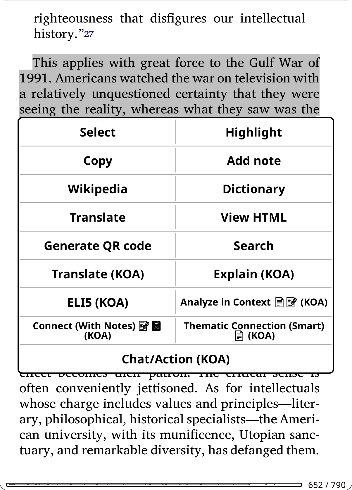
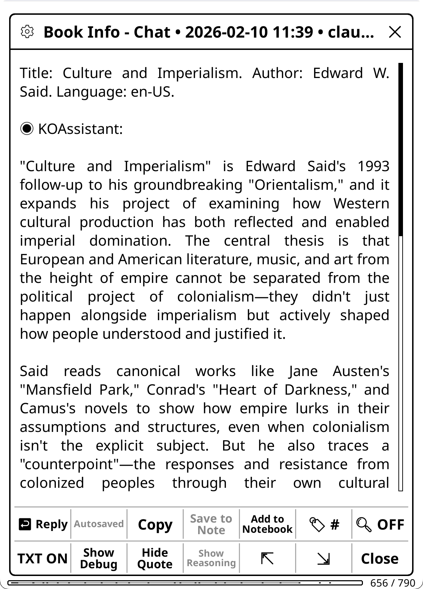

# Contexts and Chat

KOAssistant works in four contexts: a passage you highlight, a book, your library, and a general chat with no book. Each context has its own built-in actions and opens the same kind of input dialog, where chips set up this one chat, buttons run actions, and Send asks your own question.

## The four contexts

| Context | How you start it | Built-in actions |
|---|---|---|
| **Highlight** | Select text in a book, then tap **Chat/Action (KOA)** in the highlight menu. See [Highlight mode](#highlight-mode) | Explain, Quick Explain, ELI5, Summarize, Elaborate, Connect, Connect (With Notes), Explain in Context, Analyze in Context, Thematic Connection, Fact Check, Counterpoint, Current Context, Translate, AI Wiki, Grammar, Dictionary, Quick Define, Deep Analysis, Look up in X-Ray, Generate Image |
| **Book** | Long-press a book in the file browser, then **Chat/Action (KOA)**; while reading, Settings → Book Chat/Action or a gesture. See [Book/document mode](#bookdocument-mode) | About, Find Similar, Suggest from Library, About Author, Historical Context, Related Thinkers, Reviews, X-Ray, X-Ray (Simple), Recap, Analyze Notes, Key Arguments, Counterarguments, Discussion Questions, Quiz, Reading Guide, Document Analysis, Document Summary, Extract Key Insights |
| **Library** | Settings → Library Chat/Action, the Quick Settings panel, a gesture, or several books selected in the file browser. See [Library mode](#library-mode) | Next Read, Discover New, Analyze Library, Challenge My Taste, Compare, Find Common Themes, Analyze Collection, Quick Summaries, Reading Order, Recommend, Analyze Notes |
| **General** | Settings → General Chat/Action, the Quick Settings panel, or a gesture. See [General chat](#general-chat) | News Update |

- **Twelve actions work with your library:** the eleven library actions (four scan-based, seven that work on books you select) and Suggest from Library, a book action that uses library data.
- **Fact Check, Current Context, Reviews and News Update use web search**, which works with Anthropic, Gemini, OpenAI, OpenAI Subscription, xAI, Perplexity, OpenRouter, Z.AI and Qwen. See [Reasoning, Web Search and Book Tools](Reasoning-Web-Search-and-Book-Tools).
- What the other actions need is in each context's table below. You can change these actions, create your own, or turn off the ones you don't use: see [Actions and Menus](Actions-and-Menus).

## Highlight mode

Select text in a document and tap **Chat/Action (KOA)** in the highlight menu. The [input dialog](#managing-the-input-dialog) opens with the highlight actions. There you can also add extra instructions to any action before it runs (for example "esp. the economic implications" or "in simple terms").

Two faster routes skip the dialog:

- **Actions in the highlight menu.** Frequently used actions can sit in KOReader's highlight menu as buttons of their own, such as "Explain (KOA)" or "Translate (KOA)". Add one in the Action Manager: hold the action, then **+ Highlight Menu**. The other enabled highlight actions stay one tap away behind **Chat/Action (KOA)**. See [Actions and Menus](Actions-and-Menus).
- **Highlight bypass.** Runs your chosen action as soon as you select text, with no menu at all: Settings → Highlight Settings → Enable Highlight Bypass, and the Bypass Action row below it (Translate by default). See [Setup, Gestures and Panels](Setup-Gestures-and-Panels).

### Highlight actions

| Action | What it does |
|---|---|
| **Explain** | Detailed explanation of the passage |
| **Quick Explain** | A short explanation meant to land in the [minimal popup](Chat-Windows) rather than the full window. In the highlight menu by default |
| **ELI5** | Explain Like I'm 5: a simplified explanation |
| **Summarize** | Concise summary of the text |
| **Elaborate** | Expands on concepts, with additional context and details |
| **Connect** | Draws connections to other works, thinkers, and broader context |
| **Connect (With Notes)** | Connects the passage to your personal reading journey. ⚠️ *Requires: your highlights or annotation notes (asked the first time); your notes and notebook go along when annotation notes and the notebook are allowed* |
| **Explain in Context** | Comprehension-focused: what the passage means, what leads up to it, and what it builds on. Source selection: full text, summary, AI knowledge, or Smart retrieval |
| **Analyze in Context** | Reader-focused: connects the passage to your highlights, annotations, and the threads you've been tracking. Source selection: full text, summary, AI knowledge, or Smart retrieval. ⚠️ *Best with: annotation notes and the notebook allowed* |
| **Thematic Connection** | Craft-focused: the author's technique (language, structure, imagery) and how the passage fits into the work's thematic architecture. Source selection: full text, summary, or AI knowledge |
| **Fact Check** | Verifies claims using web search. ⚠️ *Requires: Web Search* |
| **Counterpoint** | Argues against the passage in good faith and at full strength: the strongest objections to its claim, reasoning and framing, and who would disagree. (Fact Check verifies accuracy; Counterpoint challenges the argument.) |
| **Current Context** | The latest information about a topic, using web search. ⚠️ *Requires: Web Search* |
| **Translate** | Translates to your configured language |
| **AI Wiki** | A Wikipedia-style encyclopedia entry about the selected text, from AI knowledge. Saved as an artifact (like the X-Ray browser's wiki entries). Uses web search when it is on globally. In the dictionary popup by default |
| **Dictionary** | Full dictionary entry: pronunciation, definitions, etymology, synonyms (also in the dictionary popup and, by default, the highlight menu) |
| **Quick Define** | Minimal lookup: a brief definition only, no etymology or synonyms |
| **Grammar** | Plain-language grammar breakdown of the selected text: how the clauses fit together, the role of each significant word or phrase, and anything irregular (with the technical term in parentheses, and the native grammatical tradition's terms for languages that have one). Not placed in any menu by default; add it from the action managers |
| **Deep Analysis** | Linguistic deep-dive: morphology, word family, cognates, etymology path |
| **Look up in X-Ray** | Local, no AI call, works offline: searches the book's X-Rays (the main one and section X-Rays) by name and alias for the selected text. An exact match opens that entry (or its compact entity card first), several entries with the same name give a short chooser, and partial matches open a results list grouped by X-Ray. In the highlight menu and the dictionary popup, only when the book has an X-Ray. See [Using X-Ray](Using-X-Ray) |
| **Generate Image** | Turns the selected text into an image (below) |

**Generate Image** is a highlight action like the others, last in the highlight menu by default, but it goes to an image-generation provider (OpenAI, xAI, Gemini or OpenRouter) instead of the chat pipeline, with its own provider, model and settings. Its **Generate Image (KOA)** button shows when the image provider in effect can generate images and has an API key, or, while the image Provider setting is on Follow main provider and your chat provider cannot make images, when any image provider has a key (the first tap asks which one to use), and you place it from the Highlight Menu manager like any other highlight action. Where images are kept, the Generated Images gallery and each book's images: [Image Generation](Image-Generation).

**What the AI sees:** your highlighted text, plus the document's metadata (title and author, as set by [Book info](Privacy-and-Data#what-gets-sent); Translate, Dictionary, Quick Define, Deep Analysis and Grammar leave it out). Explain in Context and Analyze in Context also use extracted document text to understand the surrounding content. Custom actions can use reading progress, chapter info, your highlights and annotations, the notebook, and extracted book text, depending on the action's settings and your [privacy settings](Privacy-and-Data). See [Template Variables](Template-Variables).

### Surrounding context

Surrounding context sends a bounded window of text around your selection with highlight questions and actions, so the AI sees the passage in context. Choose it in Settings → Highlight Settings → Surrounding Context: **None** (the default), **Sentence**, **Paragraph(s)**, or **Characters**, hard-capped at 2000 characters. Paragraph mode trims to a sentence boundary rather than mid-word. Dictionary lookups and actions with their own scope selection are not affected. Whether this text may go at all is the **Text around what you tap** value (Settings → Privacy & Data; Allow by default): on Ask the request asks first, and under Never the window is left out.

The rows below it in Highlight Settings tune the window:

- **Context Paragraphs:** paragraphs on each side in Paragraph(s) mode, 1 to 5 (default 1, the paragraph that holds the highlight).
- **Context Characters:** characters before and after the highlight in Characters mode, 20 to 1000 (default 100).
- **Context Direction:** **Both sides** (default) or **Before the selection only**. It also limits the context of every dictionary lookup ([Dictionary and Translation](Dictionary-and-Translation#the-text-after-the-word)).
- **Context Under Spoiler Protection:** how far past the selection the context may reach while [spoiler protection](Spoiler-Protection) is on: Nothing after the selection, To the end of its sentence, **To the end of its paragraph** (default), or No limit. Spoiler protection is on by default, so this shapes what is sent in the normal case. It limits the context of dictionary lookups the same way.

The mode can be set per book ([Book Settings and Book Hub](Book-Settings-and-Book-Hub)). The amount, the direction and the spoiler limit are global, and the **Ctx** chip changes all of them for one chat ([Session controls](#session-controls-chips)); it can also attach a range of book text.

## Source selection

Several actions let you choose what the AI works from before they run. One popup combines the **scope** (what part of the book) and the **source** (what data to send).

**Scope.** The rows shown depend on the action, whether the book has a table of contents, and your reading position.

- **Full document:** the entire document. For actions that already stop at your reading position (like Recap), this row reads **Up to current position (NN%)** instead.
- **Up to current position (NN%):** for whole-document actions, limits the scope to what you have read so far (spoiler-safe). Offered from 1% of the book to about 98%.
- **Pick section…:** a chapter or part from a hierarchical table-of-contents picker. The section's name appears below the scope buttons. Section results are saved as their own artifacts (for example "Section Key Arguments: Chapter 5").
- **From section… (to NN%):** from a section you pick up to your reading position.
- **Pick section range…:** a start section and an end section.
- **Current chapter** and **Current chapter so far:** Quiz only.

**Source.**

- **Extract text:** sends the actual document text. Most accurate, but uses more tokens. Grayed out only when book text is set to Never; on Ask, the Run button asks first. Scoped to a section, only that section's text is extracted.
- **Summary:** uses a saved summary (about 2-8K tokens) instead of the raw text. Much cheaper for repeated use or follow-up conversations. The row offers **Use existing summary** when the book has one, and **Generate summary** (one-time, reusable by other actions) when it has none and book text is not set to Never; under Never it is grayed out. Scoped to a section, it uses that section's summary when there is one, and otherwise offers the whole document's summary or to generate a section summary. A whole-document summary cannot be cut at a position, so the row is grayed out for Up to current position, From section… and section ranges.
- **Smart retrieval (AI searches the book):** on Explain in Context and Analyze in Context. Instead of extracting a fixed span, the AI uses the local book tools to gather the passages it decides are relevant, and those replace full-text extraction. It works with the Full document or Up to current position scope (the scope bounds what the tools may read); a section scope turns it off. It needs the book's text (asked on the Run button the first time, or a trusted provider) and a provider that can run book tools; with the text set to Never, or an unsupported provider, the row is grayed out with the reason. When it is available it is the default pick, unless the dialog you started from has its Tools chip off. See [Reasoning, Web Search and Book Tools](Reasoning-Web-Search-and-Book-Tools).
- **AI knowledge only:** no document data is sent; the AI uses its training knowledge of the work. Free and fast, but less accurate for obscure works.

**Actions with source selection:** Explain in Context, Analyze in Context, Thematic Connection, Key Arguments, Counterarguments, Discussion Questions, Quiz, Reading Guide, Extract Key Insights, Document Summary, Document Analysis, Recap.

- For the three highlight actions (Explain in Context, Analyze in Context, Thematic Connection), the scope sets which part of the book's text is extracted alongside the highlighted passage; they get the same scope rows as book actions.
- Document Summary and Document Analysis require text extraction: the other sources are grayed out.
- Recap can't be pointed at an arbitrary section or range (a catch-up always runs up to where you are), but From section… is offered.

**Spoiler protection in the popup.** While [spoiler protection](Spoiler-Protection) is on for the book, or switched on with the dialog's Spoiler chip for this chat, the popup preselects **Up to current position** instead of Full document whenever that row exists, and running a scope that covers text you haven't read yet asks once ("This covers parts you haven't read yet.") before it sends. The chip switched off lifts both for that run.

**When to use each source:**

- **Full text:** short to medium documents, one-off queries, when you need the AI to work from the actual text.
- **Summary:** longer documents, repeated queries, extended conversations, when token cost matters.
- **Smart retrieval:** long documents where you want targeted passages instead of one big extraction, and the AI to decide what is relevant to your question.
- **AI knowledge:** well-known works the AI has good training data on, quick queries, where nuance and bias matter less.

**How sources change the answer.** These aren't just quality tiers; they change *how the AI thinks*. When you provide the actual text, the AI shifts from recall to analysis. Instead of (only) reconstructing a work from memory, filtered through whatever patterns, emphasis and blind spots its training absorbed, it analyzes the material in front of it: parsing structure, tracing arguments, finding patterns in what is actually written. Training-era biases and editorial slant matter less (but still matter) when the AI works from your text rather than its pre-trained impressions of it.

With AI knowledge only, the AI gives you its "remembered take" on a work, shaped by which reviews, summaries and discussions dominated its training data. For canonical works this is often good enough. But for anything where framing matters (political texts, contested histories, philosophical arguments, new research), the difference between "analyze this passage" and "tell me about this work" can be substantial.

**In short:** text extraction gives the AI a job to do on specific material; AI knowledge asks it what it thinks it knows.

For documents you'll query many times, generate the summary ahead of time with the Document Summary action. Opening a saved summary or any other artifact (from Quick Actions, View Artifacts or a gesture) is covered in [Artifacts and Caching](Artifacts-and-Caching).

## Book/document mode

Long-press a book in the file browser and tap **Chat/Action (KOA)**, or, while reading, use Settings → Book Chat/Action or a gesture (KOAssistant: Book Chat/Action).

Some actions work from the file browser, using the document's metadata (title, author) and what is saved with the book (highlights, notes, notebook, reading progress); others need the book open, because they read its text or use the scope and source popup. Those are hidden in the file browser.

- **One-tap buttons in the file browser.** Action Manager → hold an action → **+ File Browser** pins it to the long-press menu, so it runs without the action selector. All the file browser buttons (utilities, pinned actions and Chat/Action) are spread over rows of up to 4. Long-press a pinned button to run it once another way (on another model, for example), or for its description, **Remove from the file browser menu**, the editor, and its other placements under **More…**, with no trip to the Action Manager. See [Actions and Menus](Actions-and-Menus).
- **A book that is not open.** A chat about a book other than the open one (from the file browser, a Book Hub, a group's page or the artifact browser) belongs to that book. Its dialog reads "KOAssistant: Book (not open)" and offers the closed-book actions; the chat uses that book's title, settings and saved reading position and is saved with it, as are the artifacts it makes (X-Ray (Simple), for example). Book tools stay off there, since they can only search the open book.
- **Book Hub** gathers one book's artifacts, chat, chat history, notebook, group and settings on one full-screen page: see [Book Settings and Book Hub](Book-Settings-and-Book-Hub).

### Book actions

| Action | What it does |
|---|---|
| **About** | Overview, significance, and why to read it |
| **Find Similar** | Recommendations for similar works. When Library Scan is allowed, notes which ones you already own |
| **About Author** | Author biography and writing style |
| **Historical Context** | When it was written and its historical significance. Adapts to the work type (novel, manifesto, religious text, research paper) |
| **Related Thinkers** | Intellectual landscape: influences, contemporaries, and connected thinkers |
| **Reviews** | Critical and reader reviews, awards, and reception. ⚠️ *Requires: Web Search* |
| **X-Ray** | Browsable reference guide built from the book's text: entries with aliases and connections, search across all X-Rays, mentions per chapter, AI Wiki entries, section X-Rays, local lookup, automatic upkeep, checkpoints and version history. ⚠️ *Requires: book text (asked the first time)*. See [Using X-Ray](Using-X-Ray) |
| **X-Ray (Simple)** | Prose companion guide from AI knowledge: characters, themes, settings, key terms. No text extraction needed. Uses reading progress to avoid spoilers |
| **Recap** | "Previously on..." style summary to help you resume reading. Source selection: extracted text (with incremental updates) or AI knowledge. Hidden flows limit its scope ([Using X-Ray](Using-X-Ray)). ⚠️ *Best with: book text allowed* |
| **Analyze Notes** | Patterns and connections in your notes and highlights. ⚠️ *Requires: your highlights or annotation notes (asked the first time; your notes go along only when annotation notes are allowed)* |
| **Key Arguments** | Thesis, evidence, assumptions, and counterarguments. Source selection: full text, summary, or AI knowledge. Supports section scope |
| **Counterarguments** | Prosecutes the case against the work: steelmanned opposing positions, the argument's weakest links, what would falsify it, and who disagrees and why. (Key Arguments maps the argument; this one argues back.) Source selection: full text, summary, or AI knowledge. Supports section scope. Saved as an artifact |
| **Discussion Questions** | Comprehension, analytical, and interpretive prompts. Source selection: full text, summary, or AI knowledge. Supports section scope |
| **Quiz** | Interactive comprehension quiz, one question at a time with answer selection, scoring, and review. Multiple choice (auto-graded), short answer and discussion (self-graded). Triggered at chapter ends (configurable) or run from Quick Actions with a scope picker; question types, count and difficulty are set in Settings. Saved as an artifact. Source selection: full text, summary, or AI knowledge. Supports section scope. See [Reading Analysis Actions](Reading-Analysis-Actions) |
| **Reading Guide** | Spoiler-free guide to what's ahead: threads in motion, patterns to notice, helpful background, how to approach the rest. Uses your reading position to stay safe. Source selection: full text, summary, or AI knowledge. Supports section scope |
| **Document Analysis** | Deep analysis: thesis, structure, key insights, audience. Saved as an Analysis artifact. Supports section scope. ⚠️ *Requires: book text (asked the first time)* |
| **Document Summary** | Comprehensive summary, saved as a Summary artifact that other actions can use as their document source. Supports section scope. ⚠️ *Requires: book text (asked the first time)* |
| **Extract Key Insights** | The most important takeaways: ideas worth remembering, novel perspectives, actionable conclusions. Source selection: full text, summary, or AI knowledge. Supports section scope |
| **Suggest from Library** | What to read next from your own library, based on the current book and your reading patterns. Also offered by the end-of-book popup. ⚠️ *Requires: Library Scan and a folder ticked for the run ([the folder window](Privacy-and-Data#the-folder-window))* |

**What the AI sees:** the document's metadata (title, author, and the DOI when one is detected). How much book information goes with freeform chats and book-aware actions is set in **Settings → Privacy & Data → Book info**: None, Title only, Title & author (the default), or Title, author & position, which adds reading progress, chapter and page when Reading position is on (a book that is not open sends its saved progress only). A book whose metadata has no title is named by its file name, as a file name: an action's context line says the metadata has no title and gives the name, and the action's own words say "this book" (an AI title set in Book Settings counts as a title). None sends nothing that names the book, the title in an action's own prompt included, so the actions that answer only from what the AI knows about the book (About, Find Similar, Reviews and the like) say they cannot run ([Privacy and Data](Privacy-and-Data#what-gets-sent)). For Analyze Notes: your annotations. For full-document actions: the entire document text. For Suggest from Library: your library catalog (title, author, series, reading status, and progress for the books you are reading or have on hold). For library scan actions, when reading habits are allowed: curated engagement groups (lists of books sorted by reading patterns; see [Privacy and Data](Privacy-and-Data)).

For academic texts, [Research Mode](Research-Mode) changes the prompts, the X-Ray and web search; it switches on by itself when a DOI is detected. What each reading-analysis action reads and which privacy setting it needs: [Reading Analysis Actions](Reading-Analysis-Actions).

## Library mode

Open Settings → Library Chat/Action, the **Library Chat/Action** tile in Quick Settings, or a gesture (KOAssistant: Library Chat/Action): you land straight in an input dialog with all library actions. File-browser multi-select works too: in KOReader's select mode (long-press a book, then **Select**, and tap the others), open the selection menu (the check mark at the top right, or a long-press) and tap **Compare with KOAssistant**, its last button.

The library dialog splits its actions into two zones, each with its own button.

**Library Scan zone.** Scan-based actions under a **Library Scan ▾** button that manages folders. The button counts the folders in use, and its popup switches your default scan folders off or on for this session, lists the folders you added on the fly before (the last five, unticked; a tap adds one for this dialog) and adds folders for this session only (**+ Add Folder…**, which also remembers the folder among those recent ones; it never becomes a default folder). The pick lasts while the dialog is open: a new library dialog starts from your default scan folders, and with every folder unticked no list is sent. The zone shows by default so you can discover these actions; they need Library Scan not set to Never (Settings → Privacy & Data → Library Scan, also in Settings → Reading & Library) and a folder ticked here (default folders in Settings → Reading & Library → Default Scan Folders start ticked): until one is, they stay grayed out. On Ask, a run asks first and names the ticked folders; on Allow it just runs ([Privacy and Data](Privacy-and-Data#the-folder-window)). While Library Scan is Never the actions stay grayed out, and tapping **Library Scan ▾** shows a notice that names the setting. To hide the zone, use the gear menu → **Hide Library Scan Actions**.

| Action | What it does |
|---|---|
| **Next Read** | What to read next from your library, including books worth revisiting or picking back up, based on reading patterns, what you've finished, and what has been sitting unread. When reading habits are allowed, includes engagement context (stalled reads, briefly started books) |
| **Discover New** | Suggests new books based on your library: identifies your taste and recommends works you don't have, including a few picks outside your comfort zone ("Expand your horizons"). When reading habits are allowed, includes deep reads and recently finished books for better taste inference |
| **Analyze Library** | The genres and authors you gravitate toward, completion patterns, and gaps in your collection. When reading habits are allowed, includes full engagement data for richer pattern analysis |
| **Challenge My Taste** | Critiques your reading pattern rather than celebrating it: where your library is one-sided, which voices are missing, and what a sharp critic of your shelf would say, ending with a few books that would argue with it. When reading habits are allowed, includes engagement patterns |

**Items zone.** Selection-based actions under an **Items ▾** button. They need two or more selected books and stay grayed out until then; long-press a grayed-out button to see what it does.

| Action | What it does |
|---|---|
| **Compare** | What makes each work distinct: contrasts, not just similarities |
| **Find Common Themes** | Shared DNA: recurring themes, influences, connections |
| **Analyze Collection** | What this selection reveals about the reader's interests |
| **Quick Summaries** | A brief summary of each work |
| **Reading Order** | Suggests an order based on dependencies, difficulty, themes |
| **Recommend** | Suggests 5-8 new works based on patterns across your selected works. When Library Scan is allowed, notes which recommendations you already own and prioritizes unread books |
| **Analyze Notes** | Highlights, annotations and notes across the selected books: patterns in what you mark, what you write, and how your thinking connects across works. ⚠️ *Requires: your highlights or annotation notes; one question for the set, and each book's own value still applies* |

**Selecting books.** **Items ▾** offers presets (**Currently Reading**, **Recently Finished**, **On Hold**, **Last 5 from History**), **From a Group…** when you have groups, **Browse History…** and **Browse Folder…**; once books are selected, also **View/Edit Items (N)** and **Clear Selection**. Inside the book picker, its menu switches between history, folder and (if you have KOReader collections) collection sources without closing, and your selections persist across the switches. The picker's title shows how many books are selected, and so does the dialog's title.

**Freeform chat** works too: type a question and tap Send. With a folder ticked under **Library Scan ▾** (your default scan folders start ticked) and Library Scan not set to Never, the library catalog goes along as context (on Ask, the Send asks first and names the folders; with no items selected the catalog is the chat's only context, so there is no Continue without), and so do the selected items; Send stays grayed out until there is one or the other. Your library scan is sent only where it is allowed, judged for the provider the message actually goes to; a notice says so when it is left out. The input hint rotates suggestions ("What should I read next?", "How do these books connect?", "A book I've been neglecting").

**What the AI sees:** for scan-based actions, library catalog metadata (title, author, series, reading status, and progress for the books you are reading or have on hold). For selection-based actions, the selected titles and authors. Actions with sidecar flags (Analyze Notes, for example) also read each book's highlights, annotations and notebook entries from its sidecar files, with the same privacy double-gating as single-book actions, annotations degrading to highlights included; a warning appears when that data is large. Library scanning is explained in [Privacy and Data](Privacy-and-Data).

## General chat

Open Settings → General Chat/Action, the **General Chat/Action** tile in Quick Settings, or a gesture (KOAssistant: General Chat/Action; easier).

A free-form conversation without document context. If you start it while a book is open, that "launch context" is saved with the chat so you know where you launched it from, but it doesn't affect the conversation: the AI doesn't see where you launched it, and the chat is saved with your general chats.

| Action | What it does |
|---|---|
| **News Update** | Today's top news stories from Al Jazeera, with links. ⚠️ *Requires: Web Search* |

News Update is in the gesture menu by default but not in the general input dialog; to add it there, see [Actions in the input dialog](#actions-in-the-input-dialog). It shows the per-action web search override (`enable_web_search = true`): even with web search off globally, this action uses it. See [Reasoning, Web Search and Book Tools](Reasoning-Web-Search-and-Book-Tools).

> **Tip:** general-context actions can see their own recent saved results through the `{previous_results_section}` placeholder, which lets you build "repeating" actions that continue where they left off (a running journal, a rolling news digest). It reads the assistant replies of your most recent saved general chats of that same action, so you need saved chats for it. See [Template Variables](Template-Variables).

## Managing the input dialog

Every context opens an input dialog. Its title names what you're chatting about: "KOAssistant: Highlight", "KOAssistant: Book", "KOAssistant: Book (not open)", "KOAssistant: X-Ray Chat", or "Library Chat/Action" with the selected count; general chat keeps the generic "KOAssistant Actions". A close X sits on the right of the title bar and a gear icon on the left.

Under the text field come, in order:

1. **The chips and Send**, sharing the first row. The [session chips](#session-controls-chips) control this chat; the row's font shrinks as it fills.
2. **The action buttons**, two per row, chosen per context ([Actions in the input dialog](#actions-in-the-input-dialog)). The library dialog groups them in two zones ([Library mode](#library-mode)).
3. **Two utility buttons** when they apply: **View Artifacts** (books with saved artifacts) and **Group** (books in a group; it opens the group's members). Both can be turned off in Settings → Menus & Buttons → Input dialogs (Show View Artifacts button, Show Group button).

**Send** sends what you typed as a freeform chat, without an action template. On a highlight, Send with nothing typed discusses the selected text, and in a book chat it sends the book's details on their own; in general and library chats it asks you to type something first. Long-press **Send** to send with another model or without reasoning (your model buttons, **No reasoning** and **More models…**); the pick stays for the rest of that chat.

**Action buttons** run on a tap. Long-press one to run it once another way (on top of this dialog's chips), or for its description, **Add to this input dialog** / **Remove from this input dialog**, the editor, and its other placements under **More…**: see [The action hold menu](#the-action-hold-menu).

**Your typed text is kept.** Sending, running an action with typed text, or closing the dialog keeps a copy for this session, and **Restore last input** in the gear menu puts it back (after anything you have typed since). When a send fails or is cancelled, the message points you there.

### The gear menu

- **Your model**, first: 🤖 and its name (or "Model: …" without emoji icons). Tap it for your [favorite models](Providers-and-Models), recent picks and **More models…**. A pick changes your model, as the highlight menu's model button does, and the dialog reopens on it.
- **Quick Settings:** the streamlined settings panel ([Setup, Gestures and Panels](Setup-Gestures-and-Panels)).
- **Choose and Sort Actions…:** reorder, show or hide the actions of this dialog's context.
- **Show More Actions…:** expands the grid to every enabled action for this context; it reads **Show Fewer Actions** once expanded.
- **Restore last input:** shown when there is typed text to restore.
- **Toolbar Buttons…:** which session chips appear ([Choosing which chips appear](#choosing-which-chips-appear)).
- **Book Settings** (book and highlight chats): per-book overrides for the book you're chatting about ([Book Settings and Book Hub](Book-Settings-and-Book-Hub)).
- **Send book info** (book and highlight chats about the open book; not in the closed book's dialog, whose actions answer from what the AI knows and cannot run without the title): checked when the book info goes with this dialog's messages and the actions run from it. Tap it to switch for this dialog and the chat it starts (off sends nothing that names the book, as Book info set to None does, and an action that cannot run without the title says so; on sends the title and author even where None is set). The switch ends when the dialog closes. Hold it for the setting itself, For this book or Global ([Privacy and Data](Privacy-and-Data#what-gets-sent)).
- **Hide Library Scan Actions** (library chats; **Show Library Scan Actions** brings them back).

### Actions in the input dialog

| Context | Default actions |
|---|---|
| **Highlight** | ELI5, Elaborate, Connect, Fact Check, AI Wiki, Counterpoint, Explain in Context, Translate, Explain, Summarize |
| **Book** | About, Find Similar, Key Arguments, Counterarguments, Extract Key Insights, Discussion Questions, About Author, Reviews |
| **Closed Book (file browser)** | About, Find Similar, Analyze Notes, Related Thinkers, About Author, Historical Context, Reviews, Suggest from Library, X-Ray (Simple) |
| **X-Ray Chat** | Explain, Elaborate, ELI5, Fact Check, Connect |
| **Library** | Next Read, Discover New, Analyze Library, Challenge My Taste, Compare, Find Common Themes, Analyze Collection, Quick Summaries, Reading Order, Recommend, Analyze Notes |
| **General** | None: use Send for freeform chat |

X-Ray Chat is the chat that "Chat about this" opens from an X-Ray entry ([Using X-Ray](Using-X-Ray)); Explain in Context and Analyze in Context are not offered there.

All defaults can be changed: add, remove or reorder actions for each context on its own. The other enabled actions stay reachable through **Show More Actions…**, a button at the end of the grid (except in general chat) and a row of the gear menu.

To change which actions appear:

- **In the dialog:** gear icon → **Choose and Sort Actions…**.
- **In the Action Manager** (Settings → Actions & Prompts → Manage Actions): hold an action → **+ Input Dialog** adds it to its context's dialog.
- **For any context:** Settings → Menus & Buttons → Input Dialog Actions, then pick Book, Closed Book, Highlight, X-Ray Chat, Library or General.

The general input dialog shows only actions you have added; it starts empty. To add one, open Settings → Actions & Prompts → Manage Actions, find the action under the **General Context** heading, hold it, and tap **+ General Input**.

Actions that need web search, such as News Update, are in the gesture menu by default but not in the input dialog, so readers without a provider that can search don't see them. Add them as above if your provider can search ([which ones can](#the-four-contexts)).

## Session controls (chips)

The first row of buttons under the text field holds the **chips**, followed by **Send**. Each chip controls one part of the request for this chat. Their order is fixed (Domain, Web, Tools, Quick, Scope, Attach, Spoiler), but you choose which ones show. Most chips follow one pattern: **tap** changes the value for this chat, **long-press** opens the saved default behind it, for this book or for all books. Closing that picker sets the chip back to the saved default, including any change you just made there. Chips that don't apply to a chat are hidden.

| Chip | Shown in | Tap | Long-press |
|---|---|---|---|
| **Domain** 🏛️ | Every chat | Opens the domain picker, with its For this book / Global switch; a pick is saved, not only for this chat | No separate menu |
| **Web** 🌐 | Every chat | Web search on or off for this chat; explains instead when your provider can't search | Web Search picker: On / Off, for this book or global, with a Search depth row |
| **Tools** 🔍 | Book and highlight chats about the open book | AI Book Tools on or off for this chat | AI Book Tools picker: On / Off, for this book or global, with Lookup effort and Read short texts whole rows |
| **Quick** ⚡ | Every chat | Quick Answer on or off for this chat | Quick Answer Default picker, with **Preset settings…** on top |
| **Scope** 🎯 / **Ctx** | Book and highlight chats about the open book (not X-Ray chat) | Book chats: pick book text to send along. Highlight chats (**Ctx**): the surrounding context for this chat | Book chats: the same picker. Highlight chats: the per-book / global surrounding-context picker |
| **Attach** 📎 | Every chat, X-Ray chat included | Stage extra material for this chat | Manage what is staged |
| **Spoiler** 🛡️ | Book and highlight chats | Spoiler protection on or off for this chat | Spoiler Protection picker, for this book or global |

The icons show with Settings → Display Settings → Emoji → Emoji Menu Icons; without them the chips spell it out ("Web ON", "Tools OFF", "Quick ON", "Spoiler Protection ON").

- **Domain** shows the active domain's name (with none set: "🏛️ None", or "Domain" without emoji icons) and opens the [domain](Prompts-Behaviors-and-Domains) picker with its For this book / Global target. The same picker holds the Research Mode switch ([Research Mode](Research-Mode)); while Research Mode is on for the book or globally, the chip shows 🔬 instead of 🏛️ (or "(research)" before the name).
- **Web** reads ON or OFF, or **N/A** when your provider or model can't search (a tap then explains and names the providers that can). The tap is a session toggle: it applies to freeform Send and to actions launched from this dialog, but doesn't change your saved web search default, and actions that always or never search keep that. Long-press for the For this book / Global picker with its Search depth row. See [Reasoning, Web Search and Book Tools](Reasoning-Web-Search-and-Book-Tools).
- **Tools** shows only in book and highlight chats about the open book. It reads ON or OFF when tools can run and **N/A** when they can't in this chat; a tap explains why (book text set to Never, a provider without book tools, or an X-Ray chat, where tools are off by design). With book text on Ask the chip works, and the Send asks before the tools read anything. It also reads N/A while a Scope pick is active, because that pick already sends book text (the Scope pick wins for that send). The long-press picker's rows are explained in [Reasoning, Web Search and Book Tools](Reasoning-Web-Search-and-Book-Tools).
- **Quick** reads ⚡ ON or OFF ("Quick ON" or "Quick" without emoji icons). A tap applies the Quick Answer posture ([below](#quick-answer-and-its-preset)); when that turns web search or book tools off (or back on), a short note says so. Long-press opens the **Quick Answer Default** picker (whether the chip starts on in a new dialog, for this book or for all books), with a **Preset settings…** row for the bundle itself. In general and library chats the Web and Quick pickers offer Global only, since there is no book.
- **Scope** (book chats) sends a slice of the book's text with your typed message: **No book text (metadata only)**, **Current page** (the text around what you tap, allowed by default), **Up to current position (NN%)**, **Current chapter**, **Current chapter (to current position)**, **From section… (to current position)**, **Pick section range…**, or **Choose section…**. Everything except Current page is book text: on Ask the Send asks the first time, and under Never a tap on those rows explains why instead of picking (a trusted provider follows its own column). If a pick reaches beyond your position while spoiler protection is on, you get a confirm box instead of a refusal, and consenting also stands the spoiler reminder down for that one send; a section or range that starts before your position and ends after it is trimmed to your position when you send. The pick turns into text when you tap Send (a Cancel on the large-extraction warning keeps your typed input), and it lasts for this dialog only: a fresh dialog starts without it. The chip shows a count ("Scope (1)").
- **Ctx** (highlight chats) sets the surrounding context that rides with your selection for this chat (**Off**, **Sentence**, **Paragraph**, **Characters**), overriding the default from [Surrounding context](#surrounding-context). The label counts what goes along ("Ctx off", "Ctx (2)"). AI Wiki always sends the sentence around the selection, Off or not: it needs it to know which topic you mean. The tap popup also has an amount button on the picked mode (paragraphs 1 to 5, characters 100, 250, 500 or 1000), a **Direction** row and, while protection is on, an **Under spoiler protection** row, both for this chat, and **Also send book text...**, which opens the same range picker as the Scope chip. Long-press opens the persistent per-book / global picker.
- **Attach** stages extra material that rides *alongside* your messages, as its own context message rather than as your question: **Notebook (this book)** (book and highlight chats; asks first when the notebook is on Ask, refused under Never), **Artifact…** (any saved or pinned artifact; the current book's first, with an "All books…" option), **Chat…** (a saved chat), **Text file…** (a `.txt` or `.md` file in UTF-8; a file in another encoding is refused with a notice), and **Note…** (a free-text note such as "this is the 2nd edition" or "I'm reading this for a course"). The chip shows the count; long-press manages or removes staged items (with nothing staged it opens the same menu as a tap). It works in every input context, X-Ray chat included. An attached notebook is checked again at each send against the provider the message goes to, and left out with a notice where the notebook is not allowed for it. Attachments ride chats and plain actions only, never an action that writes an artifact or the dictionary and translate actions: such an action drops what is staged and says so, so nothing rides the first reply of its result's chat. An artifact or pinned answer carries what it was built from: attaching it asks for those kinds when they are on Ask, and it is left out of a message to a provider they may not go to, with a notice.
- **Spoiler** shows only in book and highlight chats and turns [spoiler protection](Spoiler-Protection) on or off for this chat without changing your settings; it starts in whatever state the book's or the global setting gives. Long-press opens the per-book / global picker.

The reply window has a shorter chips row of its own (Web, Tools when it applies, Quick, Attach): see [Chat Windows](Chat-Windows).

### Quick Answer and its preset

Tapping the **⚡ Quick** chip applies a configurable bundle to the chat: a brevity nudge, reasoning off, web search off and book tools off; each part can be turned off in the preset. Quick shapes your typed messages and the actions made for it (Explain, Quick Explain, ELI5, Elaborate, Explain in Context); other actions run as usual. All five are highlight actions, so in a book, library or general chat the chip reaches your typed messages and their replies only; the ⚡ mark on a button (Emoji Data Access Indicators) shows which buttons take it. If you tap the Web or Tools chip while Quick is on, that choice is pinned and the preset no longer overrides it for this chat.

Set up the bundle in Settings → Chat & Export Settings → Quick Answer Preset (also from the chip's long-press → **Preset settings…**):

- **Quick Answer On by Default:** start new chats with the chip already on (default off). It also runs the five actions that take Quick (Explain, Quick Explain, ELI5, Elaborate, Explain in Context) as Quick from the highlight menu, gestures and the panels. Still overridable per chat, and per book from Book Settings or the chip's long-press.
- **Brevity nudge:** how strongly it asks for brevity: **Standard** (a short, direct reply with no preamble; the default), **Ultra-brief** (a hard ceiling of three short sentences), or **Off**.
- **Turn Reasoning Off** (default on): models that can't disable reasoning drop to their lowest level.
- **Turn Web Search Off** and **Turn Book Tools Off** (both default on).
- **Skip Domain Lens** and **Skip Book Background** (both default off): leave the domain, or the book's Background note, out of Quick chats.
- **Behavior:** keep the current one (default), its Mini variant ("Mini of current style"), a specific behavior (the built-in Terse suits Quick Answer), or none. Actions that pin a behavior are unaffected.
- **Model override:** Keep current (default), Fastest for provider, a tier of the active provider, or a pinned model; it applies to that chat only, and your default model is untouched. Custom providers keep the current model unless you have given them tier placements.

How Quick and reasoning interact is described in [Reasoning, Web Search and Book Tools](Reasoning-Web-Search-and-Book-Tools).

### Choosing which chips appear

Gear icon → **Toolbar Buttons…** lists the chips (Domain, Web search, Book tools, Quick controls, Scope & context, Attach, Spoiler protection) to show or hide. Only membership can change; the order is fixed. The choice applies to every input dialog and is saved in `features.session_chips`; a chip that can't appear in the current dialog is marked "(not in this view)". Chips that don't apply are hidden automatically: Tools and Scope need a chat about the open book, Spoiler a book or highlight chat.

## Quick UI features

### The action hold menu

A long press on any action button, here or on any other trigger surface (the Quick Actions panel, the highlight menu, the dictionary popup, the file browser buttons), opens one menu: the action's description, buttons that run it this one time another way (Quick answer, with or without the book info, another model, no reasoning, with or without web search), and below a double line the rows that change it for good (add to or remove from this menu, Edit…, its other placements). It is described on [Actions and Menus](Actions-and-Menus#the-action-hold-menu); the one-time model picks and what they carry through are on the same page.

### In the response window

The response window has its own page, [Chat Windows](Chat-Windows): its buttons and gear menu, quotes, links, the view modes, the Minimal Popup for short answers, text selection with **Add to reply**, and the Sources and Reasoning viewers. **Save to Note**, which keeps an answer as a KOReader note on your highlight, is [below](#save-to-note).

## Save to Note

**Save AI responses directly to your KOReader highlights.** When you work with highlighted text, the **Save to Note** button saves the AI response as a native KOReader note attached to that highlight, so explanations, translations and analysis join your reading annotations.

**How it works:**

1. Highlight text and run any KOAssistant action (Explain, Translate, and so on).
2. Review the response in the chat window.
3. Tap **Save to Note** (between Copy and Notebook).
4. KOReader's note editor opens with the response filled in.
5. Edit it if you like, then save: the highlight is created with your note attached.

**Key features:**

- **Native integration:** uses KOReader's standard highlight and note system.
- **Configurable content:** question + response (the default), last response only, the full chat with metadata, everything (debug), or ask every time. Set it in Settings → Chat & Export Settings → Content Format → Note Content; long-press the button to pick the format for one save.
- **Editable before saving:** review and change the response before you commit it.
- **Creates a permanent highlight:** the selected text becomes a saved highlight with the note attached. From the chat window and Translate View, KOReader extends that highlight to whole sentences in reflowable books, as its own Add note does; from the compact and dictionary windows it stays on the word.
- **Works with translations:** good for keeping translations alongside the original text.
- **In every view:** the chat window and Translate View have **Save to Note**; the compact and dictionary windows have a **+Note** button. The dictionary windows and Translate View have their own Note Content settings (Settings → Dictionary Settings → Note Content, Settings → Translate Settings → Note Content), which default to the answer alone.

**Use cases:** save explanations of difficult passages for later reference; keep translations alongside foreign text; build a glossary of term definitions within your book; annotate with AI-generated insights that become part of your reading notes.

**Note:** Save to Note works only in highlight chats (where you selected text). In book, library and general chats the button is grayed out.

## Related

- [Chat Windows](Chat-Windows): the response window, Minimal Popup, streaming, text selection and reply drafts.
- [Actions and Menus](Actions-and-Menus): manage, edit and create actions, and choose the menus they appear in.
- [Artifacts and Caching](Artifacts-and-Caching): summaries and other saved results, and the View / Update / Redo popup.
- [Spoiler Protection](Spoiler-Protection): what the Spoiler chip and the scope confirm protect, and how the reminder works.
- [Reasoning, Web Search and Book Tools](Reasoning-Web-Search-and-Book-Tools): what the Web and Tools chips switch on, and how Smart retrieval searches.
- [Privacy and Data](Privacy-and-Data): what each action may send, text extraction and library scanning.
