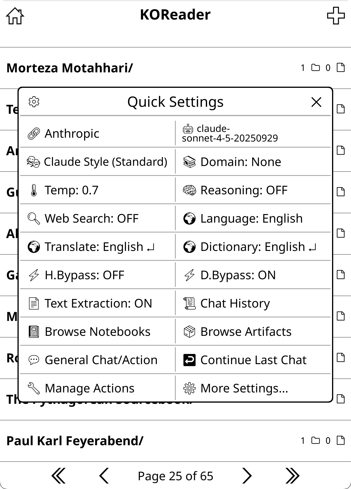
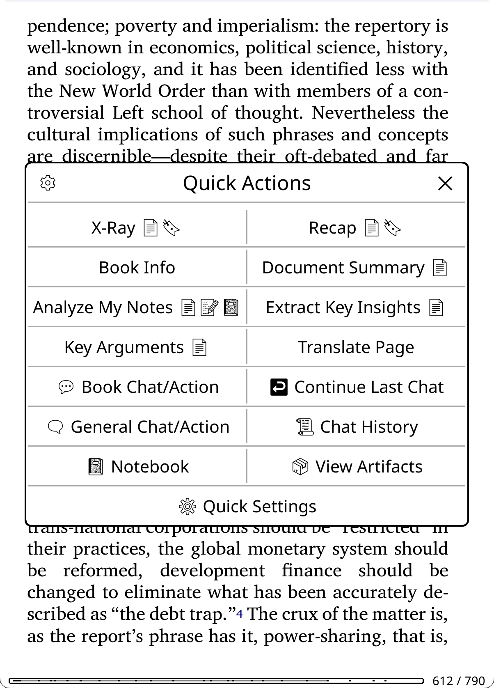

# Setup, Gestures and Panels

The Setup Wizard, a checklist for your first ten minutes, the two quick-access panels, gestures, and the bypass modes that run an action with no menu at all. If KOAssistant is not installed yet, start with [Getting Started](Getting-Started).

## Setup Wizard

The wizard has two faces, chosen the first time you open KOAssistant (its menu, or one of its actions) after installing or updating it:

**On a fresh install**, a welcome chain:

1. **Welcome**: what the next steps set up.
2. **Restore from backup**: offered only when a KOAssistant backup is found; **Set up fresh** goes on.
3. **Connect a provider**: pick a provider and paste its API key (the ten common ones are listed, Ollama among them, which needs no key; **Other providers…** has every other built-in one), then test the connection with one small request if you like. Signing in with the OpenAI subscription instead goes on with the wizard once the sign-in is done (Cancel comes back to the provider list). **Skip for now** leaves nothing working until a key is added in **Settings → API Keys & Auth**. Run again with a provider connected (the Connection topic of **Settings → Setup Wizard**), the step names what is connected and offers **Keep as it is** or another provider to add.
4. **Privacy**: the three presets of [Privacy and Data](Privacy-and-Data): **Default (Ask)**, **Allow everything**, **Block everything**, or **Decide later**.
5. **Language**: detects your KOReader UI language and asks whether to use it as your AI language; for English it offers to keep English or choose another ([Languages](Languages)).
6. **Icons**: installs the bundled emoji font when KOReader has none (a restart follows), then a display test that turns the emoji icons on if they render. **Settings → Display Settings → Emoji → Emoji Font** does the same at any time: it installs the font, and after the restart a tap on it runs the display test.
7. **Button marks**: KOAssistant's buttons sit beside KOReader's own in the highlight menu, the dictionary popup and the file browser's long-press menu, and a (KOA) mark at the end of their names tells them apart, which helps when several plugins add buttons there. **Show the mark** or **Hide the mark** sets all three places at once (**Settings → Menus & Buttons** has one box per menu for later).
8. **Open it fast**: one row per panel, **Quick Actions** (reader) and **Quick Settings** (file browser), each reading its gestures in the picker's order (tap corners first) or "not set"; tap a row to pick any KOReader gesture ([The wizard's gesture step](#the-wizards-gesture-step)). When the bottom-right corner is free in both modes, **Assign both to tap bottom-right corner** does it in one tap.
9. **Finish**: what was set, a restart note when the font or a gesture needs one, and **Open a chat**.

**After an update**, an update check: a note names what this version changed or added, with **Check now** and **Later**. Check now walks only those steps, each showing the current state with a choice to keep or change it, plus anything not set up yet (a provider, say, or the Button marks question when none of its boxes was ever touched). In this version: **Privacy** (redone: every sharing switch is Ask now, your books' own values and trusted providers kept; **Keep Default (Ask)** or pick a preset), **Icons** (with icons on and the font installed, nothing to check; with icons on and no font, the install offer; with icons off, an offer to turn them on, the font installing with them) and **Open it fast** (your two panels' gestures, **Keep as they are** or tap one to change it). The check runs once per version; Later never asks again, and **Settings → Setup Wizard** runs any of its steps any time.

**Settings → Setup Wizard** lists the topics (Connection, Privacy, Language, Icons, Button marks, Gestures) with whether each is set up; a tap re-runs that step, **Run everything** the whole chain. A **Quick: Fresh start** reset (**Settings → Backup & Reset → Reset Settings...**) keeps your API keys and your subscription sign-in and offers the welcome chain when it is done (**Later** leaves it to **Run everything**). Everything the wizard sets can be changed later in Settings.

## Getting Started Checklist

After the wizard, complete these steps for the best experience:

- [ ] **Decide what you share:** your highlights, notes, notebook, book text, library scan and reading habits are on Ask by default, so you can simply answer when an action asks; **Settings → Privacy & Data** sets a kind to Allow or Never for all books. See [Privacy and Data](Privacy-and-Data).
- [ ] **Set up gestures** (if you skipped the wizard). See [Gestures](#gestures).
- [ ] **Explore the highlight menu:** 9 buttons are included by default: the model button, then Translate, Explain, Quick Explain, Summarize, Quick Define, Dictionary, Look up in X-Ray and Generate Image. The last two show only when the book has an X-Ray, and when an image provider is configured. Add more (ELI5, Elaborate, Connect, Fact Check, AI Wiki, Counterpoint and others) in **Settings → Actions & Prompts → Manage Actions** (hold an action, then **+ Highlight Menu**), or in **Settings → Menus & Buttons → Highlight Menu Actions**. See [Actions and Menus](Actions-and-Menus).
- [ ] **Try Dictionary Bypass:** single-word selections go straight to the AI dictionary (**Settings → Dictionary Settings → Bypass KOReader Dictionary**). See [Bypass Modes](#bypass-modes).
- [ ] **Try Highlight Bypass:** multi-word selections trigger an instant translation (**Settings → Highlight Settings → Enable Highlight Bypass**).
- [ ] **Set your languages** (if you skipped the wizard): KOAssistant detects your KOReader UI language, but you can add more languages or change your primary one in **Settings → AI Language Settings**. See [Languages](Languages).
- [ ] **Add actions to gestures:** any book or general action can become a gesture (Manage Actions → hold the action → **+ Gesture Menu**; needs a restart). See [Custom Action Gestures](#custom-action-gestures).
- [ ] **Pin actions to the file browser:** add book actions you use often to the file browser's long-press menu (Manage Actions → hold the action → **+ File Browser**).
- [ ] **Hold any action button:** in the highlight menu, the dictionary popup, Quick Actions, the input dialog and the file browser menu, a long press on an action opens the same menu: its description; buttons that run it once another way (Quick answer, up to three models: your favorites, then recent picks, then your provider's fast model; No reasoning; with or without web search; **More models…**); then Add to or Remove from that menu, **Edit…**, and its other placements under **More…**. See [Actions and Menus](Actions-and-Menus).
- [ ] **Try Generate Image:** turn a highlighted passage into an AI-generated illustration (highlight menu → Generate Image; needs an OpenAI, xAI, Gemini or OpenRouter key). See [Image Generation](Image-Generation).

> **Tip:** edit a built-in action to always use the provider and model of your choice, whatever your main settings say. Dictionary actions, for example, benefit from a lighter model for speed. See [Actions and Menus](Actions-and-Menus).

## Quick Panels

KOAssistant has two quick-access panels for different purposes: **Quick Settings** (available everywhere) and **Quick Actions** (reader only). Both include most of what you need, plus buttons to open Settings and other features, and in the reader each panel has a button to switch to the other.

Give each a gesture for one-tap access ([Gestures](#gestures)), or add them to a KOReader QuickMenu alongside other actions ([Build a KOReader QuickMenu](#build-a-koreader-quickmenu)). Without a gesture, both are the first rows of the KOAssistant menu (Tools → KOAssistant): Quick Settings, and Quick Actions while reading.

### Quick Settings

Assign **KOAssistant: Quick Settings** to a gesture for one-tap access to a two-column panel of commonly used settings.

*The screenshot shows an earlier version of the panel; today's has more tiles and no Temp tile.*

- **Provider and Model:** switch between AI providers and models.
- **Behavior and Domain:** change the communication style, the knowledge context and Research Mode (the Domain tile opens the Domain & Research picker).
- **Reasoning:** set the reasoning stance (Minimal, Default or Maximum) or override the current model's reasoning. Reasoning is per model: the stance is a global preference each model honors as far as it can. Temperature is no longer a tile; it lives in **Settings → Advanced → Temperature**.
- **Web Search:** turn AI web search on or off. This sets the global default; per-chat control is the input dialog's Web chip. Marked "N/A" when the active provider can't search. Hold to set it for this book, or the search depth.
- **Book Tools:** turn AI Book Tools on or off (off by default), so the AI can look things up in the book to answer. A tap changes the global default; hold to set it for this book, the lookup effort, and how much of a short text is read whole. Marked "N/A" when your model can't use them.
- **Quick Answer:** turn Quick Answer on or off by default, so new chats start with the ⚡ Quick chip on; hold to set it for this book, or for its **Preset settings…**.
- **Spoiler Protection:** turn it on or off globally; hold for the per-book and global picker.
- **Minimal Popup:** turn the chrome-less anchored response popup on or off; hold for its mode and action list.
- **H.Bypass and D.Bypass:** turn Highlight Bypass and Dictionary Bypass on or off; hold to pick the bypass action.
- **Language, Translate and Dictionary:** your primary response language, translation language and dictionary language. With a book open, hold one for that book's languages.
- **Privacy & Data:** the Privacy & Data screen (Book Settings → Privacy & Data). A tap opens it on the open book's tab, or the values for all books when no book is open; a hold opens its Global tab. See [Privacy and Data](Privacy-and-Data#per-book-values).
- **Chat History, Browse Notebooks and Browse Artifacts:** quick access to saved chats (all books), notebooks and cached artifacts.
- **Groups:** the Groups list (every group's hub, settings and management).
- **Library Chat/Action:** run library actions on books you select from your reading history.
- **General Chat/Action:** start a context-free conversation or run a general action.
- **Continue Last Chat:** resume your most recent conversation.
- **Manage Actions:** edit and configure your actions.
- **More Settings...:** open the full settings menu.

In the reader, one more tile appears (the others shift to make room): **Quick Actions...** switches to the Quick Actions panel. Book Chat/Action lives there as a utility; it is no longer a Quick Settings tile.

With a book open, a tile shows that book's own setting when it has one, marked "(book)": Domain, Language, Translate, Dictionary, Book Tools, Quick Answer and Web Search (the Privacy & Data tile opens the book's screen instead of showing a value). The Spoiler Protection tile names what overrides the global setting for the book ("(book)", "(research mode)" or "(book finished)"). A tap on an on/off tile still changes the global default.

The panel's **gear icon** (top-left) opens **Sort Items** (reorder and show or hide the tiles) and **Align Buttons** (left-aligned or centered; Quick Settings starts left-aligned). The same tile manager is **Settings → Menus & Buttons → Quick Settings Items**, and the alignment is also **Settings → Display Settings → Panel Alignment**.

### Quick Actions

Assign **KOAssistant: Quick Actions** to a gesture for fast access to reading-related actions. It works only while a book or document is open.

*The screenshot shows an earlier version of the panel.*

- **Default actions:** X-Ray, Recap, About, Document Summary, Analyze Notes, Extract Key Insights, Key Arguments, Discussion Questions, Quiz, Suggest from Library.
- **View Artifacts:** appears when the book has any artifacts. It opens a picker that shows each cached artifact with its progress and age (for example "X-Ray (100%, 3d ago)"). The picker gathers the thirteen per-action artifacts (X-Ray, X-Ray (Simple), Summary, Analysis, Recap, About, Notes Analysis, Key Arguments, Counterarguments, Discussion Questions, Quiz, Key Insights, Reading Guide) plus any section-scoped groups, AI Wiki entries, any pinned artifacts, a **Generated Images** entry (the book's image gallery) and a **Previous X-Ray Versions** entry (archived X-Ray snapshots) when those exist. See [Artifacts and Caching](Artifacts-and-Caching).
- **Utilities:** Translate Page, Book Chat/Action, Continue Last Chat, General Chat/Action, Chat History, Notebook, View Artifacts, Group Hub (when the book is in a group), Book Hub, Book Settings, Quick Settings.

You can add any book action to Quick Actions from Manage Actions (hold the action, then **+ Quick Actions**), and holding an action on the panel opens its long-press menu. The panel's **gear icon** (top-left) opens **Panel Actions** (reorder or remove actions), **Panel Utilities** (show, hide and reorder the utility buttons) and **Align Buttons** (Quick Actions starts centered). The two managers are also in the hamburger menu of Manage Actions, and at **Settings → Menus & Buttons → Panel Actions** and **Settings → Menus & Buttons → Panel Utilities**. Default actions can be removed too.

## Gestures

### The wizard's gesture step

The Setup Wizard's **Open it fast** step shows the two panels with the gesture each has, Quick Actions in the reader and Quick Settings in the file browser, and lets you pick any KOReader gesture for either ([The gesture picker](#the-gesture-picker)). When the bottom-right corner is free in both modes, one button assigns both to **tap bottom-right corner**. After an update the same step shows what you have and offers to keep it.

### Manual Setup

The same gesture, in two contexts:

1. **In the file browser:** go to KOReader's gear menu → Taps and gestures → Gesture manager, pick a gesture (for example tap bottom-right corner) and select **KOAssistant: Quick Settings**.
2. **In the reader** (open any book or document): go to KOReader's gear menu → Taps and gestures → Gesture manager, pick the **same gesture** and select **KOAssistant: Quick Actions**.

Now the same tap gives you Quick Settings in the file browser and Quick Actions while reading.

> **Important: KOReader has two separate gesture configurations.**
>
> - **File browser gestures:** set them from the file browser (KOReader's gear menu → Taps and gestures → Gesture manager).
> - **Reader gestures:** set them while a book or document is open (same path).
> - KOAssistant's own [Gestures screen](#the-gestures-screen) shows the gestures of both and can assign either.
>
> Set up gestures in **both places** if you want access from both. Reader-only actions (such as Quick Actions, Translate Page and Book Chat/Action) appear grayed out if you try to add them to file browser gestures; this is expected. General actions (such as Quick Settings and Chat History) work in both contexts and can be added to either or both.

### The Gestures Screen

**Settings → Gestures** lists KOAssistant's gesture actions with the gestures each one has now, whether they were set there or in KOReader's gesture manager: the built-in ones ([Available Gesture Actions](#available-gesture-actions)) and any action you added to the gesture menu. Tap an action for its own dialog: a **Remove** row per gesture it has, and **Add a gesture (reader)…** or **Add a gesture (file browser)…** for the modes it works in, which opens the gesture picker. Changes apply at once while KOReader's gesture plugin is loaded; otherwise they take effect after a restart, and the screen says so. A gesture bound to a KOAssistant action that no longer exists (one of your own actions that you deleted, for instance) is listed too, as "An action that no longer exists", with its **Remove** rows; deleting one of your own actions removes its gestures with it.

### The gesture picker

The picker lists KOReader's gesture sections with their free counts: Tap corner, Long-press on corner, One-finger swipe (the edge swipes and the short diagonal swipe), Double tap, Two-finger tap corner, Two-finger swipe, Spread and pinch, Two-finger rotation, and Multiswipes (offered while KOReader's multiswipes are on). A section lists its gestures; one in use shows what holds it ("Tap top-left corner: Toggle frontlight") and can still be picked: a confirm names the replacement, and the gesture then does only this (KOReader's own gesture manager can stack several actions on one gesture; the picker gives a gesture one). A gesture that already opens this action reads "(this one)" and offers to remove it. The corner long-presses carry a note while KOReader's "Ignore long-press on corners" setting is on.

### Build a KOReader QuickMenu

For full customization, assign several KOAssistant actions to one gesture and turn on KOReader's **Show as QuickMenu** for that gesture: you get a selection menu with any actions you want, in any order, mixed with actions that are not KOAssistant's:

- Chat History, Continue Last Chat, General Chat/Action, Book Chat/Action
- Toggle Dictionary Bypass, Toggle Highlight Bypass
- Translate Page, Settings, and so on

Unlike KOAssistant's own panels (Quick Settings, Quick Actions), which show two buttons per row, KOReader's QuickMenu shows one button per row but lets you mix KOAssistant actions with any other KOReader actions.

### Direct Gesture Assignments

You can also give single actions their own gestures for instant one-tap access:

- **Translate Page** on a multiswipe, for instant page translation
- **Toggle Dictionary Bypass** on a corner tap, if you switch modes often
- **Continue Last Chat**, to resume conversations quickly

### Available Gesture Actions

**Reader only** (need an open book; grayed out in the file browser's gesture settings):

- **KOAssistant: Quick Actions:** the reading actions panel
- **KOAssistant: Book Chat/Action:** start a chat about the current book or run a book action
- **KOAssistant: Book Hub:** the book's own page, with all its artifacts, chats, notebook, group and book settings
- **KOAssistant: Translate Page:** translate the text on the visible page; see [Dictionary and Translation](Dictionary-and-Translation)

**General** (available in both the file browser's and the reader's gesture settings):

- **KOAssistant: Chat History:** browse all saved chats
- **KOAssistant: Continue Last Saved Chat:** resume the most recently saved chat
- **KOAssistant: Continue Last Chat:** resume the most recently viewed chat
- **KOAssistant: Settings:** open the main settings menu
- **KOAssistant: General Chat/Action:** start a new general conversation or run a general action
- **KOAssistant: Quick Settings:** the two-column settings panel
- **KOAssistant: Library Chat/Action:** pick books from your reading history for library actions
- **KOAssistant: Toggle Dictionary Bypass:** turn dictionary bypass on or off
- **KOAssistant: Toggle Highlight Bypass:** turn highlight bypass on or off

**Custom actions:** any book or general action can be added with **+ Gesture Menu** in Manage Actions ([Custom Action Gestures](#custom-action-gestures)). Book actions are reader only; general actions are available in both contexts. That includes artifact actions (X-Ray, Recap, Document Summary and others), utility actions and your own custom actions. **News Update** is in the gesture menu by default.

### Custom Action Gestures

You can add any **book** or **general** action to KOReader's gesture menu:

1. Go to **Settings → Actions & Prompts → Manage Actions**.
2. Hold a book or general action to see its details.
3. Tap **+ Gesture Menu**.
4. **Restart KOReader** for the change to take effect.
5. Bind it in **Settings → Gestures**, which applies changes immediately ([The Gestures Screen](#the-gestures-screen)). KOReader's own gesture screen works too: KOReader's gear menu → Taps and gestures → Gesture manager.

Actions in the gesture menu show a `[gesture]` indicator in the Manage Actions list.

**Where gestures appear:**

- **Book actions:** reader gestures only (they need an open book; grayed out in the file browser)
- **General actions:** both contexts (add them to reader and/or file browser gestures)

**Why only book and general actions?** Highlight actions need selected text, so a gesture cannot start them.

**Note:** changes need a restart because KOReader's gesture system loads the available actions at startup. To turn off all custom action gestures at once, use **Settings → Menus & Buttons → Register gesture actions** (also needs a restart). The built-in gestures (Quick Settings, Chat History and the others listed above) are not affected by this toggle.

## Bypass Modes

Bypass modes let you skip the menus and run an AI action at once.

### Highlight Bypass

Skip the highlight menu when you select text. Useful when you always want the same action (for example translation).

1. Select text by long-pressing and dragging.
2. Instead of the highlight menu, the AI action runs immediately.
3. The response appears in the action's own view: short translations land in the minimal popup next to your selection, longer ones open Translate View, and most other actions use the full chat viewer. See [Chat Windows](Chat-Windows).

Turn it on in **Settings → Highlight Settings → Enable Highlight Bypass**.

The bypass steps aside in three cases:

- the book has an X-Ray and your selection exactly matches an entry's name or alias: that entry opens instead (**Settings → Reading & Library → X-Ray → X-Ray Entry for Matching Selections**; see [Using X-Ray](Using-X-Ray));
- a very long press at the end of the selection: KOReader's normal highlight menu opens;
- the bypass action is Look up in X-Ray and the book has no X-Ray: the normal highlight menu opens.

### Dictionary Bypass

Selecting a word skips KOReader's dictionary popup and runs your chosen AI action instead. Turn it on in **Settings → Dictionary Settings → Bypass KOReader Dictionary**. It is documented with the rest of the dictionary features in [Dictionary and Translation](Dictionary-and-Translation).

### Choosing the Bypass Action

Both bypass modes let you choose which action runs:

| Bypass mode | Default action | Where to configure |
|-------------|----------------|--------------------|
| Dictionary | Quick Define | **Settings → Dictionary Settings → Bypass Action** |
| Highlight | Translate | **Settings → Highlight Settings → Bypass Action** |

The row shows the current pick (for example "Bypass Action: Quick Define"). You can select any highlight-context action, built-in or custom, as a bypass action; holding the **H.Bypass** or **D.Bypass** tile in [Quick Settings](#quick-settings) picks it too. **Recommended:** set the dictionary bypass to Quick Define or a custom lightweight action for faster responses.

### Gesture Toggles

Turn a bypass mode on or off without entering settings, by assigning these to gestures:

- **KOAssistant: Toggle Dictionary Bypass**
- **KOAssistant: Toggle Highlight Bypass**

Toggling shows a brief notification confirming the new state.

> **Quick reference: bypass mode use cases**
>
> - **Dictionary Bypass:** language learners who want instant definitions
> - **Highlight Bypass:** quick translations or instant explanations
> - **Translate Page:** academic reading, foreign-language texts
>
> Both bypass modes can be toggled from gestures for quick on and off switching, and Translate Page has a gesture of its own.

## KOReader Tips

Two things on KOReader's side that make KOAssistant work better. Have another tip? See [Contributing](Contributing).

### Text Selection

A **shorter long-press interval** makes text selection easier. Go to KOReader's gear menu → Taps and gestures → Gesture intervals → **Long-press interval** and reduce it (KOReader's default is 500 ms). Highlighting text for KOAssistant becomes much more responsive. Selecting text inside KOAssistant's own windows is covered in [Chat Windows](Chat-Windows).

### Document Metadata

**Good metadata improves AI responses.** Use Calibre, Zotero or similar tools to make sure titles, authors and identifiers are correct; a DOI on an academic paper turns on [Research Mode](Research-Mode), with academic X-Ray categories and web-enriched analysis. The AI uses this metadata for context in book chats and book actions, and in highlight actions when "Include book info" is enabled for the action. A title, author or series edited in KOReader's own **Book information** screen counts as the real one everywhere KOAssistant shows or sends it (artifact and notebook lists, book pickers, groups, the library scan, chat history), and editing it refreshes that book's entry right away.

## What Next

After the basic setup, these pages show what else KOAssistant can do. For tips on getting better answers (models, behavior styles, domains), see [Prompts, Behaviors and Domains](Prompts-Behaviors-and-Domains).

- [Contexts and Chat](Contexts-and-Chat): the chips row under the input field (Domain, Web, Tools, Quick, Scope, Attach, Spoiler) sets up one chat, and a long press opens the per-book or global default behind a chip; the ⚡ Quick chip gets a fast, brief reply.
- [Chat Windows](Chat-Windows): short answers (Translate, Quick Define and Quick Explain by default) land in a small Minimal Popup at your selection; tap it to expand.
- [Using X-Ray](Using-X-Ray): a browsable guide to the book, with section X-Rays, AI Wiki, checkpoints and version history; names are underlined as you read, and a tap opens a short card.
- [Spoiler Protection](Spoiler-Protection): on by default; replies and X-Ray checkpoint installs stay within your reading position.
- [Reading Analysis Actions](Reading-Analysis-Actions): recaps, summaries and a comprehension quiz, which can also be offered when you finish a chapter (off by default).
- [Research Mode](Research-Mode): academic X-Ray categories, web search and research prompts, automatic when a DOI is detected.
- [Reasoning, Web Search and Book Tools](Reasoning-Web-Search-and-Book-Tools): per-model reasoning, web search with an effort dial, and AI Book Tools that search and read the open book on demand (off by default).
- [Book Settings and Book Hub](Book-Settings-and-Book-Hub): one page for everything about a book, and per-book overrides for nearly everything.
- [Book Groups and Series](Book-Groups-and-Series): a series or a project as a named list of books (a series in reading order) whose X-Rays share what they know.
- [Actions and Menus](Actions-and-Menus): create your own actions and choose where they appear.
- [Dictionary and Translation](Dictionary-and-Translation): AI word lookups when you select a single word, and translation.
- [Conversations, Notebooks and Export](Conversations-Notebooks-and-Export): saved chats, and per-book markdown notebooks with Obsidian vault support.
- [Image Generation](Image-Generation), [Languages](Languages) and [Backups and Updates](Backups-and-Updates).

## Related

- [Getting Started](Getting-Started): install, API key and your first action.
- [Actions and Menus](Actions-and-Menus): what the menus and panels offer, the long-press menu, and adding actions to them.
- [Dictionary and Translation](Dictionary-and-Translation): dictionary bypass and Translate Page in detail.
- [Chat Windows](Chat-Windows): where answers appear, the Minimal Popup, and text selection inside KOAssistant's windows.
- [Settings Reference](Settings-Reference): every settings row in menu order.
