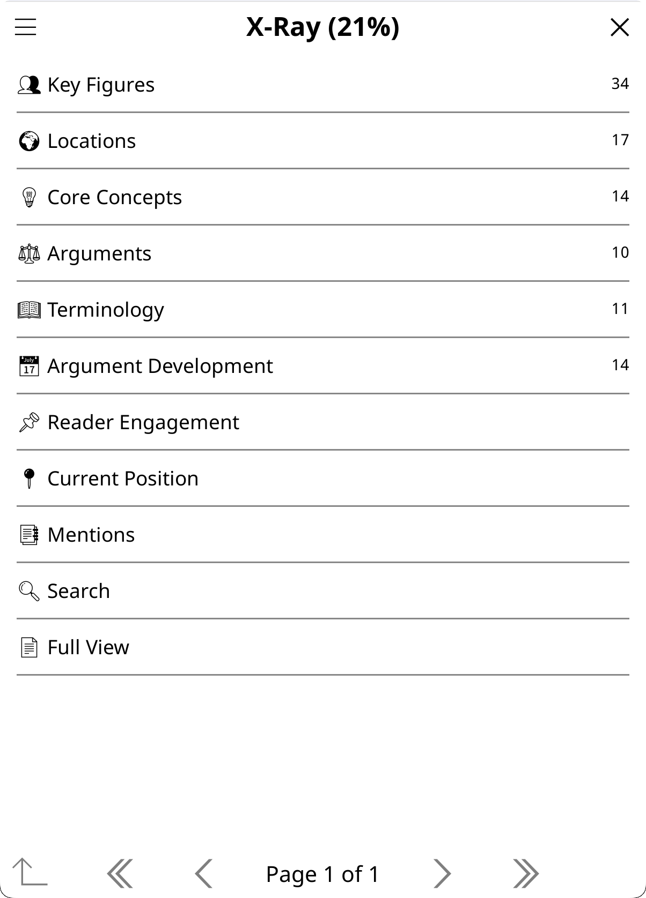
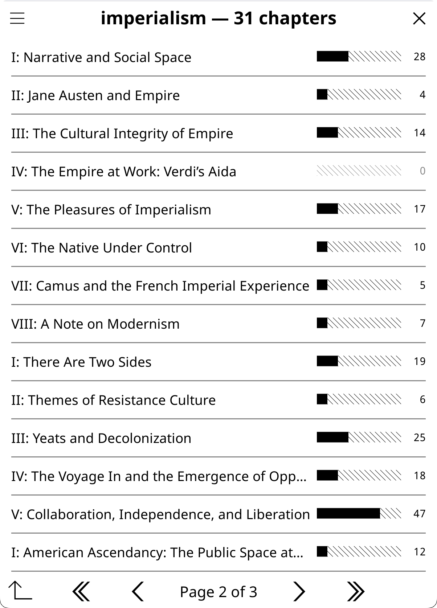

# Using X-Ray

X-Ray builds a browsable guide to the book you are reading: its people, places, ideas and terms (and the story arc, if you want it), each with a description, aliases and connections, written from the book's own text up to where you are. Use it to check who someone is without spoilers, to see where a name appears, and to look things up while you read.

## Quick start

1. Allow the book's text when X-Ray asks (the question names the amount; **Allow for this book** keeps your answer). Settings → Privacy & Data → Text Extraction → Book text sets it for all books.
2. Open a book and tap **X-Ray** in the Quick Actions panel (or use a gesture you assigned, or **Show More Actions…** in the book's input dialog).
3. In the X-Ray popup, tap **Create X-Ray…**, check the coverage and build picks, and tap **Create**. The AI needs a moment, longer for long books.
4. Browse the result, or just read on: names the X-Ray knows get a dotted underline on the page, and a tap on one opens a short card.

The X-Ray is saved with the book. Build it once, then update it as you read further: an update sends only the text you have read since.

## Before you start

**The book's text is required.** X-Ray reads the book's text and nothing else: not your highlights, not your notes. It asks for it the first time; with the text set to Never it is refused, with a button to the screen that holds the value, or use X-Ray (Simple). If you set the text to Never after building an X-Ray, you can still view it but cannot update or rebuild it.

| Action | What it reads | Privacy setting |
|---|---|---|
| X-Ray | The book text up to your position (or the whole book, if you pick it) | Book text (required; asked the first time). Your matching highlights are listed on entry pages whatever their value, matched on your device; nothing extra is sent |
| X-Ray (Simple) | The AI's training knowledge of the book, and your reading progress | Reading position (on by default), for the reading progress only |

**X-Ray does not send your highlights.** The browser matches your highlights on the device and lists them on each entry page. They leave the device only if you then chat about that entry: on Ask that chat asks first, under Never they stay out, and only a provider your highlights value allows receives them. See [Privacy and Data](Privacy-and-Data).

**Building needs the book open.** X-Ray reads the live document, so it is not among the file browser's actions. An X-Ray you built can still be opened from the file browser: long-press the book → **Book Hub (KOA)** (its X-Ray, chats, notebook and settings in one place) or **View Artifacts (KOA)**.

## X-Ray and X-Ray (Simple)

**X-Ray (Simple)** is a separate action: a prose overview (Characters, Themes, Setting, Key Terms, Where Things Stand) from the AI's training knowledge, with no text extraction. It uses your reading progress for spoiler gating. It is saved as its own artifact, so both can exist for the same book. Every run is fresh (no incremental updates); when your position advances, its popup offers an update, which regenerates at the new position. It is not in the Quick Actions panel by default (add it from the Quick Actions manager if you want it one tap away), and since it needs no open document it is a button in the input dialog of a book that is not open (a long-press in the file browser). It is best for well-known books when you don't want to send the book's text; for obscure works or research papers the results are limited, since the AI may not recognize the title.

The rest of this page is about X-Ray.

## Creating an X-Ray

### The X-Ray popup

Tapping X-Ray always opens its popup, whatever the coverage. Without an X-Ray it offers **Create X-Ray…**. With one, it leads with **View X-Ray** and puts the rest below:

| Row | What it does |
|---|---|
| **View X-Ray** (coverage, age) | Opens the X-Ray browser. "auto" in the brackets means automatic building made the last change |
| **View earlier version (N%)** | Only when your X-Ray is ahead of your position, as on a re-read: opens the latest version at or before where you are (see [Version history](#version-history)) |
| **Update X-Ray (to N%)** | A paid update to exactly your position, in one request. Its confirm also offers **Update in background (keep reading)** |
| **Update to N%, instant** | Installs a [checkpoint](#checkpoints) that is already built, for free |
| **Resume building checkpoints (from N%)…** or **Resume automatic building (paused: …)…** | Continues a build that stopped (see [When a build stops](#when-a-build-stops)) |
| **Extend…** and **Rebuild…** | Open the creation form to grow the X-Ray, or to build it again from scratch |
| **Section X-Rays…** | View, generate and merge [section X-Rays](#section-x-rays) |
| **Versions (N)…** | The free switches between checkpoints, and **All versions (N)…** |
| **Link and merge…** | When the book is in a group or has section X-Rays: the carried list, the AI merges, and **Find duplicate entities…** |
| **Automatic X-Ray: …** | This book's [Automatic X-Ray](#automatic-x-ray): Follow global, On or Off (EPUB and other flowing books only) |
| A line about spoiler protection | While protection is on: says that checkpoints follow your position (or that the installed X-Ray covers the whole book, or reaches past your position); tap it for this book's spoiler setting |
| **Marking & lookup…** | This book's [marking and lookup settings](#marking-and-lookup-settings) |

Rows with nothing to offer are left out, and a group holding a single row shows that row directly. While a build or a background update runs, its progress row (tap to cancel) takes the update row's place. The title adds your position and what is waiting ("You're at 34%. The next checkpoint (40%) is already built and installs when you reach it."), and "Last auto-update failed" with the reason after a background update failed. The popup redraws itself while it is open.

Without an X-Ray, the popup shows **Create X-Ray…**, the Section X-Rays group, a Versions group when archived versions or checkpoints exist, the Automatic X-Ray row, and **Marking & lookup…** when the book has section X-Rays or belongs to a group whose other books have X-Rays.

### The creation form

**Create X-Ray…** (and **Extend…** or **Rebuild…** on a book that has an X-Ray) opens one form. Pick how far the X-Ray should cover and how to build it.

**Coverage:**

- **The whole book** (the default).
- **Up to my current position (N%)**.
- **To the end of a section…**: pick a chapter or part from the table of contents (flowing books with a table of contents). Its one-request build always runs in the background.

**Build:**

- **In one request now**: one request, shown as it streams in. Large for long books, with no spoiler-safe versions in between.
- **In one request, in background**: the same single request in the background. A notification arrives when it is ready, and the book must stay open.
- **In checkpoints, now (N background steps)**: a set of [checkpoints](#checkpoints) built in bounded background steps while you keep reading.
- **In checkpoints, as I read (automatic)**: turns [Automatic X-Ray](#automatic-x-ray) on for this book, which builds the checkpoints as you read. Offered for the whole book and for a section end; "up to my current position" is a snapshot, built now.

A gray line under the picks says what the chosen build will do. The form starts on the whole book. For a long flowing book (four or more checkpoint steps) it also starts on checkpoints: **In checkpoints, as I read** while spoiler protection is on, **In checkpoints, now** while it is off. Shorter books start on one request. The background and checkpoint rows need a flowing book such as an EPUB; page-based documents (PDF, DjVu) are built in one request.

Below the picks sit the settings for a new X-Ray: a **Preset** button, then four buttons that each name a setting and show its pick, two to a row: **Spacing: every 10% ▾**, **Categories: Reference ▾**, **Depth: Standard ▾** and **Type: Auto ▾**. Each opens its picker, and a pick made here is saved for this book. Spacing applies to checkpoint builds. Preset, categories, depth and type apply when the pick starts a new X-Ray or rebuilds one; on a plain extend they are grayed and show what the X-Ray was built with, because an extend keeps them. [What an X-Ray tracks](#what-an-x-ray-tracks) explains each one.

Finish with **Create** (it reads **Extend** or **Rebuild** when that is what the pick does). On a small or landscape screen the form scrolls between its title and the **Cancel** / **Create** row, which stay in view.

**Extend or rebuild.** On a book that has an X-Ray, **Extend…** grows it forward from what it covers, and **Rebuild…** opens the same form building from scratch. A rebuild works like a new X-Ray (built in checkpoints, it starts with the same introduction), and your current X-Ray stays until the new one's first part is saved, so a rebuild cancelled or failed before then changes nothing. The outgoing X-Ray is then archived under **All versions**, and the checkpoints built for it are deleted. When the X-Ray already covers the whole book, or was built in a way that cannot be extended (as a whole document, from AI knowledge, or in an older format), the popup shows a single **Rebuild X-Ray…** row instead.

**Another model, once.** Long-press the X-Ray button to run it once with another model (see [Actions and Menus](Actions-and-Menus)). The pick carries through the popup to a one-request build, an update or a section X-Ray you start there; checkpoint builds and Automatic X-Ray keep your default model.

### Two tracks: incremental and complete

A new X-Ray is built on one of two tracks.

- **Incremental** (the default). Spoiler-free: it extracts text only up to your reading position, and ends with a **Current State** (fiction) or **Current Position** (nonfiction) section: active conflicts, open questions, momentum. It updates as you read further: only the new text is sent, and the AI's additions are merged into the existing X-Ray. Updates are fast and cheap (about 200-500 output tokens, against 2,000-4,000 for a full regeneration). **Extend…** → **The whole book** takes it to the end of the book with the same spoiler-free prompt. It is the only track with [checkpoints](#checkpoints) and [Automatic X-Ray](#automatic-x-ray).
- **Complete** (entire document). Holistic: it extracts and analyzes the whole document in one pass, and ends with a **Conclusion** section (resolutions and themes for fiction; key findings and implications for nonfiction). It always generates fresh: no incremental updates, no merging. Best for articles, research papers, short works, or finished books where spoiler-free scoping isn't needed. Build it with **Create X-Ray…** → **The whole book** → **In one request now**. **In one request, in background** on the same coverage builds the incremental track at full coverage instead.

Both tracks use the same browser, the same structure for the categories they share and the same privacy gates; only the final status section differs (an X-Ray built without [Where things stand](#where-things-stand) has none). An X-Ray is never converted from one track to the other. To switch, rebuild it with the other pick (**Rebuild…**, or **Rebuild X-Ray…** on a complete X-Ray): the new one replaces it once saved, and the old one is archived. Deleting the X-Ray and creating a new one works too.

**Spoiler safety.** The incremental track sends text only up to your position (`{book_text_section}`); the whole-book one-request build sends the full document (`{full_document_section}`). Marking a book finished in KOReader stands [spoiler protection](Spoiler-Protection) down for that book (checkpoint installs and chat reminders stop following your position), but it does not change text extraction: an incremental X-Ray still extracts up to your actual page, not 100%, so you can jump back into a finished book and get an X-Ray up to that point. For a full analysis of a finished book, build the complete track: **The whole book** → **In one request now** (from **Rebuild…** if the book already has an X-Ray). For a spoiler-free custom action, use `{book_text_section}` instead of `{full_document_section}` (see [Template Variables](Template-Variables)).

## What an X-Ray tracks

Four settings shape a new X-Ray: its **categories**, the **Where things stand** status block, its **depth** and its **type**. **Presets** set the first three in one tap. They apply when an X-Ray or a section X-Ray is created and when an X-Ray is rebuilt; checkpoints, updates and a plain extend keep what the X-Ray was built with.

### Categories

The categories picker has one checkbox per category, plus **Where things stand**. Each checkbox becomes the matching category of the X-Ray's type:

| Checkbox | Fiction | Nonfiction |
|---|---|---|
| People & characters | Cast | Key Figures |
| Places | World | Locations |
| Themes & ideas | Ideas | Core Concepts and Arguments |
| Terms & vocabulary | Lexicon | Terminology |
| Timeline & development | Story Arc | Argument Development |

The default is **Reference**: everything except the timeline. The timeline is the single heaviest block of an X-Ray, so leaving it out is much cheaper on a long novel. At least one category must stay checked. The ready-made combinations are the [presets](#presets).

### Where things stand

The picker's last checkbox, **Where things stand**, is the status block: Current State or Current Position, or the Conclusion of a whole-book X-Ray. It is on by default. Every update rewrites it, so an X-Ray built without it has shorter updates, and an update that finds nothing new in its text leaves the X-Ray as it is. An existing X-Ray keeps what it was built with.

### Depth

- **Light**: one line per entry, only recurring figures and turning points. About half the cost.
- **Standard** (the default): a few sentences per entry, everything the reader meets.
- **Deep**: longer entries, every figure and development, richer connections.

### Type

- **Auto** (the default): the AI decides whether the work is fiction or nonfiction. It judges the work itself (a title and author it knows, otherwise the main text), never an editor's or translator's introduction, a chronology, or other front matter by someone other than the author.
- **Fiction** (characters, places, story) or **Nonfiction** (people, concepts, argument): only that schema is sent, so the request is smaller.
- **Academic** (concepts, methods, findings, cited works): the research template, which [Research Mode](Research-Mode) also picks when it is active for the book (for example after detecting a DOI). The academic template always tracks its own full set; the categories, depth and status block shape fiction and nonfiction X-Rays.

New X-Rays also see the table of contents of the text they receive. A very small model can still be misled when the first checkpoint ends inside an introduction: set the book's type and rebuild. Picking a type that the book's X-Ray does not have offers that rebuild (**Rebuild…** or **Not now**). Updates always keep an X-Ray's own type.

### Presets

| Preset | Tracks | Where things stand | Depth |
|---|---|---|---|
| **Characters only** | the cast alone (the cheapest) | off | Standard |
| **Characters and story** | the cast and the story arc | on | Standard |
| **Reference** (the default) | people, places, ideas and terms | on | Standard |
| **Everything** | all five categories, the story arc included (the largest) | on | Standard |
| **Light companion** | people and places, one line each | off | Light |
| **Deep study** | all five categories | on | Deep |

A preset is only a shortcut, and nothing remembers which one you picked: change any of its three settings on its own and the preset row reads **Custom** (with what the settings hold). Presets leave checkpoint spacing alone.

### Where to set them

- **On the creation form**: the Preset, Categories, Depth and Type buttons. Their pickers open on this book's setting, with a Global tab beside it.
- **For one book**: Book Settings → X-Ray (**New X-Ray preset**, **New X-Ray categories**, **New X-Ray depth**, **New X-Ray type**).
- **For a group's books**: Group Settings → X-Ray; see [Book Groups and Series](Book-Groups-and-Series).
- **For all books**: Settings → Reading & Library → X-Ray, rows **Preset for New X-Rays**, **Categories for New X-Rays**, **Depth of New X-Rays** and **Type of New X-Rays**.

A book follows its group's value only once that value is applied to it (the group's **Apply** confirm when the value is set, the same question when the book joins the group, or a **Follow group** row in a picker); otherwise it follows the global default, until it picks its own. [Book Settings and Book Hub](Book-Settings-and-Book-Hub) explains how.

## Browsing the X-Ray

An X-Ray opens in a browsable category menu, not as a plain document. Each category shows its count:

- **Fiction**: Cast, World, Ideas, Lexicon, Story Arc, then Current State (or Conclusion).
- **Nonfiction**: Key Figures, Locations, Core Concepts, Arguments, Terminology, Argument Development, then Current Position (or Conclusion).
- **Academic** (see [Research Mode](Research-Mode)): Key Concepts, Foundations, Methodology, Findings, Referenced Works, Technical Terms, Figures & Data, then Current Position (or Conclusion).

Current State and Current Position appear on incremental X-Rays, Conclusion on complete ones. The menu lists what this X-Ray has: a category it was built without gets no row. Below the categories:

- **Carried from earlier books** (in a series; **Carried from group** outside a series): entries from the group's other books that this book has not reached yet. See [Series and book groups](#series-and-book-groups).
- **Mentions**: the entries a chapter mentions.
- **Search X-Ray**.
- **Full View**: the whole X-Ray as a rendered document in the chat viewer, with export.
- **X-Ray chats**: the chats you started from this book's entries, with their count.
- The book's other saved results: a single one under its own name, several under **Other Artifacts…**.

If your device has emoji fonts, Settings → Display Settings → Emoji → Emoji Menu Icons adds an icon to each category. The ☰ menu holds the version rows, the merges and more; see [The browser menu](#the-browser-menu).

The browsable menu was first inspired by the [X-Ray Plugin for KOReader by 0zd3m1r](https://github.com/0zd3m1r/koreader-xray-plugin). Chapter distribution, linkable connections and local lookup were informed by [Dynamic X-Ray by smartscripts-nl](https://github.com/smartscripts-nl/dynamic-xray), a comprehensive manual X-Ray system with curated character databases, live page markers and a custom histogram widget. KOAssistant differs by generating the X-Ray with AI instead of curating it by hand, and by using menus instead of custom widgets, but Dynamic X-Ray showed the value of per-entry chapter tracking and cross-reference linking.

### Entry pages

Tap an entry for its page: its description, the aliases the AI found (a nickname, a formal name, a title; shown for every category), and its connections as buttons. Along the bottom:

- **Chapter Appearances** and **AI Wiki** (**View AI Wiki** once one is written), described below.
- **More…**: the rest of the entry (below).
- **→ Group**, when the book is in a group: the same entry in the group's other books.
- The arrows step through the category; **Chat about this** starts a chat about the entry.

Entries of Story Arc, Argument Development, Arguments, Findings and Figures & Data, and the status entry, have no Chapter Appearances or AI Wiki button, and More… only when the entry was added from the carried list, can be illustrated or has pictures.

**Connections.** Character connections and cross-category references (places to characters, themes to characters, and so on) are buttons that open the referenced entry. References are matched across all categories by name, alias and partial name, and repeated links to the same entry are always collapsed. Settings → Reading & Library → X-Ray → Connection Buttons per Entry caps how many boxes they may take (default 9, range 0-30): past the cap the last box becomes **All connections (N)…**; at or under it, the full list with the relationship text is in More… (**List connections (N)…**). 0 draws no buttons and lists every connection instead.

**More…** holds:

- **History through checkpoints…**: how this one entry changed across the versions you have built (when the book has checkpoints). Versions past your reading position stay hidden until you confirm **Show later versions**.
- **List connections (N)…**.
- **Your highlights (N)…**: the passages you highlighted that mention this entry, while the book is open. Matched on your device whatever your highlights value, and not sent anywhere.
- **Illustrate…**: a picture of this entry, drawn from its description: a popup with a note for this picture and the image settings, then **Illustrate**. On the book's own installed X-Ray, while an image provider is available; see [Image Generation](Image-Generation#illustrate-from-x-ray).
- **Pictures (N)…**: beside Illustrate…, when pictures show this entry (drawn from it, or from a passage that names it): the gallery opened on them; see [Image Generation](Image-Generation#the-gallery).
- Under the **Edit this entry** divider: **Names and matching…**, **Merge with another entry…**, and **Link with a group member's entry…** in a book group. See [Managing entries](#managing-entries). An entry you added from the carried list (**Add as a new entry**) also has **Move back to carried list** (see [Book Groups and Series](Book-Groups-and-Series)).

In a book group, an entry page also lists what the group's other X-Rays say about it, under "In other books of the group:" (one line per book, display only; a later volume appears only once every book before it is read or has spoiler protection off).

### Chapter Appearances

**Chapter Appearances** on an entry page shows the book's whole table of contents as a tree, with a mention count and a comparison bar at every level. Parent rows expand and collapse, and the current chapter is bold. Settings → Reading & Library → X-Ray → Chapter Appearances Rows sets the density: Compact (20 rows per page, the default) or KOReader's own table of contents settings (its items per page and font size).

- **Counting.** Every match of the entry's name and aliases is collected, overlapping matches are merged, and the unique matches counted, as KOReader's text search does. A match inside another entry's longer name counts only for that longer entry, so where the text has an entry's full name, it does not also count for an entry named by the surname alone (Mentions and the underlines follow the same rule). Names match as whole words: Chinese, Japanese, Korean and Thai names match inside words, and Arabic names match with or without vowel marks, at the start of a word or after the prefixes a word carries (such as و, ب or the article).
- **Spoiler gating.** While spoiler protection is on, chapters beyond the greater of your X-Ray's coverage and your reading position are dimmed: tap one to reveal it (after a spoiler warning), or **Reveal all chapters** for all of them. The chapter that crosses your position counts only up to it. A complete X-Ray shows every chapter with no gating.
- **Reading the mentions.** Tap a chapter with mentions for its mention list: one row per occurrence, with the sentence around it. Tap a row to jump there in the book, inside KOReader's own text search (its highlighting and next / previous; its magnifier opens the search box on the entry's name). A floating **← X-Ray** button brings you back to your reading position and the view you came from. **All appearances** opens the entry's mentions in the whole book (**All appearances (up to p. N)** while chapters are dimmed).
- **Chapters** come from the table of contents, with page ranges for books without one.
- **The name index (EPUB).** Counts come from the book's name index: where each X-Ray name appears, found once in the background (a few seconds for a novel, up to a minute or two for a collected works on an e-reader) and kept next to the book, so the tree and the whole-book Mentions open at once afterwards. New names or aliases are found on their own, and a font or margin change indexes the book again for the new layout. The four most recent layouts are kept, so switching between portrait and landscape, or reading the book on another device whose sidecar folder is synced, does not index it again each time. If you open Chapter Appearances before the index is ready, it finds the names right then, with a message you can tap to cancel. A section X-Ray opens on its own pages at once and reads the rest of the book the first time you reveal beyond them. PDFs are searched each time.

### Mentions

**Mentions** (on the category menu) lists the entries that a part of the book mentions, with comparison bars, counts and category tags. It opens on the chapter you are in (the whole section for a section X-Ray, the whole book for a book marked Finished). The picker at the top changes the scope: any chapter or part (a KOReader-style tree, the current chapter bold), **Entire document (to p. N)** (from page 1 up to the greater of your coverage and your position), or **Entire document**, which reveals the whole book behind one confirmation. While spoiler protection is on, chapters beyond the greater of your coverage and your reading position are dimmed (tap to reveal), and a chapter that crosses your position is clipped at it ("up to p. N"). A complete X-Ray shows every chapter with no gating. Books without a table of contents fall back to page-range chunks. Story Arc, Argument Development, Arguments, Findings and Figures & Data are left out, since their descriptive names produce misleading matches. While carried entries are listed in their categories (the default), the carried names a part mentions follow under their own header, **From earlier books** (**From the group** outside a series); EPUB only. Mentions uses the same matching as Chapter Appearances and the underlines, and needs the book open.

### Search X-Ray

**Search X-Ray** finds any entry across all categories by name, alias or description. When the book has more than one X-Ray, a row at the bottom extends the search: **Search this book's section X-Rays (N)** from the main X-Ray, **Search the main X-Ray** or **Search the main X-Ray and other sections (N)** from inside a section. Results are grouped by X-Ray. In a book group, the other books' hits are in the same list, under **From *Title***. **Add "…" as an alias…** sits at the top of the results (see [Look up in X-Ray](#look-up-in-x-ray)).

### Chat about an entry

**Chat about this** on an entry page starts a chat with the entry as context, for follow-up questions. The entry goes with a note that it is AI-generated analysis, not text from the book. The chat opens with a short set of actions (Explain, Elaborate, ELI5, Fact Check and Connect by default); change them with the gear icon → **Choose and Sort Actions…**. Actions that read around a selection in the book (Explain in Context, Analyze in Context) are not offered, since an entry is not text from the book. The entry's text follows what the X-Ray was built from, and your highlights that mention the entry ride along where highlights may go: one question the first time for what is still on Ask, a refusal when a kind the X-Ray was built from is set to Never. The chat is saved with the book the X-Ray belongs to, even when another book is open, and the **X-Ray chats** row of the category menu lists these chats.

### AI Wiki

**AI Wiki** on an entry page (the same categories as Chapter Appearances) writes a Wikipedia-style article about the entry from the AI's own knowledge. Only the entry's name goes as the subject, with its X-Ray description as context to tell it apart, so a bare first name is understood as this book's figure without the description steering the article. Since the entry comes from the X-Ray, the article asks first for what the X-Ray was built from, as a chat about the entry does, and the saved article carries the same record. Articles are saved per entry and category with the book's other results; the button then reads **View AI Wiki**, and the viewer has **Delete** and **Regenerate**. AI Wiki articles also appear in the Artifact Browser, and deleting the main X-Ray deletes them.

### Selecting text in the browser

Hold to select text on an entry page. One word on a short hold opens the dictionary; anything else opens a popup with Copy, Dictionary, Wikipedia, Translate, Look up in X-Ray and Add to Notebook.

### The browser menu

The X-Ray browser's ☰ menu holds:

- The popup's update and version rows: **Update X-Ray (to N%)**, **Update to N%, instant**, **Switch to complete version (100%), instant**, **Switch back to your position (N%), instant**, **Install checkpoint to N% (ahead), instant** (see [Checkpoints](#checkpoints)).
- **Extend…** and **Rebuild…** (or **Rebuild X-Ray…**).
- **Delete X-Ray** (see [Version history](#version-history) for what happens to archived versions).
- **All versions (N)…**.
- **Link and merge…**: the same group as in the X-Ray popup, here whether or not the book is in a group.
- **→ Group**, in a book group: the group's books; tap one to switch to its X-Ray, at the same entry when it has one.
- **Carried entries: …**, when the book has carried entries: whether they also show inside the categories.
- **Info**: model, progress, date, type, source, whether reasoning or web search was used, merges and the books background came from, how many checkpoints exist and which one is installed.
- **Open Book**, when the X-Ray was opened from the file browser.

A version you are viewing gets **Install or delete this version…** (**Install or delete this checkpoint…** for a checkpoint) and **Other versions…** instead. A section X-Ray's menu has **Delete Section X-Ray** and **Info**.

### Managing entries

- **Names and matching…**: every name the entry goes by, one row each, saying what it is (the main name, a name from the AI, the AI's own name after you renamed the entry, a name you typed or added) and how it is matched in the book text: capitals only (automatic), any case (automatic), capitals only, any case, or not matched (a name with no capital in it says matched). Tap a row for that name. How it is matched is one choice, the one in force marked ●, the others ○; a tap on another one applies it at once, and the list stays open with the mark moved:
  - **Automatic** (it says what it decides now: capitals only or any case);
  - **Capitals only** (with the name's own example, for instance Capitals only ("the Drowned", not "the drowned"));
  - **Any case** ("the Drowned" and "the drowned");
  - **Not matched** (no underline, count or lookup).
  A name with no capital in it is only Matched or Not matched, and a name you added has no Not matched (you delete it instead). Below the choices: **Rename…** for the main name, **Make it the main name** for another, and **Delete** for a name of your own. **Back** returns to the list of names.
  **Capitals only** matches the name only where the book writes it with its capitals: a faction named "The Drowned" then marks "the Drowned" and "THE DROWNED" but not "the drowned trees". The first word of a longer name may be either case (mid-sentence the book writes "the Drowned"), and only the first letter of each word counts. It applies to the underlines, the counts in Chapter Appearances and Mentions, a selection that opens the entry, Look up in X-Ray, and KOReader's search after you tap a mention (its next and previous stop where the counts do).
  Capitals are decided **automatically**, from how the book writes each name, until you choose. Once KOAssistant has read the book for its names (the name index behind the underlines and Chapter Appearances, built in the background), a name the book writes both ways is matched with capitals only when the capitalized way is no stray: at least three times with its capitals mid-sentence (a sentence start or a heading in capitals proves nothing), at least once without them, and with them at least a quarter of the time. The row then says "capitals only (automatic)". A name the book shows with its capitals only once or twice keeps any case: one or two capitals could be a heading or a title. Most names are never written in lowercase and stay as they are, and so does a name the book mostly writes in lowercase. Carried entries follow the rule too, and so do upcoming entities, the entries known only from the next checkpoint (judged from that checkpoint). A name's choices say what the rule saw: how many of its counted uses have its capitals, or that the book's names are not indexed yet. Until the name index has the book, and in PDFs, the automatic rule decides nothing; a Capitals only you set applies in PDFs too. Choosing Capitals only or Any case keeps the automatic rule off that name until you choose Automatic again.
  A name that is not matched gives no underline, no count in Chapter Appearances and Mentions, and no direct hit when you select it or look it up; the entry keeps it (the main name stays its title) and the AI still knows it. That is how a name that is also an everyday phrase stops marking ordinary sentences. A name the AI gave is never deleted, only renamed away or set to not matched. **Add a name…** adds another spelling, transliteration or nickname. **Reset to the AI's names** gives the entry its AI name back and clears what you changed, the capitals choices included (back to automatic). Your names and choices are saved per book and survive rebuilding the X-Ray: a rebuild that names the entry as the AI first did gets your name back. After a rename the old name stays matched, as one row on the same screen.
- **Merge with another entry…**: pick the entry that is the same person or thing; the choices are those of the duplicate review below.
- **Find duplicate entities…** (in **Link and merge…**) is Merge duplicates: a mechanical scan for the same entity under two names in this X-Ray. For each pair: **Merge: keep "…"** (the other name becomes an alias), **Merge, keep both texts**, **AI merge: combined description, keep "…"** (one request), or **Never suggest this pair** (remembered for the book, and undone under **Never-merge pairs (N)…**). **Merge two entities manually…** lets you pick a pair yourself.
- After an update or an install you start yourself, the X-Ray may ask once whether to review possible duplicates (**Review** or **Not now**). Each pair is asked about only once, and never while a checkpoint build runs: the build asks when it finishes.
- Renames, links and merges also reach the checkpoints already built, so installing one later keeps your change.

## Marks and cards while you read

This is on by default, and it is the part most people miss. All of it runs on your device, with no AI call; the underlines need EPUB page mode.

### Underlines

Words on the page that match an X-Ray entry's name or alias get a discreet dotted gray underline, drawn shortly after the page settles. A typeset apostrophe or hyphen in the book matches the plain one in a name (King's Landing is found as King’s Landing), here and in the counts and lookups. Only the page you are on is read, so marking costs the same on any size of book. A change to the X-Ray shows on the page you are on at once, with no page turn: a name you add, rename, set to capitals only or to not matched, an entry merged or deleted, a new version installed. Tap a marked word to open its entry (real links in the text still win). Names known only from a checkpoint built ahead of you are marked with short dashes instead, so a new name is recognizable before you reach it (see [Upcoming entities](#upcoming-entities)).

**Marking Density** (under Settings → Reading & Library → X-Ray) sets how often a name is marked: once per page, only after 10 unseen pages (the default), only after 25 unseen pages, first appearance only, or all occurrences. The unseen-pages and first-appearance choices read the book's name index; until it is ready, a name is marked once per page. **Mark** sets which entries are marked: all entities, people only, or people and places. In a book group the marks also cover names from this book's carried list and from the group's other X-Rays (in a series, the earlier volumes, and a later one only once every book before it is read or has spoiler protection off), drawn the same dotted way, since that content is already behind you.

### Entity cards

An exact hit (tapping a marked word, or selecting text that matches an entry) opens a compact card first: the name, category and role, and a one-line identification, with the full entry one tap on the card away. Tapping elsewhere closes it. The card can be a **footnote panel** at the bottom of the screen (like KOReader's footnote popups, following the book's margins and font size) or a **floating popup** next to the tapped word, or you can turn the card off to open the full entry directly.

For an entry in your installed X-Ray, the card shows its first sentence; **Card Shows** can make it show the whole entry (swipe to scroll the footnote panel; the floating popup cuts it where it runs out of room). A card also says where an entry comes from: **From the section X-Ray: *section*** for a section X-Ray's entry, **Also in *Title*'s X-Ray** when other books of the group know the name too, and the carried list or the book's name for a name this book has not reached.

### Upcoming entities

With **Upcoming Entities** on (the default), marking, matching selections and cards also recognize entries that first appear past your installed coverage, using only the next checkpoint built past your reading position, never a later one. This is identification only. Such names get short-dash marks, and their card warns that it comes from the next checkpoint and may contain spoilers. By default the card starts with the tapped name and its category alone; a tap adds the entry's first sentence, and another tap opens the full entry behind a confirmation, whatever your spoiler setting. The first sentence names the entry, so for a nickname it tells you whose nickname it is; the full entry stays behind the confirmation. The confirmation box and the full entry both offer **Matching…**, with the same choices as Names and matching… (capitals only, any case, not matched, nothing that edits the entry itself), saved by the entry's name so they hold once the checkpoint installs. From the box it lists the name you tapped alone, under its own words, so a wrong underline is switched off without reading the entry; from the full entry it lists every name. **Upcoming Entity Cards** can show the first sentence right away instead, which can reveal that a name is another character's alias. Turn Upcoming Entities off to keep marking and lookup strictly at your installed coverage.

### Matching selections

Selecting text, or looking up a word in the dictionary, when it exactly matches an entry's name or alias opens that entry instead of the dictionary or the highlight menu, ahead of any bypass action you set there. Anything that does not match falls through to your normal dictionary or highlight menu, and a very long press at the end of a selection always brings the plain highlight menu. Only books with an X-Ray are affected. With **Tap Marked Words to Open** off, the marks are visual only, and a long press still opens matching entries. You can also set the dictionary bypass to **Look up in X-Ray**: a tapped word that an X-Ray name or alias contains is then looked up there (an exact match opens its entry, a partial one the results list), and any other word goes to KOReader's dictionary (see [Dictionary and Translation](Dictionary-and-Translation)).

### Look up in X-Ray

Select text while reading and tap **Look up in X-Ray** (in the highlight menu and the dictionary popup, once the book has any X-Ray, main or section) for an instant lookup in the saved X-Ray: no AI call, no network. It handles multi-word names, which tapping a single word in the text cannot. It searches names and aliases, not descriptions, so a common word does not hit every entry whose description uses it.

- An exact name or alias match opens that entry; several entries sharing the name give a short chooser. Partial matches always open a results list (a lone partial match is never opened for you), grouped by X-Ray when they span several.
- With more than one X-Ray (the main X-Ray and section X-Rays), it searches them all at once.
- In a book group, a name this book has no entry for is answered from its carried list, then from the group's other X-Rays.
- When a lookup finds nothing, its message offers **Add as alias of an entry…**; when it finds the wrong entries, the results list starts with **Add "…" as an alias…**. Pick the entry the name belongs to, and it is remembered for this book, so marking and lookup recognize it from then on. When your X-Ray is well behind your position, the no-results message also hints that updating it may find the entry.

### Marking and lookup settings

Everything in this section is set for all books under Settings → Reading & Library → X-Ray: **X-Ray Entry for Matching Selections** (on by default), **Passive Marking** (on), **Tap Marked Words to Open** (on), **Upcoming Entities** (on), **Upcoming Entity Cards** (name only), **Card Shows** (first sentence only), **Entity Card First** (on), **Card Style** (footnote panel), **Marking Density** (after 10 unseen pages) and **Mark** (all entities). Each can be set per book, from the X-Ray popup's **Marking & lookup…** or Book Settings → X-Ray. **Marking & lookup…** names what the marks and lookups read (this book's X-Ray, its section X-Rays, the other books in its group), and **Use global marking settings for this book** drops the book's own choices.

## Keeping the X-Ray current

X-Ray covers the book up to where you are, so it never spoils what you haven't read. There is no nagging popup: the X-Ray popup and the browser's ☰ menu show what is available right now (a free install when a checkpoint is ready, a paid update to your exact position when it is not, and the versions).

### Updating by hand

How an update works:

1. You build an X-Ray at 30%.
2. You read on to 50%.
3. Tap X-Ray: the popup shows **View X-Ray (30%, today)** and **Update X-Ray (to 50%)**.
4. **Update** sends only the new text (30% to 50%) with an index of the existing entries, and the AI returns only new or changed entries. In a book group, the index lists only the carried names the new text mentions, so updates in a long series stay small.
5. The answer is merged in: entries are matched by name and updated in place, timeline events are appended, the status section is replaced. About 200-500 output tokens, against 2,000-4,000 for a full regeneration.

An update starts where the last one ended in the text, not at a page number, so a font or margin change, a turned device or a sidecar folder synced from another device neither skips text nor sends it twice (an X-Ray saved by an older version finds its place from its percentage and starts a little early). Your position must be more than 1% past the X-Ray's coverage. The update's confirm says how it relates to built checkpoints, and offers **Update in background (keep reading)** on flowing books. When a built checkpoint is ready, the free **Update to N%, instant** installs it instead: the paid row is left out while a free checkpoint is ready or the next one is less than one checkpoint step away (**Extend…** still reaches a paid update). Going back in the book does not use the saved X-Ray: building to an earlier position is a fresh build from **Rebuild…**, where the form marks it "from scratch".

### Checkpoints

Checkpoints are versions of the book's X-Ray at points through the book, built in the background in small steps. From the creation form, pick the coverage, then:

- **In checkpoints, now**: builds the whole set now, one incremental step at a time.
- **In checkpoints, as I read (automatic)**: lets [Automatic X-Ray](#automatic-x-ray) build them as you go.

A confirmation names the plan (how many checkpoints, where) and the number of requests, and waits for **Build** (**Start** for the automatic pick). A build from nothing, and a rebuild, starts with a spoiler-free introduction (the premise, the setting, the first characters), which is one more request; a build bounded at your current position skips it.

**Spacing.** About one checkpoint every 10% of a normal-length book, adapting to length: wider on short books so a novella isn't sliced into tiny calls, narrower on very long books so a single version never covers an oversized slice. With Settings → Reading & Library → X-Ray → Checkpoints at Chapter Ends on (the default), each checkpoint moves to the nearest chapter end when the book has a usable table of contents, so versions read as "up to the end of a chapter" and the versions list shows chapter names. The form's **Spacing: every N% ▾** button changes it for this book (2.5% to 50%, the recommended value marked, with live checkpoint counts). The pick sticks for the book; Book Settings → X-Ray → **Checkpoint spacing** changes it later.

**While it builds.** Keep reading; the book must stay open. A usable X-Ray installs after the first step. Cancel anytime from the popup's "Building checkpoints" row, and resume later from where it stopped. The book is read once in total, plus a fixed overhead per checkpoint, so a full set costs somewhat more than one full X-Ray run, while each request stays small. As you read past a checkpoint, it is silently swapped in as your live X-Ray, so the X-Ray follows your position with no waiting; all versions stay under **All versions**.

**Front matter.** A step of a new X-Ray that the AI finds nothing to build from (often an edition's opening pages: a biography, a chronology) is skipped, and the next step reads further: at most three times and never past half the book, after which the build stops with "nothing to build from so far". Each skipped step is still a request. Section X-Rays are built whatever the section holds. In a book whose front matter you hid with KOReader's hidden flows, checkpoints count only the visible pages, as your reading position does, and a step that would send no book text stops the build and says so.

**Two uses.** Checkpoints serve two purposes, both first-class:

- **Spoiler-safe reading**: every position gets an X-Ray that never runs ahead of you.
- **A checkpointed full build**: a big book's X-Ray completed in bounded steps instead of one oversized request. A failure keeps the finished versions, and resume continues from the highest.

If you built them for the second reason and don't want the spoiler gating, **Switch to complete version (100%), instant** installs the finished 100% version as your live X-Ray for free. No merging is needed: each checkpoint already contains everything before it. A notice says the other checkpoints can be safely deleted; keeping them is fine too, and they stay browsable. The switch is not one-way: while the checkpoints are kept, **Switch back to your position (N%), instant** re-installs the version at or below where you are reading, and position-following resumes. Both switches are free. **Install checkpoint to N% (ahead), instant** installs the next built checkpoint ahead of you on purpose. These rows sit in the popup's **Versions (N)…** group and in the browser's ☰ menu. They are useful before a re-read, for book clubs, or to give a book spoiler-safe X-Rays for its whole length up front.

**Spoiler protection decides the installs.** With protection on, checkpoints install as you reach them. With it off for the book (also in research mode, or for a book marked Finished), the newest built checkpoint installs right away; Book Settings → X-Ray → **X-Ray updates** (Newest first or Follow my position) keeps position-following without protection. Settings → Reading & Library → X-Ray → Spoiler Protection mirrors the global spoiler setting for this reason. See [Spoiler Protection](Spoiler-Protection).

### Automatic X-Ray

Automatic X-Ray keeps a book's X-Ray up to your reading position in the background, so you never face one giant catch-up request on a long book. It builds the introduction and then checkpoints at chapter-sized steps, always keeping the next one ready ahead of you: reaching a checkpoint installs it instantly, and the one after starts building. It is off by default.

**Two ways to turn it on:**

- **For one book**: set **Automatic X-Ray** to **On** (the X-Ray popup's **Automatic X-Ray:** row, or Book Settings → X-Ray). A per-book On is self-contained: it covers the first build too, whatever the global setting. A per-book Off always wins.
- **For all books**: Settings → Reading & Library → X-Ray → Automatic X-Ray (all books). This only continues X-Rays you have already started; a book with no X-Ray is left alone until you start one.

**Nothing starts a book's first X-Ray on its own.** The two ways to start one are the creation form's **In checkpoints, as I read (automatic)** and the per-book **On**. Neither spends anything unannounced: when there is work to do, a confirmation says how many background requests it needs right now and waits for **Start**, and Cancel leaves automatic building off. If a book is left switched On while it has no X-Ray, the same confirmation appears the moment the first build would start, with **Cancel (turn Automatic X-Ray off)** as the way out. Deleting a book's X-Ray also turns its Automatic X-Ray off, so nothing restarts behind you.

**Spend guards:**

- Incremental track only: it never touches complete, AI-knowledge, older-format or section X-Rays.
- After a step is declined, fails or is cancelled, it waits out the cooldown before trying again (Settings → Reading & Library → X-Ray → Cooldown (minutes), default 15, 0 = no wait; the row shows while Automatic X-Ray (all books) is on). A build that completes does not wait. Each step is bounded by the book's checkpoint spacing, so a single step is never oversized.
- It runs only when WiFi is already on, and never turns WiFi on. After a book's first build is confirmed, it never prompts again, except once for the book's text while that is still on Ask (below).
- It sends exactly what a manual update sends (the saved X-Ray, the entry index and only the newly read text) to your configured provider, and checks that the book's text is allowed (the book's value, Allow for all books, or a trusted provider) each time, like a manual update. Never stops it; a book still on Ask is asked once, in the foreground.
- A section end picked in the creation form also bounds it; Book Settings → X-Ray → **Build up to** shows or changes that limit.
- EPUB and other flowing formats only: for a page-based book (PDF) the X-Ray popup leaves the row out, and Book Settings marks it "(no effect: page-based book)".

Once you have confirmed a book's first build, Automatic X-Ray extracts book text and spends API tokens **without a per-request tap**, under a standing Allow for the book's text: the confirm that turns it on carries the question when the book is still on Ask (**Allow for this book and start**), and a book whose automatic building is on but whose text is still on Ask is asked once, at the moment a checkpoint would build; Cancel there pauses automatic building for the book. The interactive truncation and size warnings don't apply to background runs (an oversized background extraction stops instead of asking). Leave it off if you want every request to be deliberate.

Automatic building is quiet: a step that fails for a passing reason is retried without a word, and only a build that stops anyway shows a notice, which stays until you close it (see [When a build stops](#when-a-build-stops)). Turn on Settings → Reading & Library → X-Ray → Notify on Background Activity for a brief notification when background work starts and completes, and when a checkpoint is swapped in.

### When a build stops

- **Passing problems** are retried: a step that fails for a passing reason (an empty reply, a dropped connection) is tried again, up to twice, before the build stops. When the provider names how long to wait, a background step waits that long before its retry instead of guessing.
- **Sleep.** On e-readers where KOReader turns Wi-Fi off for sleep, a request in flight stops; the popup says the build is waiting for Wi-Fi, and the checkpoint is built again seconds after Wi-Fi reconnects. Checkpoints already built keep installing meanwhile.
- **Resume.** The notice of a stopped build stays until you close it, with a **Resume** button. Resume continues the build that stopped (to your position, to a section's end, or as one request) rather than planning to the end of the book. The popup also offers **Resume building checkpoints (from N%)…**, which also names why it stopped. Resume is not offered after a build that found nothing to build from, or no book text in its part.
- **Reasons** the popup and the notices name include "request too large" (a per-minute plan limit, or the model's context or output limit), "account credits or billing" (an account limit at the provider: never retried, and only adding credits or raising the limit fixes it), "answer cut off at its length limit", "nothing to build from so far", "no book text in this part", "rate limited", "model overloaded", "provider error", "request timed out", "connection problem", "unusable response" and "empty reply".
- **Automatic building pauses after a stop that would repeat.** With Automatic X-Ray on, an answer cut off at its length limit, a request too large for the model, an account out of credit, or a step too large to send without asking pauses automatic building for that book until you resume it, instead of planning the same step at every cooldown (a cut-off answer is paid in full each time). The X-Ray popup's **Resume automatic building (paused: …)…** names the reason. Closing the book keeps the pause; restarting KOReader ends it.
- **A cut-off answer is never saved as if whole.** An answer cut at its length limit, or ended early by the provider, is not saved, and you see it marked as cut off instead of your old X-Ray. "X-Ray not saved" says what helps: a lighter depth or fewer categories, updating in checkpoints, or a model that allows longer answers. Nothing is overwritten. When the AI declines to build an X-Ray, you see its answer instead of the X-Ray already on the device.

## Version history

Every update or rebuild archives the version it replaces, so an X-Ray is never silently overwritten.

- **All versions (N)…** (in the X-Ray popup's **Versions (N)…** group, also when the popup is opened from the file browser, and in the browser's ☰ menu) lists the archived versions and the checkpoints, which can sit ahead of your position, hence "All". Main X-Ray only: section X-Rays have no history.
- The list is split into **Archived versions** (newest first) and **Prepared checkpoints** (most complete first), with your live X-Ray marked **(current)**. A row shows its coverage (or "Introduction (spoiler-free)", or "Complete"), the chapter it ends at, when it was built ("built 14:05" today, "built 3d ago" before), and where relevant "edited", "archived …", "checkpoint", **(ahead)** or **(latest before your position)**.
- Tap a version for **View** (read-only, in the full X-Ray browser titled "X-Ray Version"), **Install as current X-Ray (free)** (your current version stays in the list; it takes the archive slot the installed version frees, so installing never grows the archive) or **Delete**. A checkpoint ahead of your position asks first and warns about spoilers; free checkpoint swaps then pause until you read past it, and the popup offers the switch back.
- Archived versions also appear as **Previous X-Ray Versions (N)** on every View Artifacts surface (Quick Actions, the file browser's long-press, the input dialog's View Artifacts button, the Artifact Browser, and chat and artifact windows; the Book Hub leaves them to the X-Ray itself), right under the X-Ray row, titled **Archived X-Ray Versions (N)** when no live X-Ray remains.

**Re-reading.** If you jump back in a book so that your live X-Ray covers more than you have re-read, the X-Ray popup offers **View earlier version (N%)**: the nearest archived version or checkpoint at or below your current position. The versions list marks it "(latest before your position)". This handles the one case where a live X-Ray ahead of you could spoil a re-read.

**How many are kept.** Settings → Reading & Library → X-Ray → X-Ray Versions to Keep (default 5, range 0-20). The versions covering the least of the book are dropped first, the oldest first among equals. 0 stops archiving new versions; versions already archived stay until you delete them or the X-Ray itself. Checkpoints are stored separately and never trimmed by this.

**Deleting the X-Ray.** ☰ → **Delete X-Ray**. When it has archived versions, you choose: **Archive X-Ray (keep N versions)** keeps them reachable under "Archived X-Ray Versions" in View Artifacts, and **Delete X-Ray and N versions** removes them too. The book's AI Wiki entries (the ones made from highlighted text included) and the prepared checkpoints are deleted either way, and the book's Automatic X-Ray is turned off. The [Book Hub](Book-Settings-and-Book-Hub)'s ☰ menu → **Delete all artifacts…** deletes every saved result of the book at once. Deleting is also a way to start over, for example to change [tracks](#two-tracks-incremental-and-complete).

## Section X-Rays

Section X-Rays are focused X-Rays of one chapter, part or section, chosen from the table of contents. A book can have several alongside its main X-Ray; each is independent and stored separately.

**Creating one:**

1. In the X-Ray popup, open **Section X-Rays…** → **Generate Section X-Ray…**.
2. Pick the section in the table of contents tree.
3. Name it if you like (**Section X-Ray Name**; the name defaults to the table of contents title, 80 characters at most) and tap **Generate**. A name already in use offers to replace that section X-Ray.
4. Only the text of that page range is sent. The result is a complete X-Ray, built with the book's X-Ray categories, depth, type and status block, as a new X-Ray would be (Book Settings → X-Ray, or the defaults in Settings).

**Section ranges.** **Generate for a section range…** (in the same group) asks for the first and the last section, in either order, and builds one section X-Ray spanning everything between them (chapters 3 to 7 as one, for example). The name defaults to "First – Last". That is one request, instead of building each chapter and merging them.

**Opening them:**

- X-Ray popup → **Section X-Rays (N)…** → **View Section X-Rays (N)**: every section with its pages and age. Tap one to open it in the X-Ray browser; hold one to delete it.
- While you read inside a section's pages, **View "Name" (pp X–Y, age)** appears in the popup's group for quick access.
- Every View Artifacts surface (Quick Actions, the file browser, the Artifact Browser) has a **View Section X-Rays (N)** group.

**How they differ from the main X-Ray:**

- The title reads **X-Ray § *Name***.
- Scope gating replaces spoiler gating: chapters outside the section's pages are dimmed (whatever you have read). Tap one to reveal it after a scope warning, or **Reveal beyond scope** for all of them.
- Complete only: no updates and no version history, since the section is analyzed whole in one request. To redo one, generate it again under the same name.
- The reading position marker shows only while your page is inside the section.
- The ☰ menu has **Delete Section X-Ray** and **Info** (the section, its pages, the model).
- Font-size independence: they store document positions next to page numbers, so after a font-size change the page ranges in the list and the browser follow the new layout (EPUB).

**Merging them.** **AI merge section X-Rays…** (in the section list, in **Link and merge…**, and in the Section X-Rays group of a book with no main X-Ray) has the AI combine the section X-Rays you tick: into the main X-Ray (**Merge into main X-Ray**, **Replace main X-Ray (old version is archived)**, or **Create main X-Ray from sections** when there is none), or into one **combined section X-Ray**. It warns about gaps between the sections and about text past your reading position. Merging into the main X-Ray needs the book open, unless the main X-Ray covers the whole book (the [complete track](#two-tracks-incremental-and-complete), or an incremental X-Ray updated to 100%): only with the book open can it place the sections against a partial X-Ray's coverage, wherever each was built. After a merge into the main X-Ray you can keep the sections or delete them.

Search and marking use every X-Ray of the book, main and sections. Section X-Rays need an open book with a table of contents (they cannot be made from the file browser).

> **Tip:** Section X-Rays suit books too large for one detailed X-Ray, and books whose chapters cover separate topics (textbooks, academic works, religious texts read chapter by chapter). Rather than trimming the whole document with hidden flows, a section gives a deep analysis of one part while the full document stays available to other actions. They also suit pivotal scenes in novels, essays in a collection, or an introduction you want to refer to on its own. To cut away what you never want analyzed (bibliography, indexes, notes, apparatus), use [hidden flows](#hidden-flows-and-tables-of-contents); the two work together. Other text-extraction actions can be scoped to a section too; see [Reading Analysis Actions](Reading-Analysis-Actions).

## Series and book groups

Books in a group (a series or a project) share X-Ray knowledge:

- **Carried entries**: each book keeps a list of entries from the group's other books (in a series, the earlier ones) that have not appeared in it yet, **Carried from earlier books** (**Carried from group** outside a series). It fills itself as you group books and build X-Rays, for free, and the Ask value does not stop it, since nothing is sent; a book whose text is set to Never contributes nothing, its names stay out of the requests that list carried names, and its entries can't be carried over by hand either. By default these entries are also listed inside the categories, after the book's own ("85 + 900" on a category row); the **Carried Entries** setting (Settings → Reading & Library → X-Ray, a group, a book, or the browser's ☰ menu) can keep them on their own list only.
- **Link** (free, nothing sent) joins two names that are one thing, such as a short name here and the full name carried; **Possible matches** on the carried list proposes such pairs.
- **AI merge** (paid; every row says how many requests) has the model combine another book's X-Ray into this one: **AI merge with another book (1 request)…**, **AI merge the series (1 request per book)…** or **AI merge the group into this book (1 request per book)…**. After the confirm, each asks once for the kinds the X-Rays in the run were built from (book text, for one) when they are still on Ask; a book whose text is set to Never is refused with a door to its settings. The section X-Ray merge and the duplicate review's AI merge ask the same way.
- Lookups, search, cards and marks reach across the group: a name this book does not know yet is answered from the other X-Rays, labeled **From *Title***.
- **The series reveal**: in a series, later books stay out of reach until the ones before them are read (marked Finished, or read to the last page) or have their own spoiler protection off. When one is held back, a confirmation opens it by name, one book at a time.

These rows live in **Link and merge…** (the X-Ray popup and the browser's ☰ menu), with **→ Group** to switch between the books' X-Rays. [Book Groups and Series](Book-Groups-and-Series) has the full story.

## Hidden flows and tables of contents

**Hidden flows.** When KOReader's hidden flows are active (hiding endnotes, translator introductions, or the other books of a collected works), KOAssistant adapts:

- Text extraction skips hidden content: only visible pages are sent to the AI.
- Reading progress counts visible pages only (page 42 of 70 visible pages is 60%, not 42%).
- Mentions and Chapter Appearances leave out the chapters of hidden flows.
- Checkpoint positions and section targets count visible pages, as your position does.
- The X-Ray browser tells you when your reading position is inside a hidden part ("Position is outside the active hidden flow").

This works for EPUB and PDF. The hidden content is simply invisible to KOAssistant. Hidden flows are one of the best ways to save tokens and improve results: hide front matter, introductions, appendices, bibliography, indexes and references, and what remains becomes the "whole book" for every action (X-Ray, summaries, analysis). For collected works or anthologies, hide everything but one volume: a complete X-Ray then treats the visible text as the entire document. Hidden flows and [section X-Rays](#section-x-rays) work together: hidden flows trim away what you never want analyzed, section X-Rays focus on chapters within what remains. KOReader's documentation explains how to set up hidden flows.

**Custom tables of contents.** Mentions and Chapter Appearances use KOReader's active table of contents, including a custom one you made, and section X-Rays are picked from it. A book with no table of contents falls back to page-range chunks of 20 pages (a twentieth of the book, when that is longer). For better results, make a custom table of contents with KOReader's **Custom table of contents** (in the settings of its navigation menu): you add chapters in the Page browser by long-pressing a thumbnail, or by selecting text on a page to use as the chapter title.

## Costs and model choice

- **Output size.** An X-Ray is large structured output (often 10K to 30K+ tokens), and the action asks for up to 64K output tokens to avoid truncation. It is a demanding task: weaker models struggle to follow the format, and when they manage it, the content is weaker. Models with low output caps (some Groq models stop at 8K) give shorter, possibly cut-off X-Rays. Use larger models with higher output limits for the best results.
- **A model for X-Ray only.** In Settings → Actions & Prompts → Manage Actions, hold **X-Ray**, tap **Edit Settings**, and set **Provider** and **Model**. Your global model stays for everything else: for example a fast model as your global default for lookups and chat, and a more capable one for X-Ray. You can also switch your global model for one run and back, or [run it once with another model](#the-creation-form). See [Actions and Menus](Actions-and-Menus).
- **Cheaper X-Rays.** The Characters only preset (the cheapest); leaving the timeline out (the default); Light depth (about half the cost); Where things stand off (shorter updates); a set type (a smaller request than Auto).
- **Start early.** Updates send only new text, so an X-Ray started at 10% and updated as you read keeps each request small; starting at 80% of a long novel sends the whole 80% at once. A one-request build of a long book is large: the large-extraction warning (over 500K characters) and the truncation warning appear before such a request is sent (see [Artifacts and Caching](Artifacts-and-Caching)).
- **Checkpoints** read the book once in total plus a fixed overhead per checkpoint: somewhat more than one full run, in small requests. Skipped front-matter steps are still requests.
- **Automatic X-Ray** spends without a per-request tap once a book's first build is confirmed.
- **Reasoning is pinned off** for X-Ray (its checkpoints and background updates included), and an action's own setting outranks every reasoning stance. On short, dense works (research papers, academic chapters, technical documents under about 100 pages) more reasoning can noticeably improve the depth and completeness of the entries, and the extra time is worth it. To let your reasoning settings reach X-Ray: in Settings → Actions & Prompts → Manage Actions, hold **X-Ray**, tap **Edit Settings**, then **Reasoning** → **Global (use setting)**. Then set the stance to Maximum, or raise your model's own reasoning level (Settings → Advanced → Reasoning, or the Quick Settings Reasoning tile). See [Reasoning, Web Search and Book Tools](Reasoning-Web-Search-and-Book-Tools).

## Limits and storage

- Building and updating need the book open; X-Ray (Simple) also runs from the file browser.
- Complete X-Rays and section X-Rays do not update; every run is fresh.
- Checkpoints, Automatic X-Ray and background builds need a flowing book (EPUB). Underlines need EPUB page mode.
- X-Ray cannot be duplicated in the action manager, since its output needs the X-Ray browser.
- Older X-Rays saved as plain text can still be viewed; the next build replaces them with the current format.
- An X-Ray is stored as structured data with the book's other saved results in its sidecar folder, moves with the book, and is deleted with it; see [Artifacts and Caching](Artifacts-and-Caching). It is rendered as a document for Full View and for the `{xray_cache_section}` placeholder, which custom actions can use; whether a custom action may read it depends on how the X-Ray was built (see [Template Variables](Template-Variables)).

## Related

- [Book Groups and Series](Book-Groups-and-Series): carried entries, Link and AI merge across a series or project.
- [Spoiler Protection](Spoiler-Protection): how protection decides checkpoint installs, and what the AI is told.
- [Book Settings and Book Hub](Book-Settings-and-Book-Hub): every per-book X-Ray row, and the Book Hub.
- [Artifacts and Caching](Artifacts-and-Caching): View Artifacts, the other saved results, context windows and costs.
- [Research Mode](Research-Mode): the academic X-Ray and DOI detection.
- [Reading Analysis Actions](Reading-Analysis-Actions): Recap and the other actions that read the book.
